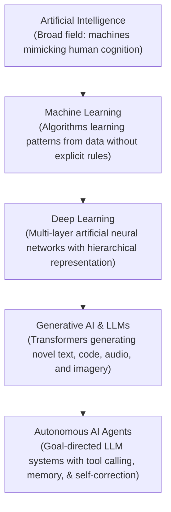
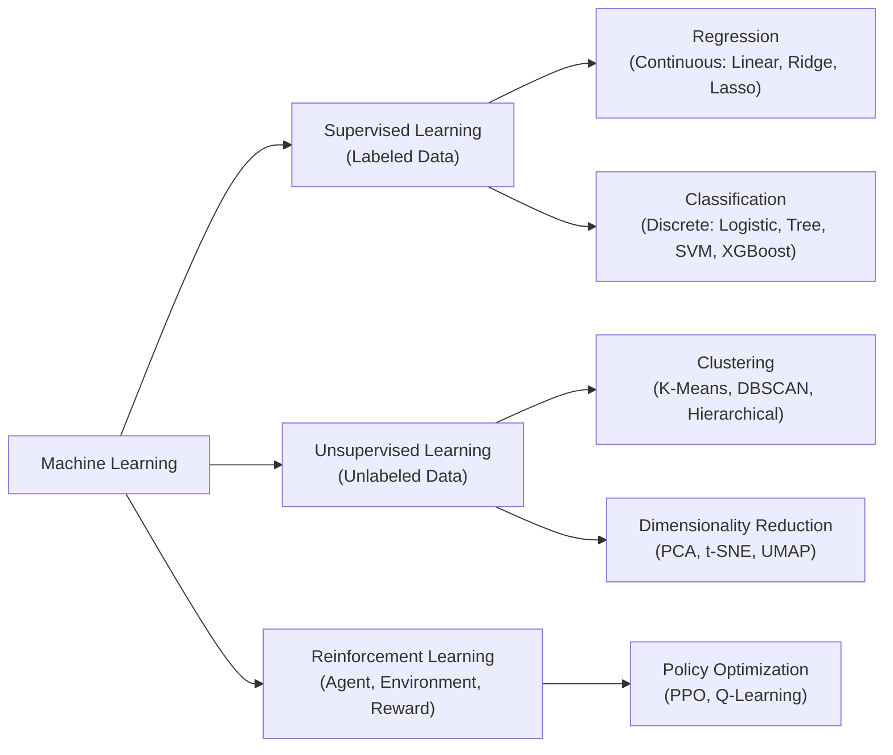
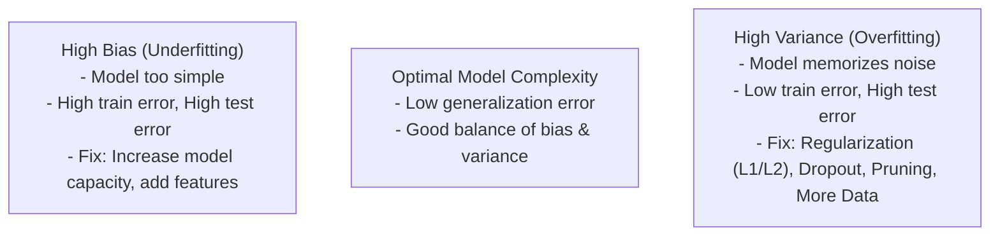
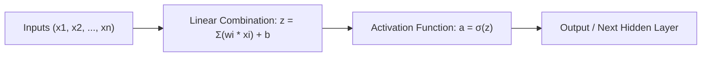
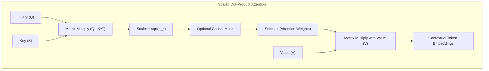
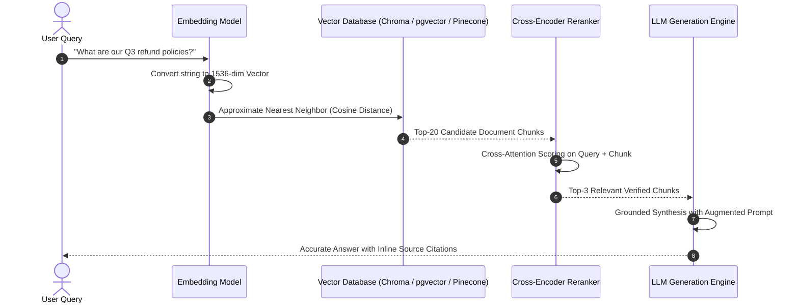
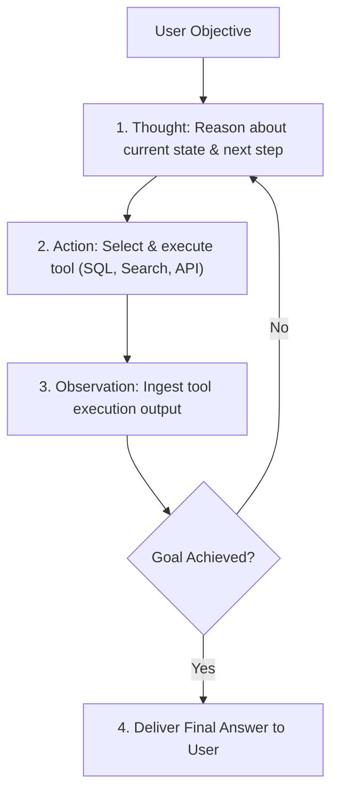
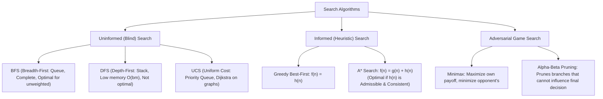
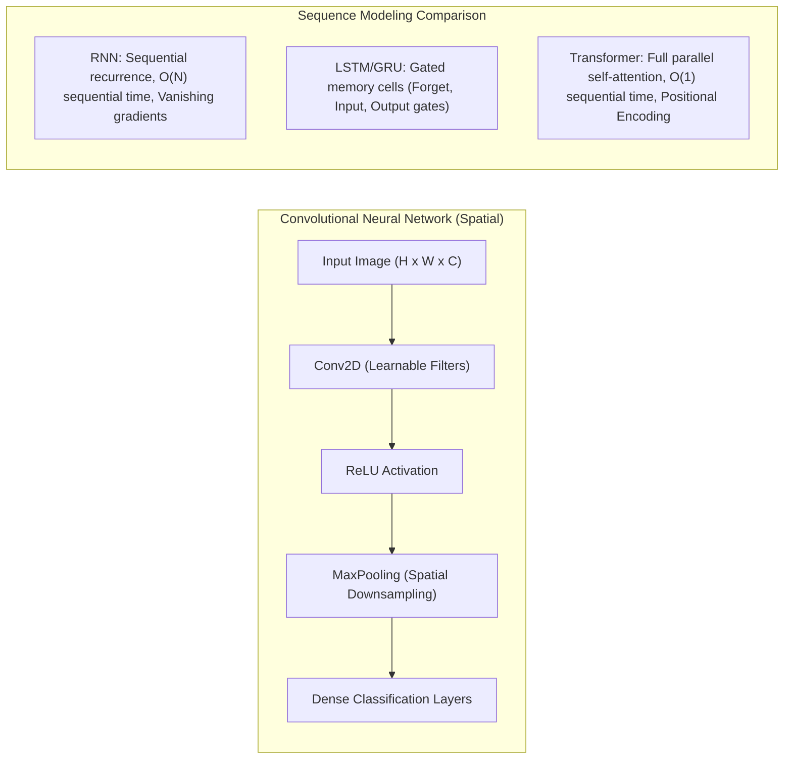
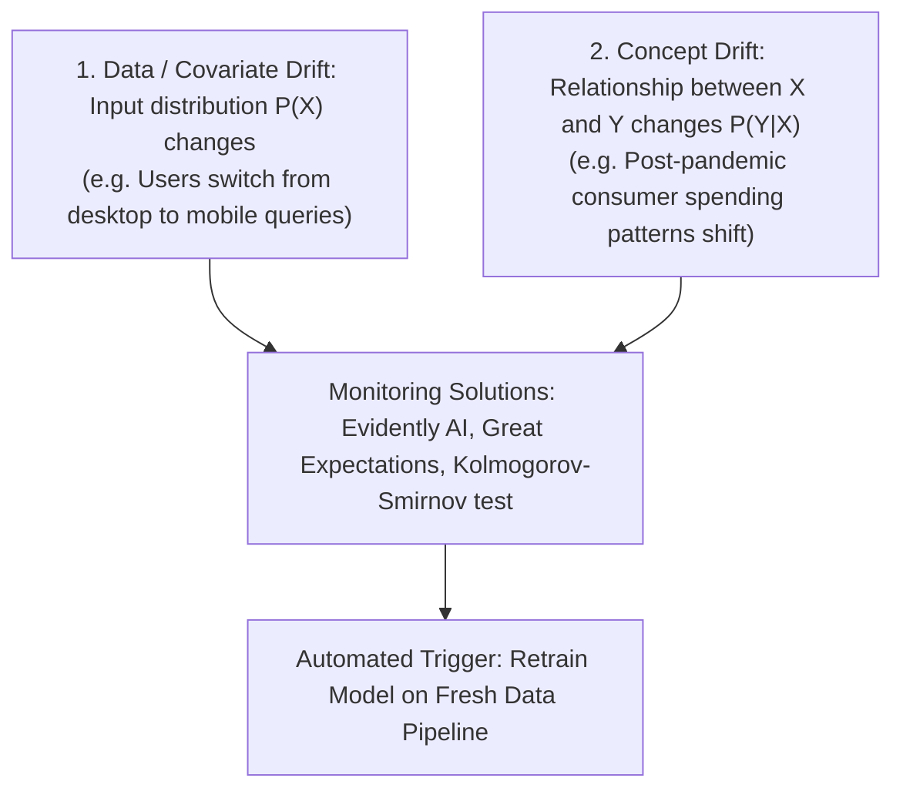

# Artificial Intelligence, Machine Learning & LLM Master Reference

---

## 1. The AI Spectrum & Evolution Hierarchy



### Comparative Taxonomy

| Dimension | Classical AI (Expert Systems) | Machine Learning | Deep Learning | Generative AI & LLMs |
|---|---|---|---|---|
| **Core Mechanism** | Handcrafted IF-THEN rules | Statistical pattern recognition | Multi-layer Deep Neural Networks | Attention-based Foundation Transformers |
| **Feature Engineering** | 100% manual domain logic | Mostly manual (Extraction, Scaling, PCA) | Automated representation learning | Pre-trained semantic token embeddings |
| **Data Requirements** | Low data; high domain expertise | Thousands of structured tabular samples | Tens of thousands to millions of raw samples | Billions to trillions of multimodal tokens |
| **Compute Profile** | Minimal CPU | Standard CPU / Light GPU | Clustered GPUs / TPUs (CUDA) | Massive distributed GPU clusters (H100/B200) |
| **Output Type** | Deterministic outputs | Classification or numerical predictions | Predictions, bounding boxes, encodings | Structured text, code, audio, synthetic media |

---

## 2. Machine Learning: Supervised, Unsupervised & Reinforcement



### Core Algorithms Cheat Sheet

| Algorithm | Type | Working Principle | Best Use Case |
|---|---|---|---|
| **Linear Regression** | Supervised (Reg) | Fits hyperplane minimizing Ordinary Least Squares (OLS) residual error | Predicting real estate pricing, continuous metrics |
| **Logistic Regression** | Supervised (Class) | Passes linear combination through Sigmoid function: $\sigma(z) = rac{1}{1 + e^{-z}}$ | Binary classification, churn prediction, credit scoring |
| **Decision Trees** | Supervised (Both) | Splits nodes by maximizing Information Gain or Gini Impurity reduction | Interpretable credit/medical risk rules |
| **Random Forest** | Supervised (Ensemble) | Bagging (Bootstrap Aggregation) + random feature subsets over $N$ trees | High-dimensional tabular data, robust baseline |
| **XGBoost / LightGBM**| Supervised (Ensemble) | Gradient Boosting: sequentially fits shallow trees to residual errors | Kaggle/enterprise tabular competitions |
| **Support Vector Machine**| Supervised (Both) | Maximizes margin between support vectors using Kernel Trick (RBF) | Non-linear boundaries in moderate data sizes |
| **K-Means Clustering** | Unsupervised | Iteratively assigns samples to nearest centroid and updates centroids | Customer segmentation, anomaly clustering |
| **PCA** | Unsupervised | Orthogonal transformation maximizing variance along principal components | Dimensionality reduction, data visualization |

---

## 3. Model Training & Evaluation Metrics

### The Bias-Variance Tradeoff



### Classification Metrics Matrix

* **Confusion Matrix:**
  * **TP:** True Positives | **FP:** False Positives (Type I error)
  * **TN:** True Negatives | **FN:** False Negatives (Type II error)

$$	ext{Accuracy} = rac{TP + TN}{TP + TN + FP + FN}$$

$$	ext{Precision} = rac{TP}{TP + FP} \quad 	ext{(Low FP priority: Spam filter)}$$

$$	ext{Recall (Sensitivity)} = rac{TP}{TP + FN} \quad 	ext{(Low FN priority: Cancer detection)}$$

$$	ext{F1-Score} = 2 	imes rac{	ext{Precision} 	imes 	ext{Recall}}{	ext{Precision} + 	ext{Recall}} \quad 	ext{(Harmonic mean for imbalanced datasets)}$$

---

## 4. Deep Learning & Neural Network Foundations



### Activation Functions

1. **ReLU (Rectified Linear Unit):** $f(x) = \max(0, x)$. Standard for hidden layers. Overcomes vanishing gradient problem for positive values, but susceptible to "Dying ReLU" when gradients zero out.
2. **Leaky ReLU:** $f(x) = \max(lpha x, x)$ where $lpha pprox 0.01$. Solves Dying ReLU.
3. **Sigmoid:** $\sigma(x) = rac{1}{1 + e^{-x}}$. Compresses values into $(0, 1)$. Used in output layer for binary classification.
4. **Softmax:** Multi-class classification output; converts raw logit vectors into a normalized probability distribution summing to 1:
   $$P(y = i) = rac{e^{z_i}}{\sum_{j} e^{z_j}}$$

### Optimization & Backpropagation
* **Loss Functions:** Binary Cross-Entropy (BCE) for binary classification, Categorical Cross-Entropy (CCE) for multi-class, Mean Squared Error (MSE) for regression.
* **Backpropagation:** Computes partial derivatives of the loss with respect to all network weights via the Calculus Chain Rule:
  $$rac{\partial L}{\partial w} = rac{\partial L}{\partial a} \cdot rac{\partial a}{\partial z} \cdot rac{\partial z}{\partial w}$$
* **Adam Optimizer:** Adaptive Moment Estimation. Combines Momentum (decaying average of past gradients) and RMSProp (decaying average of past squared gradients).

---

## 5. Transformers & The Attention Mechanism

The breakthrough architecture introduced in *"Attention Is All You Need"* (Vaswani et al., 2017) eliminating recurrence (RNN/LSTM) in favor of parallelized **Scaled Dot-Product Self-Attention**.



$$	ext{Attention}(Q, K, V) = 	ext{softmax}\left(rac{QK^T}{\sqrt{d_k}}
ight)V$$

* **Query ($Q$):** What the current token is looking for.
* **Key ($K$):** What information the other tokens offer.
* **Value ($V$):** The actual informational content of the token.
* **Multi-Head Attention:** Linearly projects queries, keys, and values into multiple subspaces, allowing the model to jointly attend to information at different representation positions (e.g., syntactic vs semantic relationships).

---

## 6. Large Language Models (LLMs) & Generative AI

### LLM Training Stages
1. **Pre-training (Next-Token Prediction):** Self-supervised training on trillions of text tokens (Common Crawl, Wikipedia, GitHub) to learn language semantics and world knowledge. Extremely compute-heavy ($10^6+$ GPU hours).
2. **Supervised Fine-Tuning (SFT / Instruction Tuning):** Training the base model on curated Prompt-Response instruction datasets to transform the completion engine into an assistant.
3. **RLHF / DPO (Alignment):**
   * **RLHF (Reinforcement Learning from Human Feedback):** Trains a Reward Model on human preferences, optimizing policy via PPO.
   * **DPO (Direct Preference Optimization):** Directly optimizes policy on preference pairs without training a separate reward model.

### Parameter-Efficient Fine-Tuning (PEFT / LoRA / QLoRA)
* **LoRA (Low-Rank Adaptation):** Freezes the pre-trained model weights $W_0 \in \mathbb{R}^{d 	imes k}$ and injects trainable rank-decomposition matrices $A \in \mathbb{R}^{d 	imes r}$ and $B \in \mathbb{R}^{r 	imes k}$ where $r \ll \min(d, k)$:
  $$W = W_0 + \Delta W = W_0 + B \cdot A$$
* **QLoRA:** Quantizes base weights to 4-bit NormalFloat (NF4) and adds double quantization with paged optimizers, enabling 70B parameter models to fine-tune on consumer GPUs (e.g., 24GB RTX 3090/4090).

---

## 7. Retrieval-Augmented Generation (RAG) Architecture

RAG solves two critical LLM flaws: **hallucinations** and **outdated/private domain knowledge**, by grounding generative responses in verified retrieved context.



### RAG Pipeline Best Practices
1. **Chunking Strategies:** Recursive character chunking (500–1000 tokens) with 10–20% overlap, or semantic chunking based on sentence embedding distance.
2. **Hybrid Search:** Combines dense semantic vector retrieval (approximate nearest neighbor) with sparse keyword retrieval (BM25) via Reciprocal Rank Fusion (RRF).
3. **Reranking:** Passing top vector hits through a cross-encoder model (e.g., Cohere Rerank, BGE-Reranker) to evaluate exact semantic alignment before feeding to LLM.

---

## 8. Autonomous AI Agents & The ReAct Framework

AI Agents extend LLMs from conversational chatbots into autonomous problem solvers capable of executing multi-step workflows, invoking APIs, and maintaining memory.



### Key Components of an Agent System
* **Planning:** Decomposing complex queries into sub-tasks (Chain-of-Thought, Tree-of-Thoughts).
* **Tool Calling / Function Calling:** Model produces structured JSON defining function names and arguments instead of prose. The application executes the function and feeds output back into the context window.
* **Memory:**
  * *Short-term memory:* Conversation history buffer inside the active context window.
  * *Long-term memory:* External vector database storing past user preferences and historical session transcripts.

---

## 9. Top 20 High-Yield AI & LLM Interview Questions

1. **Why do LLMs hallucinate, and how do you mitigate it?**
   * *Answer:* LLMs are statistical token predictors, not deterministic truth engines. Hallucinations occur due to compressed knowledge loss, bias in training corpora, or out-of-distribution prompts. Mitigation strategies include: (1) RAG with strict grounding prompts, (2) Low temperature settings (0.0–0.2), (3) Chain-of-Thought prompting, and (4) Structured output validation with guardrails.
2. **RAG vs. Fine-Tuning: When do you use which?**
   * *Answer:* Use **RAG** when data changes frequently, requires strict source attribution/citations, is proprietary/dynamic, or when compute budget is limited. Use **Fine-Tuning** when you need to change the model’s style, tone, output format (e.g., domain-specific SQL syntax), or internalize a fixed vocabulary.
3. **What is the difference between Temperature, Top-K, and Top-P?**
   * *Answer:*
     * **Temperature:** Controls the sharpness of the probability distribution over tokens. Lower values ($T 	o 0$) make generation greedy and deterministic; higher values flatten the curve for creative diversity.
     * **Top-K:** Restricts candidate token selection to the $K$ most probable tokens.
     * **Top-P (Nucleus Sampling):** Dynamically restricts selection to the smallest cumulative probability set summing to threshold $P$ (e.g., 0.9).
4. **Explain the vanishing gradient problem and how modern architectures solve it.**
   * *Answer:* In deep networks with Sigmoid/Tanh activations, derivative values are $< 0.25$. As gradients multiply backwards through $N$ layers, they diminish exponentially, preventing early layers from updating. Solutions: ReLU activations, Residual Skip Connections (ResNets, Transformers), and Layer Normalization.

## 10. Classical AI Search & Game Playing



### A* Search Implementation Example
```python
import heapq

def a_star_search(graph, start, goal, heuristic_dict):
    # Priority Queue storing (f_score, current_node, path, g_score)
    open_set = [(heuristic_dict[start], start, [start], 0)]
    visited = set()

    while open_set:
        f_score, current, path, g_score = heapq.heappop(open_set)

        if current == goal:
            return path, g_score

        if current in visited:
            continue
        visited.add(current)

        for neighbor, edge_weight in graph.get(current, []):
            if neighbor not in visited:
                new_g = g_score + edge_weight
                new_f = new_g + heuristic_dict.get(neighbor, 0)
                heapq.heappush(open_set, (new_f, neighbor, path + [neighbor], new_g))

    return None, float('inf')
```

---

## 11. Computer Vision (CNNs) & Sequence Modeling (RNNs vs. Transformers)



---

## 12. Generative Models: GANs vs. VAEs vs. Diffusion

| Model Family | Core Mechanism | Training Objective | Strengths | Tradeoffs |
|---|---|---|---|---|
| **GANs** (Generative Adversarial) | Two-player minimax game: Generator vs Discriminator | $\min_G \max_D V(D, G)$ | Blazing-fast inference, sharp outputs | Prone to Mode Collapse, unstable training |
| **VAEs** (Variational Autoencoders) | Encodes input to probabilistic latent distribution $\mathcal{N}(\mu, \sigma^2)$ | Maximize Evidence Lower Bound (ELBO) | Solid mathematical grounding, smooth latent space | Generated images can be blurry |
| **Diffusion Models** (Stable Diffusion, Midjourney) | Reverses a progressive Gaussian noise injection process over $T$ timesteps | Denoising Score Matching loss | Industry-standard photorealism, high stability | Slow inference (requires 20–50 iterative denoising steps) |

---

## 13. MLOps, Model Drift & Quantization



### Model Quantization Techniques
* **Post-Training Quantization (PTQ):** Compresses 16-bit floating point weights (FP16) down to 8-bit or 4-bit integers (INT8/INT4) after training without retraining.
* **GGUF / llama.cpp:** File format enabling CPU/GPU unified memory offloading for local LLM inference.
* **AWQ (Activation-aware Weight Quantization):** Protects the top 1% most salient weight channels based on activation magnitudes, retaining near-FP16 accuracy at 4-bit precision.
