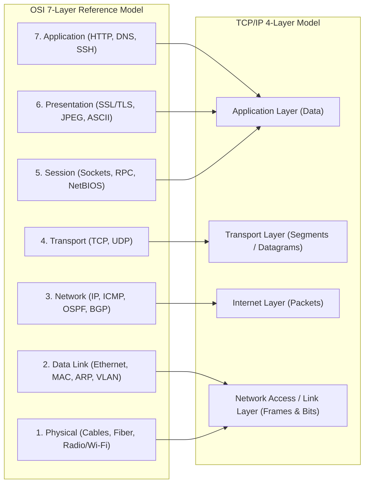
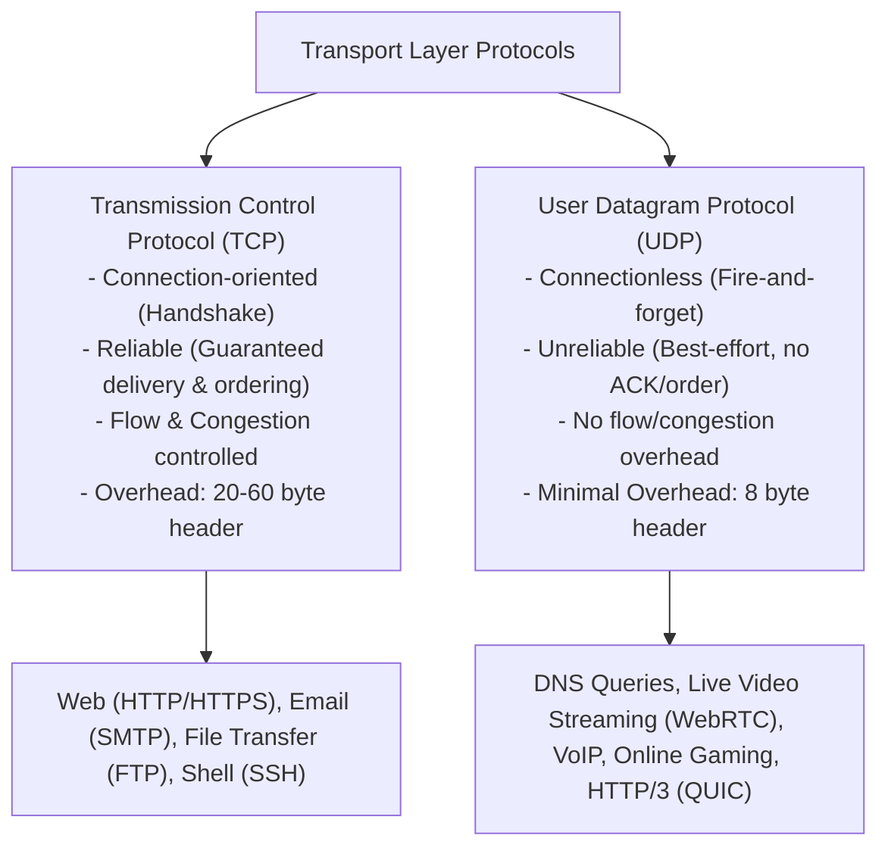
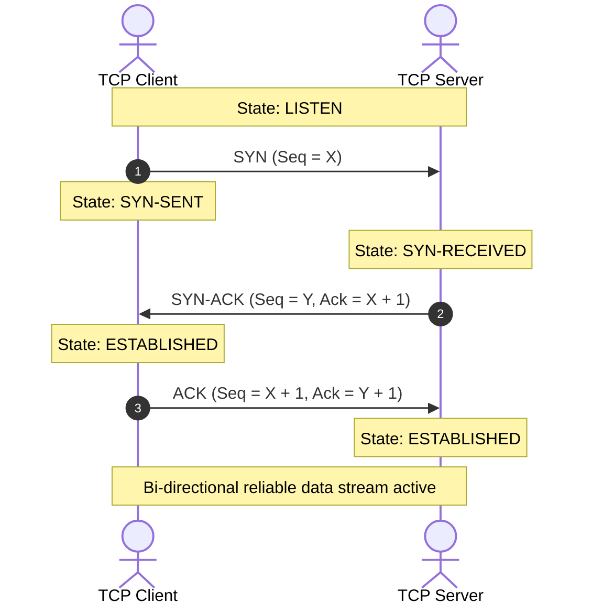
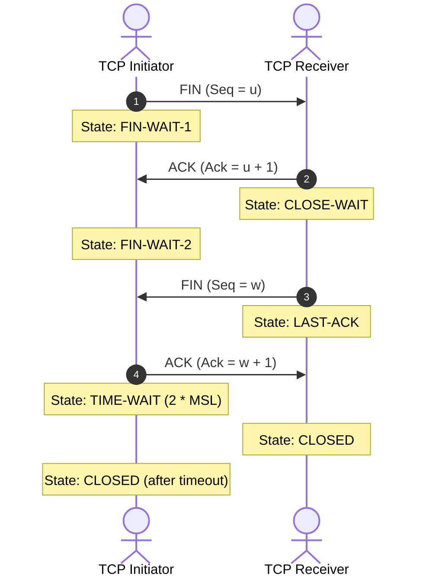
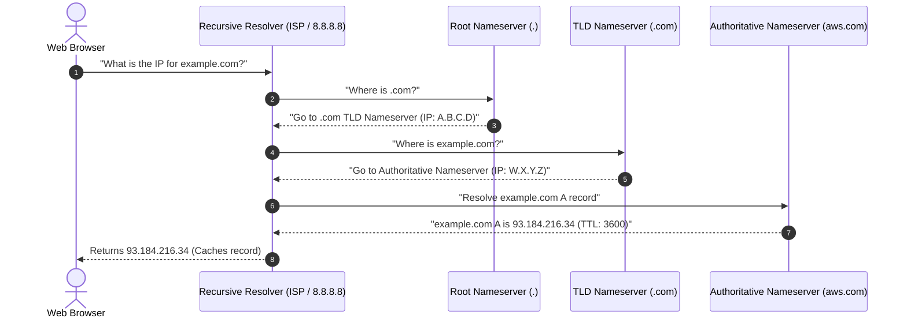
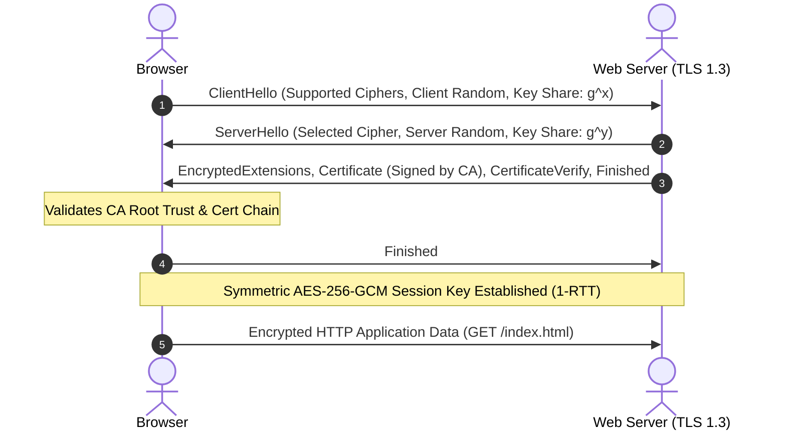
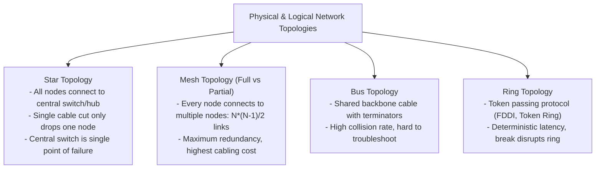
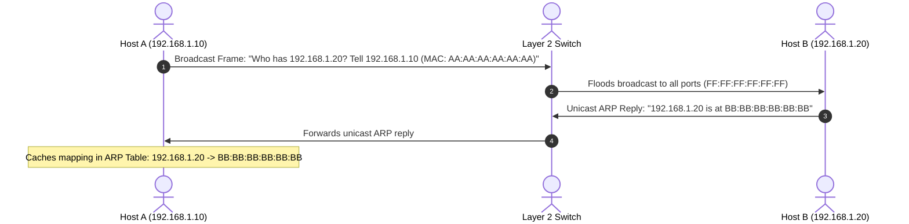
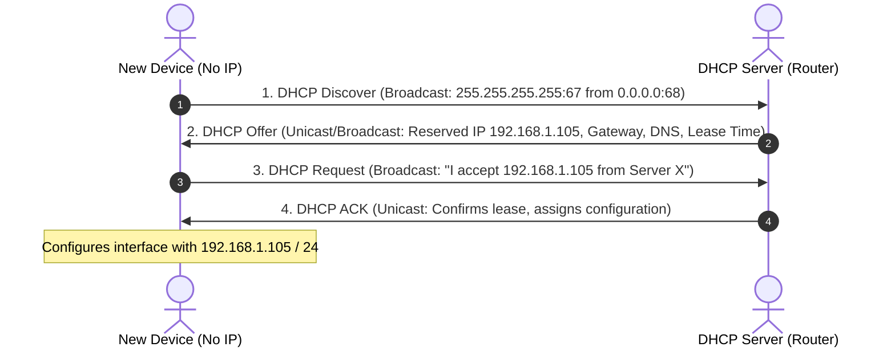

# Computer Networks Master Reference & Systems Guide

---

## 1. Network Models: OSI 7-Layer vs. TCP/IP 4-Layer

### Protocol Data Units (PDU) & Network Devices

| Layer # | OSI Layer Name | Protocol Data Unit (PDU) | Core Protocols | Hardware Devices | Primary Function |
|---|---|---|---|---|---|
| **7** | Application | Data | HTTP, HTTPS, DNS, SMTP, SSH, FTP, WebSocket | Gateway, Application Proxy | Network process to application interface |
| **6** | Presentation | Data | TLS/SSL, JSON, XML, JPEG, gzip | Gateway | Data formatting, encryption, and compression |
| **5** | Session | Data | Sockets, NetBIOS, RPC | Gateway | Session establishment, maintenance, and teardown |
| **4** | Transport | Segment (TCP) / Datagram (UDP)| TCP, UDP, QUIC, SCTP | Layer 4 Load Balancer, Firewall | End-to-end communication, flow/congestion control |
| **3** | Network | Packet | IPv4, IPv6, ICMP, ARP, OSPF, BGP | Router, Layer 3 Switch | Logical addressing, routing across internetworks |
| **2** | Data Link | Frame | Ethernet (802.3), Wi-Fi (802.11), PPP, VLAN | Switch, Bridge, NIC | Node-to-node frame transfer via physical MAC |
| **1** | Physical | Bits | 1000BASE-T, V.90, Fiber Optics | Hub, Repeater, Modem, Cables | Raw bitstream transmission over physical media |

---

## 2. Transport Layer: TCP vs. UDP Deep Dive

### TCP 3-Way Handshake (Connection Establishment)

### TCP 4-Way Handshake (Connection Teardown)

> **Why is `TIME-WAIT` (2MSL) necessary?** It ensures that the final ACK was received by the server (retransmitting if lost) and guarantees all lingering duplicate packets from this connection expire in the network before port reuse.

### TCP Congestion Control Mechanisms
1. **Slow Start:** Congestion window ($CWND$) starts at 1 MSS (Maximum Segment Size) and doubles every Round Trip Time (RTT) ($CWND = CWND \times 2$) exponentially until reaching the Slow-Start Threshold ($SSTHRESH$).
2. **Congestion Avoidance:** When $CWND \ge SSTHRESH$, growth becomes linear ($CWND = CWND + 1$ per RTT) to probe capacity cautiously.
3. **Fast Retransmit & Fast Recovery:** When 3 duplicate ACKs are received, TCP infers a packet was dropped without waiting for a retransmission timer, retransmits immediately, sets $SSTHRESH = CWND / 2$, and continues linear growth.

---

## 3. Network Layer, IP Addressing & Subnetting

### IPv4 vs. IPv6

| Attribute | IPv4 | IPv6 |
|---|---|---|
| **Address Length** | 32 bits (4 bytes) | 128 bits (16 bytes) |
| **Address Space** | $2^{32} \approx 4.3 \times 10^9$ addresses | $2^{128} \approx 3.4 \times 10^{38}$ addresses |
| **Format** | Dotted-decimal: `192.168.1.1` | Hexadecimal with colons: `2001:0db8:85a3::8a2e:0370:7334` |
| **Header Size** | Variable: 20 to 60 bytes | Fixed: 40 bytes (faster routing) |
| **Checksum in Header** | Yes (must be recomputed at every router) | No (eliminated; handled by L2 and L4) |
| **Configuration** | Manual DHCP / Static | Stateless Address Autoconfiguration (SLAAC) / DHCPv6 |
| **Security** | Optional IPSec | Mandatory native IPSec support |

### Subnetting & CIDR Mechanics
In Classless Inter-Domain Routing (CIDR) notation `192.168.10.0/24`:
* `/24` means the first 24 bits represent the **Network ID**, and the remaining $32 - 24 = 8$ bits represent the **Host ID**.
* **Subnet Mask:** `255.255.255.0`
* **Total IP Addresses:** $2^8 = 256$
* **Usable Host Addresses:** $2^8 - 2 = 254$
  * First address (`192.168.10.0`): **Network Address**
  * Last address (`192.168.10.255`): **Broadcast Address**

---

## 4. Application Layer Workflows

### The Complete DNS Resolution Pipeline

### Modern Web Protocols: HTTP/1.1 vs. HTTP/2 vs. HTTP/3

| Feature | HTTP/1.1 | HTTP/2 | HTTP/3 |
|---|---|---|---|
| **Transport Protocol** | TCP | TCP | UDP (via QUIC) |
| **Multiplexing** | No (Head-of-Line blocking at HTTP level) | Yes (Binary framing over 1 TCP connection) | Yes (Zero Head-of-Line blocking over UDP) |
| **Header Compression** | None (Raw plaintext headers repeated) | HPACK (Static + Dynamic Huffman table) | QPACK (Optimized for out-of-order packets) |
| **Connection Handshake**| TCP (1 RTT) + TLS (1-2 RTT) = 2-3 RTT | TCP (1 RTT) + TLS 1.3 (1 RTT) = 2 RTT | QUIC Handshake = 0-RTT or 1-RTT connection |
| **Server Push** | No | Supported | Supported |

---

## 5. Network Security: HTTPS & The TLS 1.3 Handshake

---

## 6. Top 20 High-Yield Computer Networks Interview Questions

1. **What happens under the hood when you type `https://www.google.com` into your browser and hit enter?**
   * *Answer:*
     1. Browser checks local DNS cache (browser, OS hosts file, recursive resolver).
     2. If not cached, executes hierarchical DNS lookup (Root -> TLD -> Authoritative).
     3. Browser establishes TCP 3-Way Handshake with Google's edge IP (SYN -> SYN-ACK -> ACK).
     4. Executes TLS 1.3 cryptographic handshake to negotiate symmetric encryption keys.
     5. Client transmits HTTP `GET /` request over the secure socket.
     6. Google's Nginx/Borg reverse proxy routes request to internal services, returning HTML.
     7. Browser renders DOM/CSSOM and fires subsequent queries for assets.
2. **What is the difference between ARP and RARP?**
   * *Answer:* ARP (Address Resolution Protocol) resolves a known logical IP address to a physical hardware MAC address on a local link. RARP (Reverse ARP) resolves a known physical MAC address to an IP address (mostly superseded by DHCP).
3. **Explain the difference between a Hub, Switch, and Router.**
   * *Answer:* A **Hub** is a Layer 1 device that blindly broadcasts incoming bits to all ports (single collision domain). A **Switch** is a Layer 2 device that inspects MAC frames and forwards them only to the destination port using a MAC address table (each port is its own collision domain). A **Router** is a Layer 3 device that routes IP packets between different subnets using routing tables.
4. **What is Head-of-Line (HoL) blocking? How did HTTP/2 and HTTP/3 solve it?**
   * *Answer:* In HTTP/1.1, a slow request blocks subsequent requests on the same TCP connection. HTTP/2 solved this at the application layer with binary frame multiplexing. However, if a single TCP packet dropped at the transport layer, all streams paused until retransmitted. HTTP/3 completely eliminates HoL blocking by running over UDP via QUIC, making individual streams fully independent.

## 7. Network Topologies & Data Link Layer Protocols

### Address Resolution Protocol (ARP) & Collision Domains

---

## 8. Dynamic Host Configuration Protocol (DHCP DORA Process)

---

## 9. IP Routing Algorithms & NAT/PAT

| Protocol | Category | Algorithm | Metric | Convergence Speed | Typical Use Case |
|---|---|---|---|---|---|
| **RIP** (Routing Information Protocol) | Interior Gateway (IGP) | Distance Vector (Bellman-Ford) | Hop Count (Max 15 hops) | Slow; prone to routing loops | Small, legacy networks |
| **OSPF** (Open Shortest Path First) | Interior Gateway (IGP) | Link State (Dijkstra's SPF) | Cost (Inverse bandwidth) | **Very Fast**; uses hierarchical areas | Enterprise campus & data center backbones |
| **BGP** (Border Gateway Protocol) | Exterior Gateway (EGP) | Path Vector | AS-Path & Policy attributes | Moderate; optimized for global stability | The core routing protocol of the global Internet |

### Network Address Translation (NAT) & Port Address Translation (PAT)
* **Problem:** Depletion of public IPv4 addresses ($2^{32} pprox 4.3$ billion).
* **PAT / NAT Overload:** Maps thousands of private RFC 1918 internal IP addresses (`10.0.0.0/8`, `172.16.0.0/12`, `192.168.0.0/16`) to a **single public IP address** by translating source TCP/UDP port numbers.
