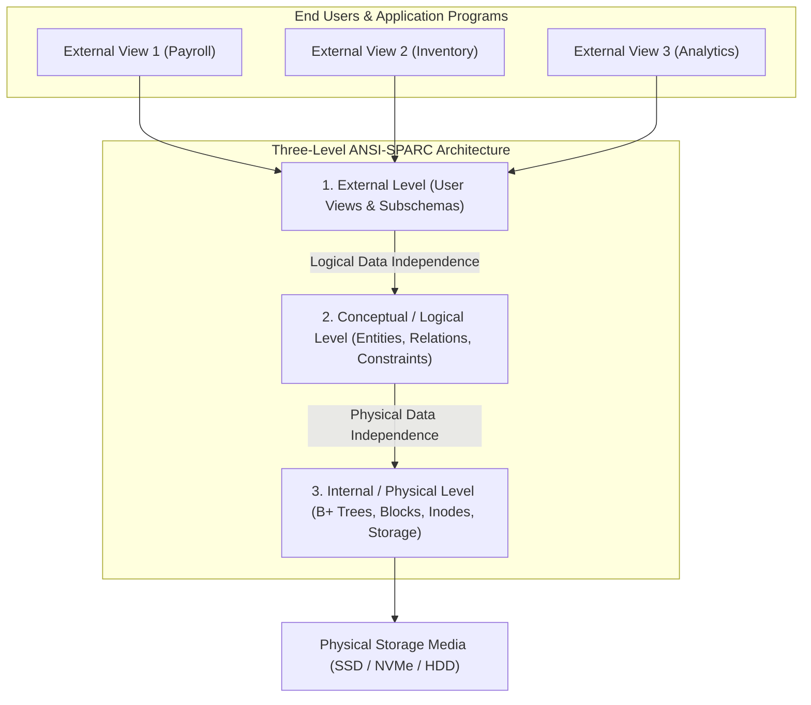
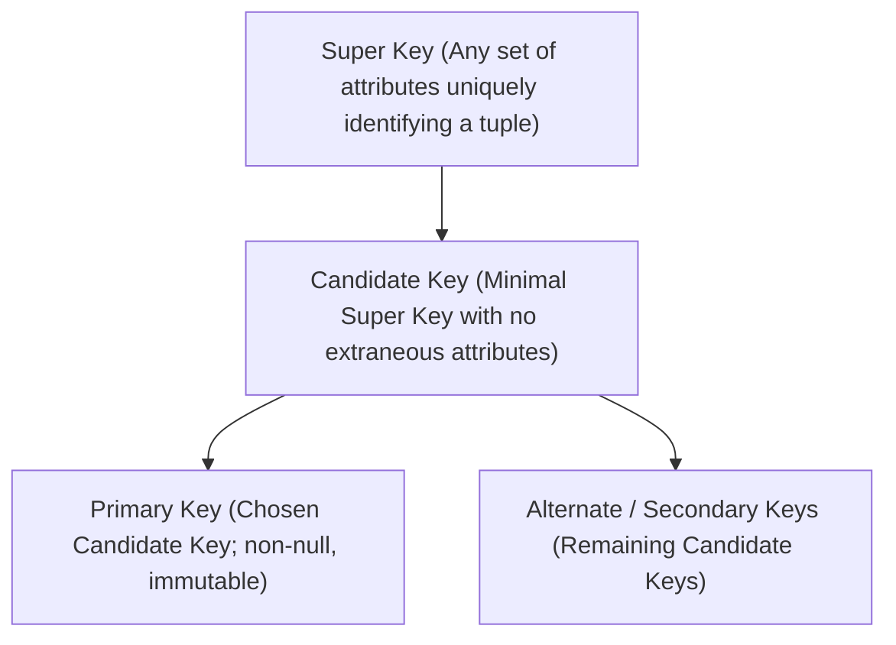
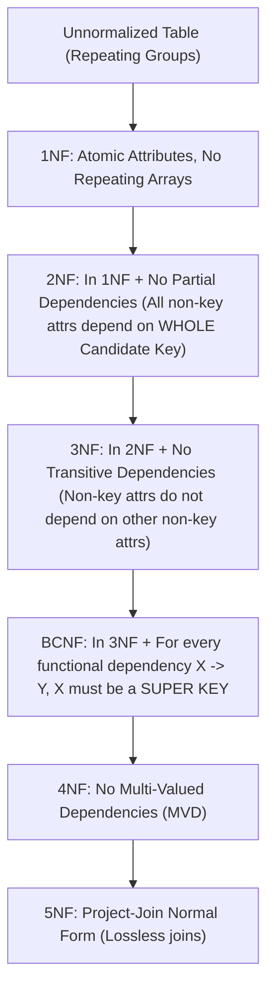
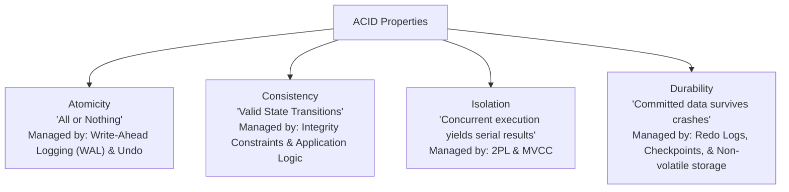
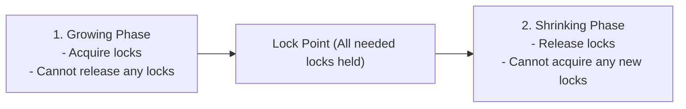
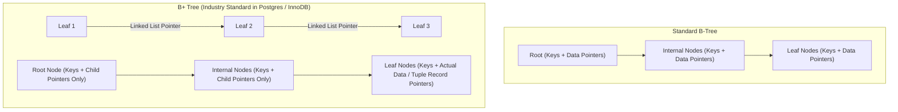
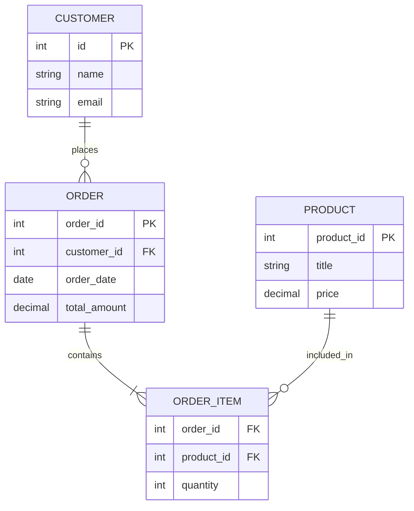
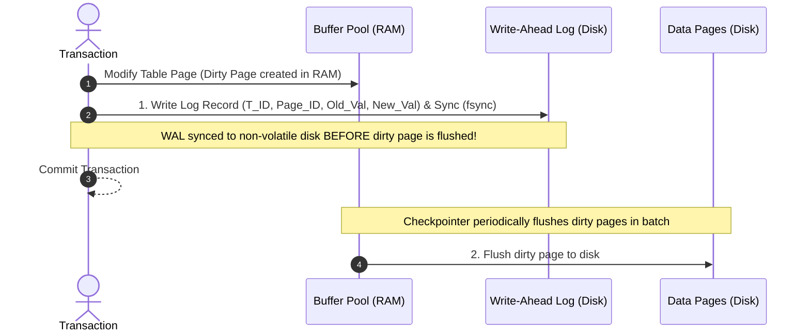

# Database Management Systems (DBMS) Master Reference

---

## 1. Core Architecture & Data Independence

A Database Management System (DBMS) is system software that enables the definition, creation, querying, updating, and administration of structured data.

### Data Independence
1. **Logical Data Independence:** The capacity to alter the conceptual schema (e.g., adding a table, adding a column) without requiring rewrites of existing external views or application code.
2. **Physical Data Independence:** The capacity to modify physical storage structures (e.g., rebuilding a B+ tree index, moving data blocks between drives, changing hashing algorithms) without modifying the conceptual or logical schema.

---

## 2. Relational Model & Database Keys

| Key Type | Formal Definition | Uniqueness | Nullable? | Example |
|---|---|---|---|---|
| **Super Key** | Attribute set that uniquely identifies every row | Guaranteed | Permitted (if part of composite) | `{emp_id}`, `{emp_id, email}`, `{ssn, phone}` |
| **Candidate Key** | Minimal super key with no redundant attributes | Guaranteed | Never | `{emp_id}`, `{ssn}`, `{email}` |
| **Primary Key** | Single candidate key chosen to identify tuples | Guaranteed | Strictly `NOT NULL` | `emp_id INT PRIMARY KEY` |
| **Foreign Key** | Attribute in child table referencing primary key in parent | Matches Parent PK | Nullable (unless specified) | `dept_id REFERENCES departments(id)` |
| **Composite Key** | Primary key comprising two or more columns | Combination is unique | Neither column can be NULL | `order_id + product_id` in `order_items` |

---

## 3. Database Normalization & Normal Forms

Normalization systematically decomposes relations to eliminate **data redundancy** and prevent **anomalies**:
* **Insertion Anomaly:** Inability to record information without inserting unrelated extraneous data.
* **Deletion Anomaly:** Unintentional loss of critical data when deleting unrelated tuples.
* **Update Anomaly:** Modifying a value requires updating multiple redundant copies; failure causes data inconsistency.

### Normal Forms Matrix

| Normal Form | Rule Requirement | Dependency Eliminated | Practical Action |
|---|---|---|---|
| **1NF** | Attribute values must be atomic (indivisible scalars). | Repeating groups, comma-separated lists | Split multivalue columns into separate rows. |
| **2NF** | In 1NF and no **Partial Dependency** (non-prime attribute depending on a proper subset of a composite candidate key). | Partial functional dependencies | Move partially dependent columns to a dedicated relation. |
| **3NF** | In 2NF and no **Transitive Dependency** ($X \to Y$ and $Y \to Z$ where $Z$ is non-prime). | Transitive dependencies | For $X \to Y$, ensure $X$ is a super key or $Y$ is prime. |
| **BCNF** | For every non-trivial functional dependency $X \to Y$, $X$ must be a **Super Key**. | Anomalies where a prime attribute depends on non-key attributes | Stricter version of 3NF; eliminates all redundancy based on FDs. |

---

## 4. Transactions & ACID Properties

A transaction is a logical unit of work consisting of one or more database operations that must execute reliably.

---

## 5. Concurrency Control & Isolation Anomalies

When multiple transactions execute concurrently, uncoordinated access creates concurrency anomalies:

### Read/Write Concurrency Anomalies
1. **Dirty Read:** Transaction $T_1$ updates a row without committing; Transaction $T_2$ reads the uncommitted value. $T_1$ rolls back, leaving $T_2$ with invalid data.
2. **Non-Repeatable Read:** Transaction $T_1$ reads a row. Transaction $T_2$ updates or deletes that row and commits. $T_1$ rereads the row and encounters different values.
3. **Phantom Read:** Transaction $T_1$ queries rows matching a range predicate (`WHERE salary > 50000`). Transaction $T_2$ inserts a new matching row and commits. $T_1$ repeats the range query and discovers new "phantom" tuples.
4. **Lost Update:** Two transactions read the same initial value and concurrently write back modified updates; one update overwrites the other without factoring in the change.

### ANSI SQL Isolation Levels vs. Anomalies

| Isolation Level | Dirty Read | Non-Repeatable Read | Phantom Read | Mechanism Employed |
|---|---|---|---|---|
| **Read Uncommitted** | Possible | Possible | Possible | No read locks; transactions read raw shared memory buffers |
| **Read Committed** (Postgres default)| **Prevented** | Possible | Possible | Read locks acquired and released immediately per statement; MVCC snapshot per query |
| **Repeatable Read** | **Prevented** | **Prevented** | Possible | Read locks held until transaction ends; MVCC snapshot taken at transaction start |
| **Serializable** | **Prevented** | **Prevented** | **Prevented** | Two-Phase Locking (2PL), Predicate locks, or Serializable Snapshot Isolation (SSI) |

---

## 6. Two-Phase Locking (2PL) & Deadlocks

Two-Phase Locking ensures conflict serializability by dividing lock lifecycles into two distinct phases:

* **Strict 2PL:** All Exclusive ($X$) locks must be held until the transaction commits or aborts (prevents cascading rollbacks).
* **Rigorous 2PL:** Both Shared ($S$) and Exclusive ($X$) locks must be held until commit/abort.

### Deadlock Resolution in DBMS
* **Wait-Die Scheme (Non-preemptive):** If older transaction $T_i$ requests resource held by younger $T_j$, $T_i$ waits. If younger requests from older, younger **dies** (rolls back).
* **Wound-Wait Scheme (Preemptive):** If older transaction requests resource from younger, older **wounds** (preempts) younger. If younger requests from older, younger waits.

---

## 7. Storage & Indexing: B-Tree vs. B+ Tree

### Why B+ Trees are Preferred over B-Trees for Databases
1. **Higher Fanout:** Internal nodes store only routing keys and child pointers (no record data), allowing more keys per disk block (page). This drastically decreases tree depth (typically 3–4 levels for billions of rows).
2. **Efficient Range Scans:** Leaf nodes form a doubly linked list. Range queries (`BETWEEN 100 AND 500`) locate the starting key via logarithmic tree search ($O(\log N)$) and traverse the linked list sequentially without traversing up and down the tree.
3. **Predictable Query Latency:** Every search traverses from root to leaf, giving uniform $O(\log N)$ latency.

---

## 8. Top 20 High-Yield DBMS Interview Questions

1. **What is the difference between Conflict Serializability and View Serializability?**
   * *Answer:* A schedule is **conflict serializable** if it can be transformed into a serial schedule by swapping non-conflicting concurrent operations. A schedule is **view serializable** if it is view equivalent to a serial schedule (preserving initial reads, updated writes, and final writes). View serializability is NP-complete to test, while conflict serializability is tested in polynomial time $O(V + E)$ using Precedence (Serialization) Graph cycle detection.
2. **What is the difference between a Clustered and a Non-Clustered Index?**
   * *Answer:*
     * **Clustered Index:** Dictates the physical order in which data rows are stored on disk. There can be only **one** clustered index per table (typically the Primary Key). Leaf nodes contain actual data rows.
     * **Non-Clustered Index:** A separate secondary structure containing sorted index keys and pointers (row IDs / tuple specifiers) pointing to the physical data rows. A table can have multiple non-clustered indexes.
3. **What is Write-Ahead Logging (WAL)?**
   * *Answer:* WAL is an architectural protocol ensuring Durability and Atomicity. It mandates that any modification to database data must be written and synced to non-volatile disk log files (Redo/Undo logs) *before* the dirty data page itself is flushed from RAM buffer pools to the database disk blocks.
4. **Explain 3NF vs. BCNF with an edge-case example.**
   * *Answer:* In 3NF, for any non-trivial functional dependency $X \to Y$, either $X$ is a super key or $Y$ is a prime attribute. In BCNF, $X$ **must** be a super key, with no exceptions for prime attributes. BCNF eliminates anomalies that can still occur in 3NF when a relation has multiple overlapping composite candidate keys.

## 9. Entity-Relationship (ER) Modeling & Relational Algebra

### Relational Algebra vs. SQL Equivalents

| Relational Algebra Operator | Symbol | SQL Equivalent | Purpose |
|---|---|---|---|
| **Select** | $\sigma_{	ext{condition}}(R)$ | `SELECT * FROM R WHERE condition` | Filters rows matching predicate |
| **Project** | $\pi_{A_1, A_2}(R)$ | `SELECT A1, A2 FROM R` | Selects specific columns, discarding others |
| **Cartesian Product** | $R 	imes S$ | `SELECT * FROM R CROSS JOIN S` | Combines every tuple of $R$ with every tuple of $S$ |
| **Natural Join** | $R owtie S$ | `SELECT * FROM R NATURAL JOIN S` | Equi-join on all shared attribute names |
| **Union** | $R \cup S$ | `SELECT * FROM R UNION SELECT * FROM S` | Combines rows from both compatible relations |
| **Set Difference** | $R - S$ | `SELECT * FROM R EXCEPT SELECT * FROM S` | Tuples in $R$ that do not exist in $S$ |

---

## 10. Database Recovery: Write-Ahead Logging & Checkpointing

### Crash Recovery Algorithm (ARIES)
1. **Analysis Phase:** Scans WAL forward from the last checkpoint to identify active transactions (uncommitted) and dirty pages in memory at crash time.
2. **Redo Phase:** Scans WAL forward to replay all logged changes (repeating history) to restore state up to the exact crash instant.
3. **Undo Phase:** Scans WAL backward, undoing the changes of all transactions that were active (uncommitted) when the crash occurred, leaving the database consistent.
