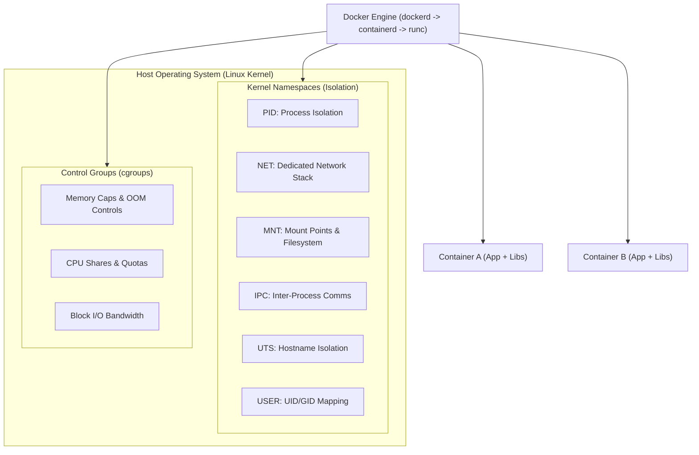
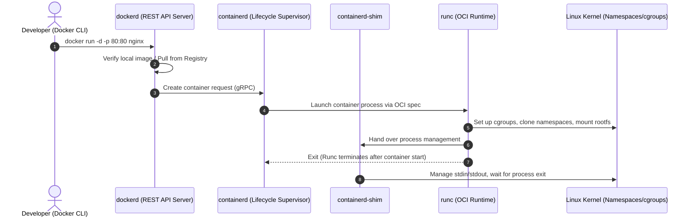
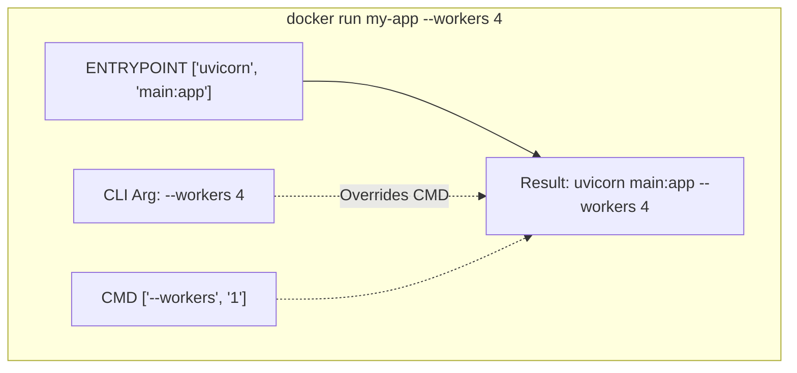
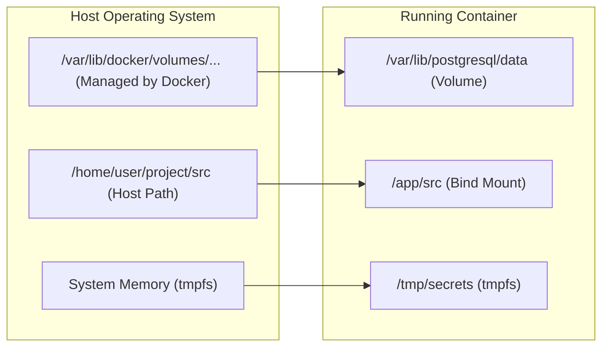
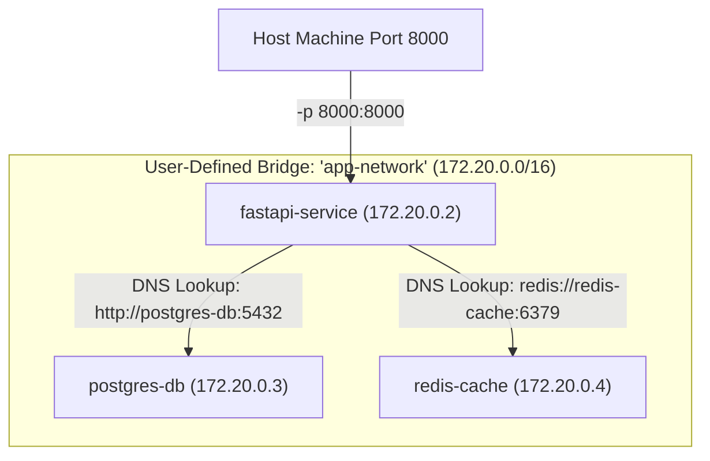
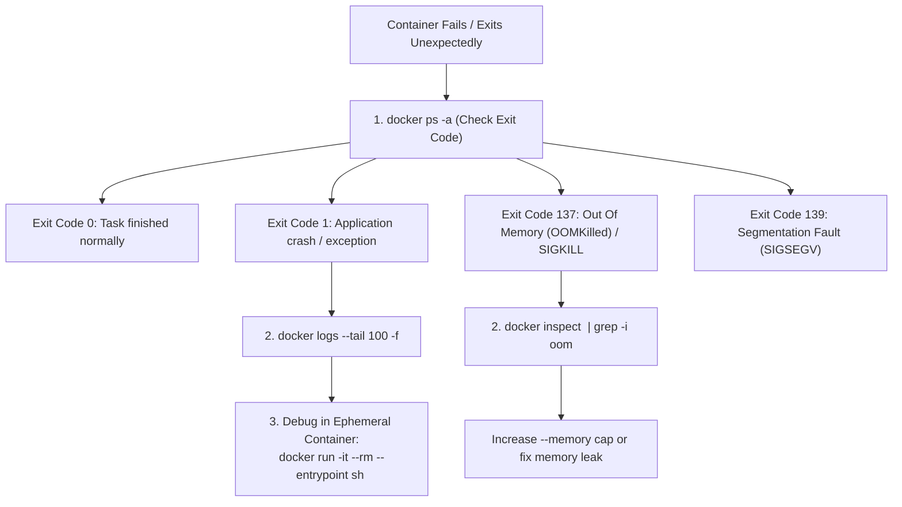

# Docker Master Reference & Production Guide

---

## 1. Core Architecture & Containerization Foundations

Containerization packages an application, its runtime, system tools, libraries, and configurations into a lightweight, standalone execution unit that shares the host operating system's kernel.



### Docker Containers vs. Virtual Machines

| Dimension | Docker Containers | Virtual Machines (VMs) |
|---|---|---|
| **Virtualization Level** | Operating-System level (Kernel sharing) | Hardware level (Hypervisor Type 1/2) |
| **Guest OS** | No guest OS; reuses host kernel | Full guest OS per instance (GBs of overhead) |
| **Startup Time** | Milliseconds to seconds | Minutes (full OS boot process) |
| **Resource Efficiency** | Extremely high; near bare-metal performance | High overhead; static allocation of RAM/vCPU |
| **Isolation** | Process-level via Namespaces & cgroups | Hardware-level isolation via Hypervisor |
| **Storage Footprint** | Megabytes (shared layer architecture) | Gigabytes to tens of Gigabytes |
| **Best Used For** | Microservices, stateless APIs, CI/CD pipelines | Running distinct OS kernels, multi-tenant isolation |

---

## 2. Docker Engine Internals



* **`dockerd` (Docker Daemon):** Persistent background service handling API requests, managing images, networks, volumes, and authentication.
* **`containerd`:** Industry-standard container runtime manager. Supervises container lifecycles, image transfers, and execution shims.
* **`runc`:** Lightweight, CLI tool for spawning containers according to the OCI (Open Container Initiative) specification.
* **`containerd-shim`:** Sits between containerd and the container process, allowing the Docker daemon to restart or crash without terminating the running container.

---

## 3. Dockerfile Master Reference & Best Practices

```dockerfile
# 1. Official Minimal Base Image
FROM python:3.12-slim-bookworm AS base

# 2. Build Arguments (Build-time only)
ARG APP_VERSION=1.0.0
ARG ENV=production

# 3. Environment Variables (Persist in final container)
ENV PYTHONUNBUFFERED=1     PYTHONDONTWRITEBYTECODE=1     PORT=8000     APP_DIR=/app

# 4. Set working directory
WORKDIR ${APP_DIR}

# 5. Install system dependencies in single cached RUN layer
RUN apt-get update && apt-get install -y --no-install-recommends     curl     libpq-dev     && rm -rf /var/lib/apt/lists/*

# 6. Copy requirements first for Docker layer caching
COPY requirements.txt .

# 7. Install Python packages without caching wheels
RUN pip install --no-cache-dir -r requirements.txt

# 8. Copy application code
COPY . .

# 9. Create a non-root security user (Least Privilege)
RUN addgroup --system appgroup && adduser --system --ingroup appgroup appuser     && chown -R appuser:appgroup ${APP_DIR}
USER appuser

# 10. Expose documentation port
EXPOSE 8000

# 11. Healthcheck instruction for orchestrators
HEALTHCHECK --interval=30s --timeout=5s --start-period=5s --retries=3     CMD curl -f http://localhost:8000/health || exit 1

# 12. Exec-form entrypoint and command
ENTRYPOINT ["uvicorn"]
CMD ["main:app", "--host", "0.0.0.0", "--port", "8000"]
```

### Critical Instruction Matrix

| Instruction | Execution Scope | Primary Purpose & Edge Cases |
|---|---|---|
| `FROM` | Image Init | Sets base image. Can be used multiple times in multi-stage builds. |
| `WORKDIR` | Build & Runtime | Creates directory if non-existent and sets context. Avoid raw `cd` in `RUN`. |
| `COPY` | Build-time | Copies local files into container. Preferred over `ADD` for safety. |
| `ADD` | Build-time | Copies files, auto-extracts `.tar` archives, and downloads remote URLs. |
| `RUN` | Build-time | Executes command and commits a new layer (e.g., `apt-get install`). |
| `CMD` | Runtime | Default command/arguments. Overridable via `docker run image [cmd]`. |
| `ENTRYPOINT`| Runtime | Fixed executable. Does not get overridden easily; appended by `CMD` arguments. |
| `ENV` | Build & Runtime | Persists environment variables across image layers and running containers. |
| `ARG` | Build-time only | Available solely during `docker build --build-arg VAR=VAL`. Not in container. |
| `EXPOSE` | Documentation | Informs user which port service binds to. Does **not** publish ports to host. |
| `VOLUME` | Runtime | Declares managed mount point for persistent data. |
| `USER` | Runtime | Switches process from root to unprivileged UID. Crucial for security. |

---

## 4. CMD vs. ENTRYPOINT Deep Dive

Containers can execute commands in two syntaxes:
1. **Exec Form (Recommended):** `["executable", "param1", "param2"]` — Bypasses shell, runs directly as PID 1, correctly receiving Linux signals (`SIGTERM`, `SIGINT`).
2. **Shell Form:** `command param1 param2` — Runs `/bin/sh -c "command param1"`. Does **not** propagate OS signals to your app, preventing graceful shutdown.



---

## 5. Multi-Stage Production Builds

Multi-stage builds allow compiling assets, installing dev tooling, and compiling binaries in intermediate stages, copying only production artifacts into the final lean image.

```dockerfile
# ==========================================
# Stage 1: Build & Compilation Environment
# ==========================================
FROM python:3.12-slim-bookworm AS builder

WORKDIR /build
RUN apt-get update && apt-get install -y --no-install-recommends gcc libpq-dev

COPY requirements.txt .
RUN pip install --user --no-cache-dir -r requirements.txt

# ==========================================
# Stage 2: Final Minimal Runtime Image
# ==========================================
FROM python:3.12-slim-bookworm AS runner

WORKDIR /app

# Copy only the compiled Python packages from builder stage
COPY --from=builder /root/.local /root/.local
COPY . /app

ENV PATH=/root/.local/bin:$PATH     PYTHONUNBUFFERED=1

EXPOSE 8000
CMD ["uvicorn", "main:app", "--host", "0.0.0.0", "--port", "8000"]
```

> **Result:** Image size reduced from ~980MB (with build tools, headers, and caches) to ~140MB, eliminating build vulnerabilities from production.

---

## 6. Docker Storage: Volumes vs. Bind Mounts vs. tmpfs



| Type | Managed By | Host Location | Persistence | Typical Use Case |
|---|---|---|---|---|
| **Named Volume** | Docker Engine | `/var/lib/docker/volumes/<name>/_data` | Persistent across container reboots/removals | Databases (PostgreSQL, MySQL), stateful volumes |
| **Bind Mount** | User / Host | Arbitrary user directory (e.g., `./src`) | Dependent on host filesystem | Local development (live code reload) |
| **tmpfs Mount** | Linux Kernel | RAM only (non-disk) | Destroyed on container stop | High-security keys, transient in-memory caches |

### Storage CLI Commands
```bash
# Volumes
docker volume create pg_data
docker run -d --name db -v pg_data:/var/lib/postgresql/data postgres:16
docker volume ls
docker volume inspect pg_data
docker volume prune -f

# Bind Mounts (Local Live Reloading)
docker run -d -p 8000:8000 -v $(pwd)/src:/app/src my-fastapi-app
```

---

## 7. Docker Networking Architecture

Docker isolates containers using virtual network bridges and Linux network namespaces.



### Network Drivers
1. **Bridge (Default):** Software bridge enabling containers on the same bridge network to communicate while isolating from external networks. Custom bridges provide **automatic DNS service discovery**.
2. **Host:** Removes network isolation between the container and Docker host. Container shares host IP and ports directly (`--network host`). Max throughput, but port conflicts are possible.
3. **None:** Disables all networking. Container has only loopback interface (`lo`). Ideal for isolated batch compute.
4. **Overlay:** Enables multi-host container-to-container communication in Docker Swarm or distributed clusters.
5. **Macvlan:** Assigns a physical MAC address to container, making it appear as a physical device on the host LAN.

```bash
# Network Operations
docker network create --driver bridge app-network
docker run -d --name postgres-db --network app-network -e POSTGRES_PASSWORD=secret postgres:16
docker run -d --name fastapi-app --network app-network -p 8000:8000 my-api
# FastAPI connects to database using hostname 'postgres-db'
```

---

## 8. Multi-Container Orchestration: Docker Compose

```yaml
version: '3.8'

services:
  web:
    build:
      context: .
      dockerfile: Dockerfile
    container_name: dayzero_backend
    restart: unless-stopped
    ports:
      - "8000:8000"
    environment:
      - DATABASE_URL=postgresql://postgres:secret@db:5432/dayzerodb
      - REDIS_URL=redis://cache:6379/0
      - GEMINI_API_KEY=${GEMINI_API_KEY}
    depends_on:
      db:
        condition: service_healthy
      cache:
        condition: service_started
    networks:
      - dayzero_net

  db:
    image: postgres:16-alpine
    container_name: dayzero_postgres
    restart: always
    environment:
      POSTGRES_USER: postgres
      POSTGRES_PASSWORD: secret
      POSTGRES_DB: dayzerodb
    volumes:
      - db_data:/var/lib/postgresql/data
    healthcheck:
      test: ["CMD-SHELL", "pg_isready -U postgres"]
      interval: 10s
      timeout: 5s
      retries: 5
    networks:
      - dayzero_net

  cache:
    image: redis:7-alpine
    container_name: dayzero_redis
    restart: always
    networks:
      - dayzero_net

volumes:
  db_data:
    driver: local

networks:
  dayzero_net:
    driver: bridge
```

---

## 9. Container Security & Production Hardening

1. **Non-Root Execution:** Always specify `USER appuser` in Dockerfile. Running as root allows container breakouts to gain root access on the host kernel if namespaces are bypassed.
2. **Read-Only Root Filesystem:** Run containers with `--read-only` to prevent attackers from writing malware or modifying binaries:
   ```bash
   docker run --read-only --tmpfs /tmp --tmpfs /run my-app
   ```
3. **Drop Linux Capabilities:** Restrict container privileges by dropping unnecessary kernel capabilities:
   ```bash
   docker run --cap-drop=ALL --cap-add=NET_BIND_SERVICE my-app
   ```
4. **Prevent Privilege Escalation:** Prevent processes from gaining additional privileges via `setuid` binaries:
   ```bash
   docker run --security-opt=no-new-privileges:true my-app
   ```
5. **Resource Limiting (Denial of Service Prevention):**
   ```bash
   docker run --memory="512m" --memory-swap="1g" --cpus="1.5" --pids-limit 100 my-app
   ```

---

## 10. Master Docker CLI Cheatsheet

```bash
# -----------------------------
# Image Lifecycle
# -----------------------------
docker pull <image>:<tag>                  # Pull image from registry
docker images                              # List local images
docker build -t <name>:<tag> .             # Build image with build context
docker build --no-cache -t <name> .        # Build ignoring cached layers
docker rmi <image_id>                      # Remove image
docker image prune -a                      # Delete all unused images

# -----------------------------
# Container Execution & Lifecycle
# -----------------------------
docker run -d --name <name> -p 80:80  sh             # Ephemeral interactive shell
docker ps                                  # List running containers
docker ps -a                               # List all containers (inc stopped)
docker stop <container>                    # Send SIGTERM, then SIGKILL after 10s
docker kill <container>                    # Immediate SIGKILL
docker rm <container>                      # Remove stopped container
docker rm -f <container>                   # Force remove running container

# -----------------------------
# Debugging & Inspection
# -----------------------------
docker logs -f --tail 100 <container>      # Follow recent container logs
docker exec -it <container> sh             # Execute command in running container
docker inspect <container_or_image>        # Low-level JSON metadata
docker stats                               # Live resource telemetry (CPU/MEM/IO)
docker top <container>                     # Display running processes of container
docker diff <container>                    # Inspect changes to container filesystem

# -----------------------------
# System Hygiene
# -----------------------------
docker system df                           # Show Docker disk usage
docker system prune -a --volumes           # Nuclear cleanup of unused data
```

## 11. Container Troubleshooting & Lifecycle Debugging Playbook



### Essential Debugging Commands
```bash
# Check if container was terminated by Linux kernel OOM killer
docker inspect <container_id> --format='{{.State.OOMKilled}}'

# View live container processes and CPU/Memory usage
docker top <container_id>
docker stats --no-stream

# Copy files directly into or out of a container for inspection
docker cp <container_id>:/app/logs/error.log ./local_error.log

# Inspect container environment variables and network IP
docker inspect <container_id> --format='{{range .Config.Env}}{{println .}}{{end}}'
docker inspect <container_id> --format='{{range .NetworkSettings.Networks}}{{.IPAddress}}{{end}}'
```

---

## 12. Production Docker Best Practices Checklist

1. **Use Specific Minimal Base Tags:** Never use `FROM python:latest`. Always pin explicit immutable tags: `FROM python:3.12.3-slim-bookworm`.
2. **Order Dockerfile Layers by Change Frequency:** Place infrequently changed instructions (`RUN apt-get...`, `COPY requirements.txt`) near the top, and frequently changed source code (`COPY . .`) at the bottom to maximize build caching.
3. **Combine `RUN apt-get update && apt-get install`:** Always combine package installation with cache cleanup in a single `RUN` layer:
   ```dockerfile
   RUN apt-get update && apt-get install -y --no-install-recommends        libpq-dev        curl        && rm -rf /var/lib/apt/lists/*
   ```
4. **Enforce Non-Root Users:** Never let container processes run as `root` (UID 0):
   ```dockerfile
   RUN addgroup --system app && adduser --system --group app
   USER app
   ```
5. **Add Comprehensive `.dockerignore`:** Exclude `.git`, `__pycache__`, `.env`, `node_modules`, `*.md`, and local credentials from build contexts.
