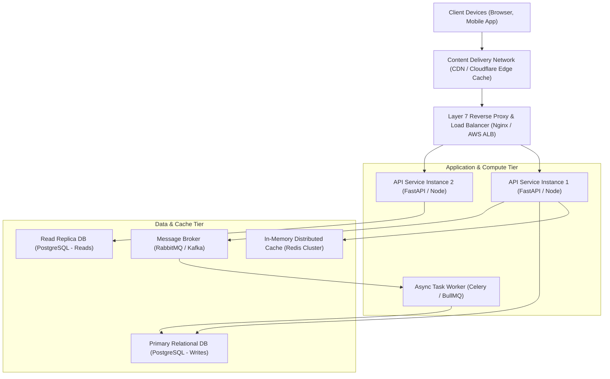
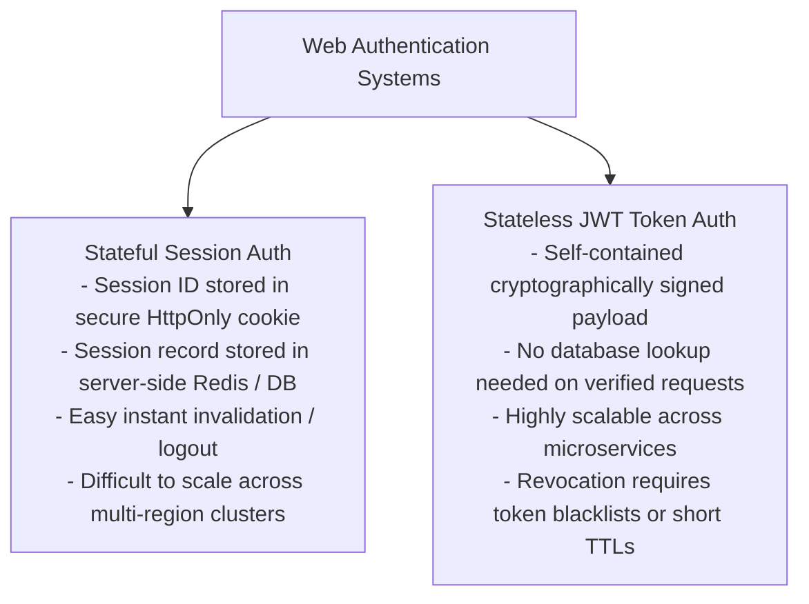
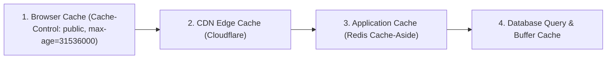
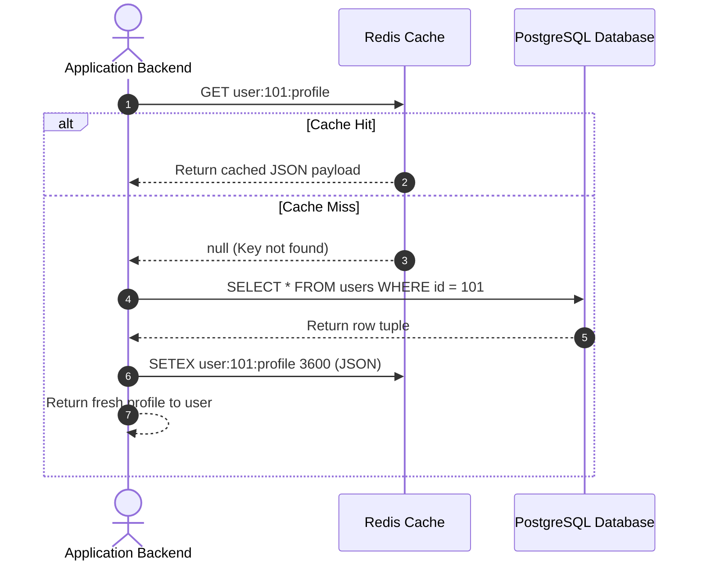
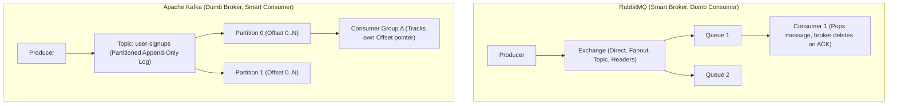
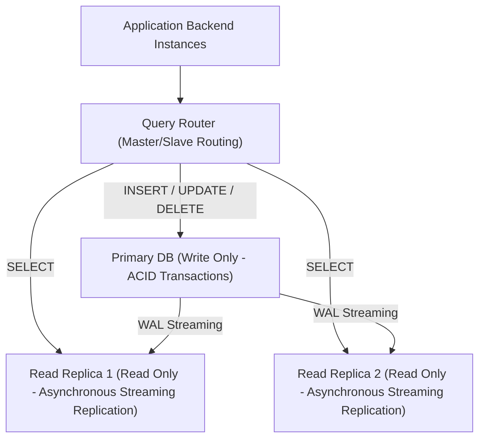

# Full-Stack Web Development Master Reference & System Design Guide

---

## 1. Modern Full-Stack System Architecture

A production full-stack web application orchestrates user experience, application logic, caching, background workers, and distributed databases across decoupled architectural tiers.

### Rendering Paradigms Comparison

| Paradigm | Where HTML is Built | Time To First Byte (TTFB) | First Contentful Paint (FCP) | SEO Friendliness | Typical Use Case |
|---|---|---|---|---|---|
| **CSR** (Client-Side Rendering) | Browser (via bundle JS) | **Fastest** (static shell) | Slower (waits for JS execution) | Poor without SSR pre-rendering | Admin dashboards, SaaS portals (DayZero AI) |
| **SSR** (Server-Side Rendering) | Node/Python Server on request | Slower (server compute latency) | **Fast** (HTML fully formed) | **Excellent** | E-commerce, news sites, content platforms |
| **SSG** (Static Site Generation)| At build time | **Fastest** (served directly from CDN) | **Instant** | **Exceptional** | Blogs, documentation, marketing landing pages |
| **ISR** (Incremental Static Regen)| At build time + revalidated in background | **Fastest** (CDN edge cached) | **Instant** | **Exceptional** | High-traffic e-commerce product catalogs |

---

## 2. Authentication & Authorization: Sessions vs. JWTs

### Token-Based Authentication Architecture (Access + Refresh Tokens)
1. **Access Token:** Short-lived (e.g., 15 minutes), passed in `Authorization: Bearer <token>` header. Contains user claims, permissions, and expiration.
2. **Refresh Token:** Long-lived (e.g., 7–30 days), stored securely inside an `HttpOnly`, `Secure`, `SameSite=Strict` cookie. Used exclusively against a `/refresh-token` endpoint to issue fresh access tokens.

---

## 3. Web Security: The OWASP Top 10 Mitigation Playbook

### 1. SQL Injection (SQLi)
* **Vulnerability:** Unsanitized user inputs concatenated directly into dynamic SQL query strings.
* **Mitigation:** Exclusively use **Parameterized Prepared Statements** or high-level Object-Relational Mappers (ORMs) like SQLAlchemy, Django ORM, or Prisma. Never concatenate strings into raw SQL!

### 2. Cross-Site Scripting (XSS)
* **Vulnerability:** Injecting malicious client-side JavaScript into web applications, which executes inside another user's browser session (stealing cookies or tokens).
  * *Stored XSS:* Malicious payload persisted in database.
  * *Reflected XSS:* Payload reflected in URL query parameters.
  * *DOM-based XSS:* Manipulating insecure DOM sinks (`innerHTML`, `eval()`).
* **Mitigation:** Context-aware output encoding, using modern frameworks (React auto-escapes JSX), setting `HttpOnly` on sensitive session cookies, and establishing a strict **Content Security Policy (CSP)** header.

### 3. Cross-Site Request Forgery (CSRF)
* **Vulnerability:** A malicious third-party site tricks an authenticated user's browser into executing unwanted actions on an application where the user is currently authenticated via cookies.
* **Mitigation:**
  * Configure session cookies with `SameSite=Strict` or `SameSite=Lax`.
  * Implement Anti-CSRF Synchronizer Tokens (Double-Submit Cookie pattern).
  * Require custom request headers (`X-Requested-With`, `X-CSRF-Token`) for state-changing requests (`POST`, `PUT`, `DELETE`).

---

## 4. Multi-Tier Caching & Invalidation Strategies

### The Cache-Aside (Lazy Loading) Pattern

---

## 5. Top 15 High-Yield Full-Stack Interview Questions

1. **What is the difference between REST, GraphQL, and WebSockets?**
   * *Answer:* **REST** is an architectural style based on standard HTTP verbs operating on discrete resource endpoints; it excels in caching and standard CRUD, but can suffer from over-fetching or under-fetching. **GraphQL** exposes a single endpoint where clients request the exact query shapes they need, eliminating over-fetching at the cost of complex server-side caching and vulnerability to query complexity denial-of-service. **WebSockets** provide full-duplex, persistent TCP connections for real-time bidirectional communication (live chats, financial tickers, multiplayer gaming).
2. **What is CORS and how does a preflight request work?**
   * *Answer:* CORS (Cross-Origin Resource Sharing) is a browser security mechanism that restricts a web page from making requests to a different domain, port, or protocol than the origin that served the page. When a client issues a "non-simple" request (e.g., uses `Content-Type: application/json` or custom headers), the browser automatically sends an HTTP `OPTIONS` preflight request with `Origin` and `Access-Control-Request-Method` headers. The server must respond with `Access-Control-Allow-Origin` before the browser dispatches the actual request.
3. **What is Horizontal Scaling vs. Vertical Scaling?**
   * *Answer:* **Vertical Scaling (Scaling Up)** involves adding more resources (CPU cores, RAM, faster NVMe storage) to an existing single machine. It has physical hardware ceilings and introduces a single point of failure. **Horizontal Scaling (Scaling Out)** involves adding more stateless machine instances behind a load balancer. It provides near-infinite scale and high availability, but requires distributed architecture, stateless sessions, and database clustering.

## 6. Message Brokers: RabbitMQ vs. Apache Kafka

| Dimension | RabbitMQ | Apache Kafka |
|---|---|---|
| **Architecture** | Traditional Message Queue (AMQP Broker) | Distributed Partitioned Append-Only Commit Log |
| **Message Consumption**| Messages are popped and deleted from queue upon ACK | Messages persist on disk (retention period); consumers read by offset |
| **Throughput** | ~20k to 50k msgs/sec | **1,000,000+ msgs/sec** (sequential disk I/O, zero-copy OS paging) |
| **Replayability** | No (unless manually DLQ re-routed) | **Yes** (Rewind consumer offset pointer to replay historical events) |
| **Best Used For** | Complex routing, RPC, asynchronous tasks (Celery) | Real-time event streaming, metrics telemetry, activity tracking |

---

## 7. Scalability Patterns: Database Read Replicas & Sharding

