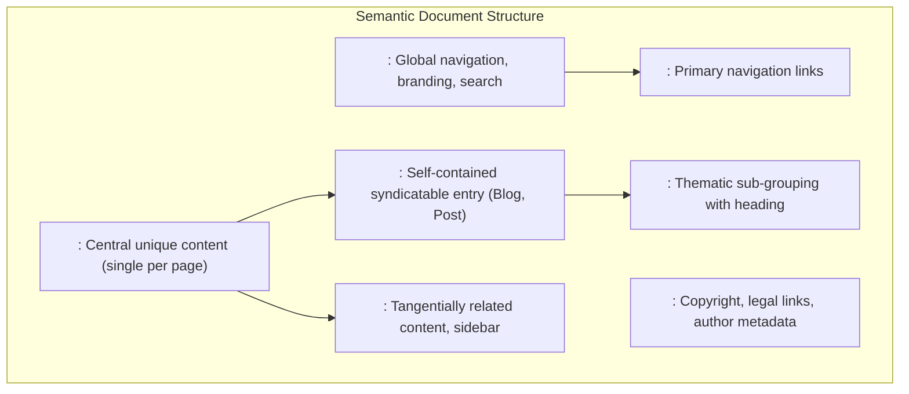
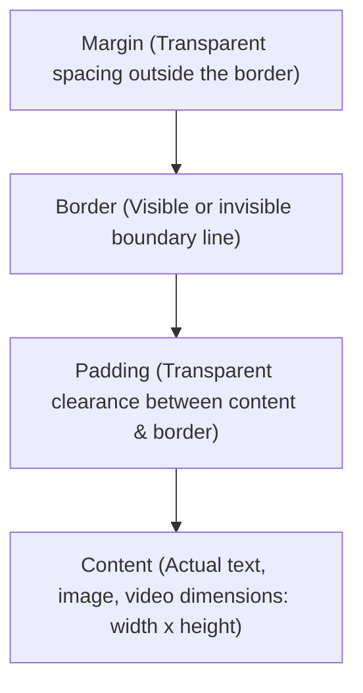
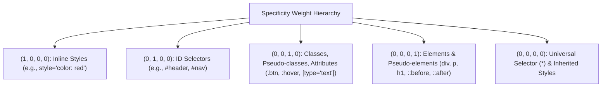
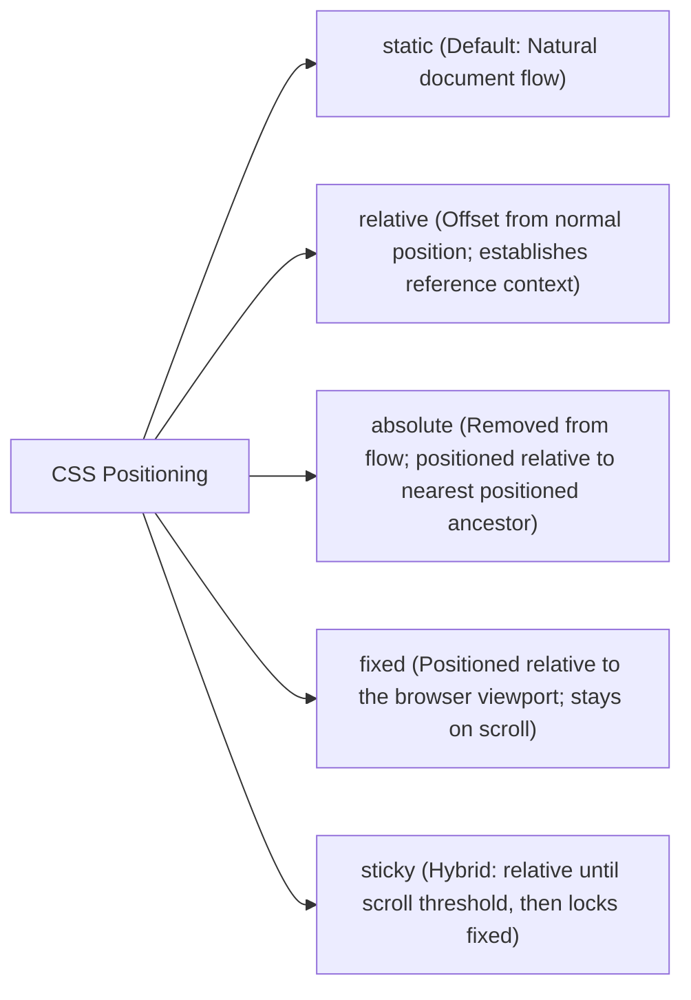
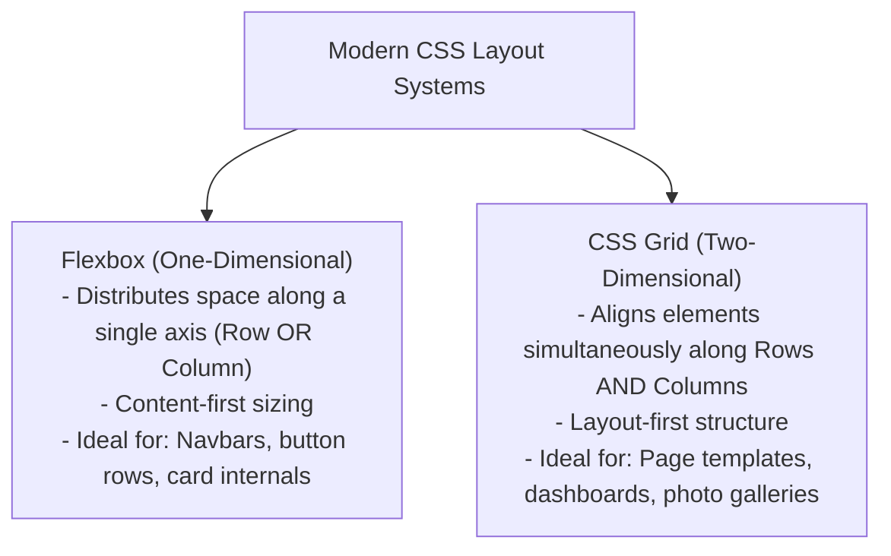
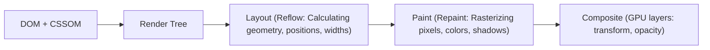

# HTML5 & Modern CSS3 Master Reference & Frontend Layouts Guide

---

## 1. Semantic HTML5 & Document Architecture

Semantic HTML assigns contextual meaning to markup rather than presentation alone, dramatically improving accessibility (screen readers), SEO crawlers, and code maintainability.



### Semantic vs. Non-Semantic Comparison

| Non-Semantic (Generic) | Semantic Equivalent | Contextual Purpose |
|---|---|---|
| `<div class="header">` | `<header>` | Introductory container, logo, navigation header |
| `<div class="nav">` | `<nav>` | Major navigational block |
| `<div class="main-content">` | `<main>` | Dominant, unique content of the `<body>` |
| `<div class="post">` | `<article>` | Standalone, distributable composition |
| `<div class="sidebar">` | `<aside>` | Content indirectly related to adjacent content |
| `<b>` / `<i>` | `<strong>` / `<em>` | Semantic importance / emphatic stress (screen readers alter inflection) |

---

## 2. The CSS Box Model & Sizing Mechanics

Every element rendered on a web page is modeled as a rectangular box:



### `content-box` vs. `border-box`

| Dimension | `box-sizing: content-box` (CSS Default) | `box-sizing: border-box` (Production Standard) |
|---|---|---|
| **Formula** | $\text{Rendered Width} = \text{width} + \text{padding} + \text{border}$ | $\text{Rendered Width} = \text{width}$ (Padding/Border included) |
| **Problem** | Setting `width: 100%` with `padding: 20px` overflows container viewport | Width remains fixed; padding compresses inner content safely |

```css
/* Universal Border-Box Reset (Mandatory in production) */
*, *::before, *::after {
    box-sizing: border-box;
    margin: 0;
    padding: 0;
}
```

---

## 3. CSS Specificity & The Cascade Hierarchy

When multiple CSS selectors target the same element with conflicting properties, the browser calculates a 4-part specificity score:

$$\text{Specificity} = (a, b, c, d)$$



> **The `!important` Rule:** Overrides all normal cascade weights. Use sparingly (e.g., utility overrides); excessive use causes unmaintainable specificity wars.

---

## 4. CSS Positioning & Stacking Contexts



```css
/* Sticky Header Example */
.navbar {
    position: sticky;
    top: 0;
    z-index: 1000; /* Stacking order within its stacking context */
    background: rgba(255, 255, 255, 0.95);
    backdrop-filter: blur(8px);
}
```

---

## 5. Modern Layouts: Flexbox vs. CSS Grid



### Complete Flexbox Architecture
```css
.flex-container {
    display: flex;
    flex-direction: row;            /* row | row-reverse | column | column-reverse */
    justify-content: space-between; /* Main Axis: flex-start | center | flex-end | space-between | space-around */
    align-items: center;            /* Cross Axis: flex-start | center | flex-end | stretch | baseline */
    flex-wrap: wrap;
    gap: 1.5rem;                    /* Modern gap spacing without negative margins */
}

.flex-item {
    flex: 1 1 300px; /* flex-grow: 1, flex-shrink: 1, flex-basis: 300px */
}
```

### Responsive Zero-Media-Query CSS Grid
```css
/* Automatically wraps cards when screen size shrinks below 280px without a single @media query! */
.card-grid {
    display: grid;
    grid-template-columns: repeat(auto-fit, minmax(280px, 1fr));
    gap: 2rem;
}
```

---

## 6. Responsive Design & Modern Fluid Typography

```css
/* Fluid Typography using CSS clamp() */
h1 {
    /* clamp(minimum, preferred_scaling, maximum) */
    font-size: clamp(2rem, 5vw + 1rem, 4.5rem);
}

/* Mobile-First Responsive Breakpoints */
/* Base styles apply to mobile (320px+) */
.container { width: 100%; padding: 1rem; }

/* Tablet */
@media (min-width: 768px) {
    .container { max-width: 720px; margin: 0 auto; }
}

/* Desktop */
@media (min-width: 1024px) {
    .container { max-width: 960px; }
}

/* Ultrawide */
@media (min-width: 1280px) {
    .container { max-width: 1200px; }
}
```

---

## 7. Performance & Rendering: Reflow vs. Repaint



* **Reflow (Layout):** Triggered when geometry changes (`width`, `height`, `margin`, `padding`, `fontSize`). Recalculates coordinates of all elements; computationally expensive!
* **Repaint:** Triggered when visual appearances change without altering layout (`color`, `background-color`, `box-shadow`).
* **GPU Compositing (Fastest):** Animating `transform` (`translateX`, `scale`) and `opacity` bypasses both Reflow and Repaint, delegating transformations directly to the GPU for butter-smooth 60/120 FPS animations.

---

## 8. Top 15 High-Yield HTML & CSS Interview Questions

1. **What is the difference between `display: none` and `visibility: hidden`?**
   * *Answer:* `display: none` removes the element entirely from the render tree; it occupies zero space in the document layout, triggering a Reflow. `visibility: hidden` hides the element visually, but the element still preserves its original width, height, and position in the document flow, triggering only a Repaint.
2. **What is a CSS Stacking Context and how is it created?**
   * *Answer:* A stacking context is a three-dimensional conceptualization of HTML elements along the z-axis. Elements with high `z-index` inside a lower stacking context cannot appear above elements in a higher stacking context. It is created by: the root `<html>` element, elements with `position: relative/absolute` and a `z-index` other than `auto`, `position: fixed/sticky`, or elements with `opacity < 1`, `transform`, `filter`, or `will-change`.
3. **What is the difference between `rem` and `em` units?**
   * *Answer:* `rem` (Root EM) is relative strictly to the font-size of the root `<html>` element (default 16px). `em` is relative to the font-size of its immediate **parent element**, which can lead to compound cascading scaling issues when nesting tags.
4. **Why are semantic elements important for Accessibility (a11y)?**
   * *Answer:* Assistive technologies (screen readers like NVDA, VoiceOver) use semantic landmarks (`<nav>`, `<main>`, `<article>`) to generate navigable page outlines, allowing visually impaired users to jump directly to sections via keyboard shortcuts without tabbing through hundreds of generic `<div>` tags.

## 9. Modern CSS Custom Properties & Dynamic Theme Switching

```css
/* CSS Variables Definition in :root */
:root {
    --bg-primary: #ffffff;
    --text-primary: #1a1a1a;
    --accent-color: #2563eb;
    --card-shadow: 0 4px 6px -1px rgba(0, 0, 0, 0.1);
}

/* Dark Theme Overrides */
[data-theme="dark"] {
    --bg-primary: #0f172a;
    --text-primary: #f8fafc;
    --accent-color: #38bdf8;
    --card-shadow: 0 4px 6px -1px rgba(0, 0, 0, 0.5);
}

body {
    background-color: var(--bg-primary);
    color: var(--text-primary);
    transition: background-color 0.3s ease, color 0.3s ease;
}

.card {
    box-shadow: var(--card-shadow);
    background: var(--bg-primary);
}
```

---

## 10. Web Accessibility (WCAG 2.1) & ARIA Patterns

```html
<!-- Accessible Accessible Form Pattern -->
<form role="form" aria-labelledby="contact-heading">
    <h2 id="contact-heading">Contact Engineering Team</h2>

    <div class="field-group">
        <label for="user-email">Work Email (Required):</label>
        <input 
            type="email" 
            id="user-email" 
            name="email" 
            required 
            aria-required="true"
            aria-describedby="email-hint email-error"
        />
        <span id="email-hint" class="hint">We'll never share your email with third parties.</span>
        <span id="email-error" class="error" role="alert" aria-live="assertive"></span>
    </div>

    <!-- Screen-reader accessible icon button -->
    <button type="submit" aria-label="Submit contact request">
        <svg aria-hidden="true" focusable="false" width="16" height="16">...</svg>
        <span>Send Message</span>
    </button>
</form>
```
