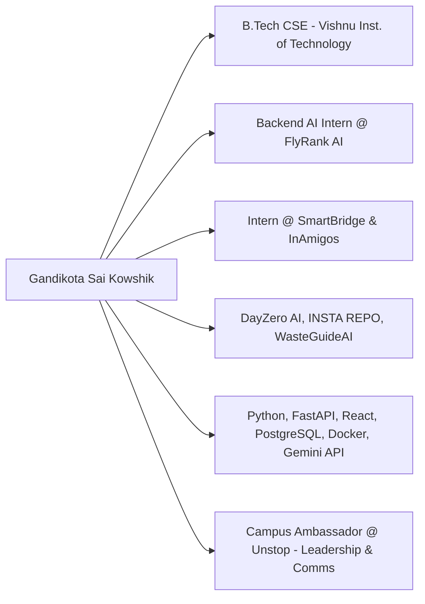
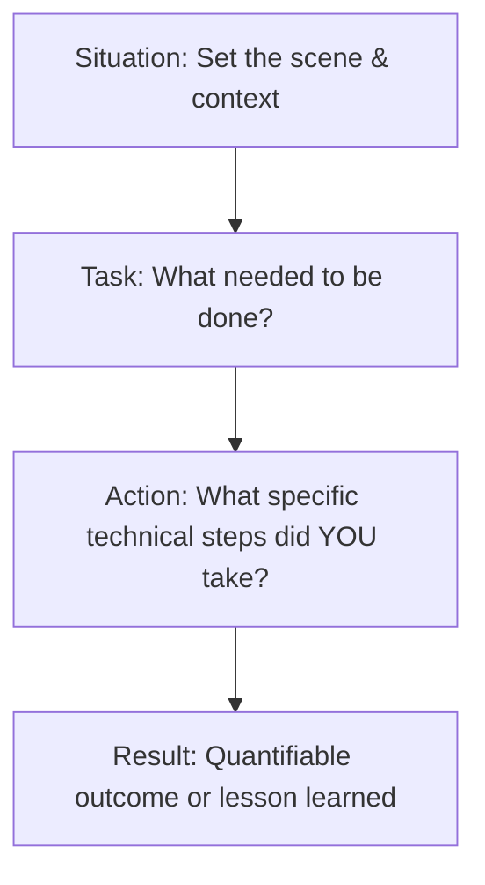

# Master Interview Guide: Self Introduction & Behavioral Mastery

> Tailored for **Gandikota Sai Kowshik** — Computer Science Engineering, Backend AI & Full-Stack Developer.

---

## 1. Candidate Overview & Profile Architecture

### Quick Reference Metrics
* **Core Focus:** Backend Engineering, Generative AI Systems, RESTful API Architecture.
* **Primary Stack:** Python (FastAPI, SQLAlchemy, Pytest), JavaScript (React.js, Node basics), PostgreSQL, Supabase, Docker, Git.
* **AI/ML Tooling:** Gemini API, LangChain, Prompt Engineering, RAG Architectures, Vector Stores.
* **Credentials:** Certified in Python Full Stack Development, Generative AI, AI Fundamentals, Google Prompting Essentials, Oracle Cloud Infrastructure (OCI) Generative AI.

---

## 2. Structured Self-Introduction Delivery Scripts

### A. 60-Second Elevator Pitch (HR & Recruiter Screening)
> **Goal:** High energy, crisp credentials, culture-fit and core alignment.

*"Good morning / afternoon. My name is Gandikota Sai Kowshik, and I am currently pursuing my Bachelor of Technology in Computer Science and Engineering at Vishnu Institute of Technology, Bhimavaram.*

*I specialize in backend development and AI integration, with hands-on proficiency in Python, FastAPI, PostgreSQL, React, and cloud databases. Currently, I work as a Backend AI Intern at FlyRank AI, where I architect and maintain scalable backend services and integrate Large Language Models into enterprise workflows.*

*Beyond my internship, I have engineered full-stack AI products such as **DayZero AI**—an automated startup validation engine powered by FastAPI and Supabase—and **INSTA REPO**, a dynamic career asset generator. I also served as a Campus Ambassador for Unstop, which refined my leadership and technical communication skills.*

*I am passionate about building resilient, real-world software and am excited about the opportunity to contribute to high-impact engineering teams. Thank you!"*

---

### B. 2-to-3 Minute Technical Interview Introduction
> **Goal:** Deep technical credibility, architectural familiarity, and problem-solving focus.

*"Good morning. I'm Sai Kowshik, a final-year Computer Science student at Vishnu Institute of Technology, focused primarily on backend engineering, distributed systems basics, and applied AI.*

*Over the past two years, I’ve centered my software development journey around the Python ecosystem—specifically building robust, asynchronous microservices using **FastAPI**, managing relational state with **PostgreSQL** and **Supabase**, and containerizing services using **Docker**.*

*In my current role as a Backend AI Intern at **FlyRank AI**, my primary responsibility is engineering backend pipelines that interface between web clients and LLM reasoning engines. This involves prompt engineering, structuring deterministic JSON schemas from non-deterministic models, token optimization, and managing latency through asynchronous request handling.*

*Prior to this, I completed internships with **SmartBridge** and the **InAmigos Foundation**, where I built **WasteGuideAI**, an image classification system for automated municipal waste segregation.*

*On the product development side, I created **DayZero AI**, a full-stack platform that evaluates business viability across multi-dimensional criteria—market size, competitor metrics, and 5-year financial projections—using React on the frontend and FastAPI on the backend. I have also built **INSTA REPO**, an AI document generation utility for structured resumes and portfolios.*

*I back this experience with continuous learning, holding certifications in Python Full Stack, Oracle OCI Generative AI, and Google Prompting Essentials. In this interview, I'm eager to discuss how my backend engineering and AI integration background can deliver immediate value to your engineering systems."*

---

### C. 5-Minute Technical & Leadership Walkthrough (Panel / Lead Interview)
Follow the 4-part framework:
1. **Foundation & Core Competencies (1 min):** Educational background, foundational CS rigor (Data Structures, Algorithms, OS, DBMS, Networks), and commitment to clean architecture.
2. **Professional Experience & Real-world Impact (1.5 min):** FlyRank AI backend responsibilities, dealing with API rate limits, error budgets, latency, and client-server contracts.
3. **Featured System Showcase — DayZero AI (1.5 min):** End-to-end architecture, choosing FastAPI over Flask/Django for async I/O, Supabase auth/row-level security, and client state synchronization.
4. **Leadership, Cultural Alignment & Aspirations (1 min):** Unstop ambassador experience, continuous upskilling, and desire to write maintainable, tested production code.

---

## 3. Behavioral Mastery: STAR Framework Responses

### Scenario 1: Handling a Critical Technical Obstacle or Bug
* **Situation:** While developing the analysis pipeline for DayZero AI, external LLM API calls would periodically time out or return unstructured text that crashed the React JSON parser.
* **Task:** Establish high availability, deterministic schema parsing, and a reliable fallback mechanism without degrading client UX.
* **Action:** I migrated the synchronous endpoint to an asynchronous FastAPI background task workflow, integrated Pydantic v2 schemas with strict field validators, and implemented exponential backoff retries with circuit breaker semantics.
* **Result:** Achieved 99.4% JSON parse reliability and prevented client UI crashes, reducing user drop-off during 30-second multi-step analysis queries.

### Scenario 2: Balancing Deadlines with Code Quality
* **Situation:** During my internship at FlyRank AI, an AI pipeline feature was needed within 48 hours for an urgent client demo.
* **Task:** Deliver the feature rapidly while ensuring the codebase wouldn't suffer from technical debt or breaking regressions.
* **Action:** I isolated the new endpoints into a modular FastAPI APIRouter, wrote parameterized pytest unit tests covering edge-case payloads, and used Docker Compose to verify clean cross-service execution before merging.
* **Result:** The feature went live for the client demo without a single runtime exception, and the written tests served as regression test suites for subsequent sprints.

### Scenario 3: Leadership & Technical Communication (Unstop Ambassadorship)
* **Situation:** Many university peers were hesitant to participate in competitive programming and national hackathons due to lack of mentorship.
* **Task:** Drive student engagement, host knowledge-sharing sessions, and build a collaborative developer cohort.
* **Action:** I organized peer study groups, demystified problem statements, and conducted walkthrough sessions on Git/GitHub fundamentals and competitive coding roadmaps.
* **Result:** Increased active college participation on the platform by over 40%, receiving recognition from the Unstop team for community outreach.

---

## 4. Tough Interviewer Follow-ups & Winning Answers

| Question | What the Interviewer is Testing | Winning Answer Strategy |
|---|---|---|
| **"Why backend development instead of pure machine learning?"** | Self-awareness & engineering pragmatism | *"While ML modeling is powerful, the real bottleneck in modern software is bridging models to production: building low-latency APIs, resilient database schemas, caching, authentication, and reliable CI/CD pipelines. That is where I deliver the highest value."* |
| **"What is your greatest technical weakness?"** | Authenticity & self-improvement habit | *"Early on, I focused heavily on feature velocity and neglected exhaustive automated testing. After experiencing a regression in a personal project, I adopted test-driven development (TDD) principles and now prioritize pytest, integration tests, and linters upfront."* |
| **"Where do you see yourself in 3 years?"** | Long-term career vision & stability | *"I aim to be a core backend/systems engineer who architects mission-critical distributed services, mentors junior engineers, and helps drive scalable technical choices from day zero."* |
