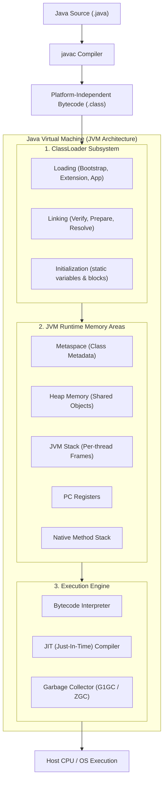
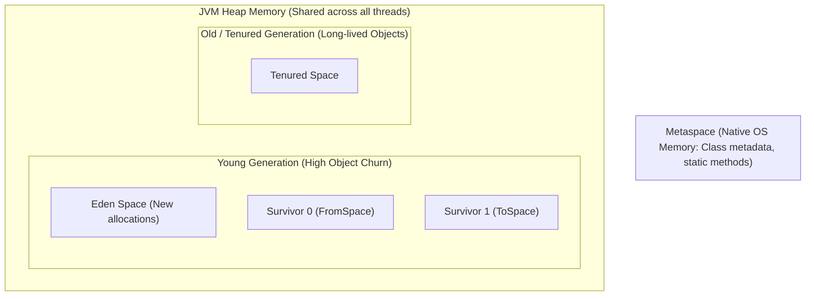
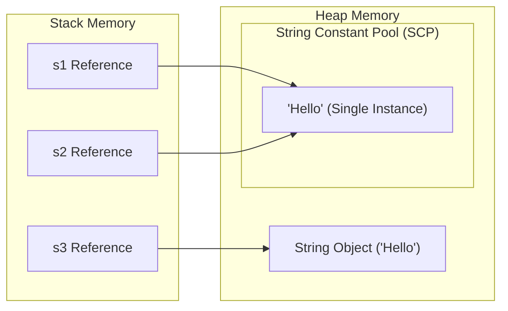
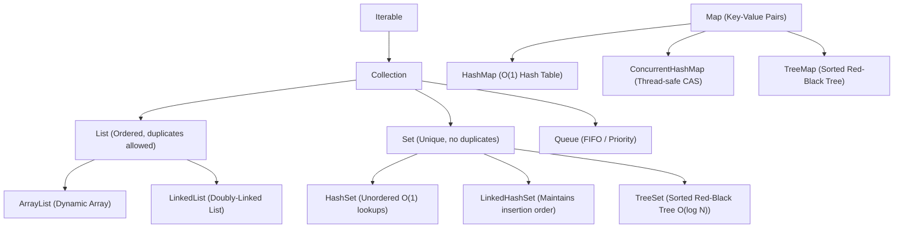
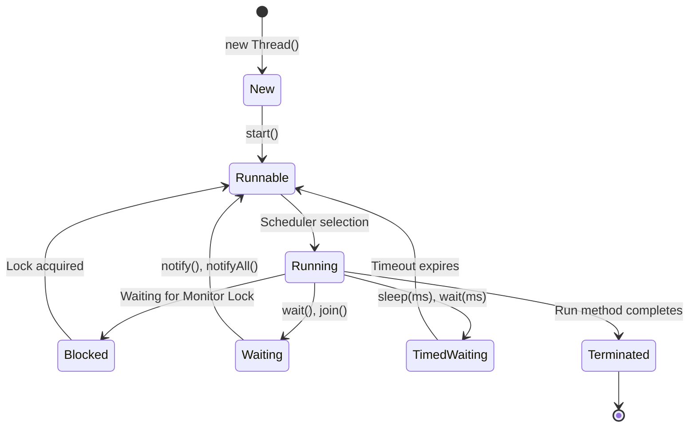

# Java Master Reference & JVM Internals Guide

---

## 1. JVM Architecture & Execution Pipeline

Java is a compiled and interpreted, platform-independent, object-oriented language adhering to the philosophy *"Write Once, Run Anywhere"* (WORA).



### JDK vs. JRE vs. JVM

| Component | Contains | Target Audience | Primary Purpose |
|---|---|---|---|
| **JVM** (Java Virtual Machine) | Runtime Engine, JIT, Garbage Collector | Abstract specification | Executes compiled `.class` bytecode into native machine instructions |
| **JRE** (Java Runtime Environment) | JVM + Core Class Libraries (`rt.jar`) | End users running Java apps | Minimum environment required to **run** Java applications |
| **JDK** (Java Development Kit) | JRE + Development Tools (`javac`, `jdb`, `javap`, `jar`)| Software Engineers | Comprehensive kit required to **develop, compile, and debug** Java apps |

---

## 2. JVM Memory Model & Garbage Collection



### Object Allocation Lifecycle
1. New objects are allocated in the **Eden Space**.
2. When Eden fills, a **Minor GC** triggers: surviving objects move to Survivor space (`S0` or `S1`) with an age counter incremented.
3. Objects that survive multiple GC cycles (default threshold: 15 cycles) are promoted to the **Tenured (Old) Generation**.
4. When the Old Generation fills, a **Major / Full GC** executes.

### Modern Garbage Collectors
* **G1GC (Garbage-First GC):** Default since Java 9. Divides the heap into hundreds of small equal regions; prioritizes collecting regions with the most garbage first to minimize Stop-The-World (STW) pauses.
* **ZGC (Z Garbage Collector):** Scalable low-latency GC capable of handling multi-terabyte heaps with STW pause times strictly under 1 millisecond.

---

## 3. String Immutability & Memory Pooling

In Java, `String` objects are immutable for security, thread safety, and memory optimization via the **String Constant Pool (SCP)**.



```java
String s1 = "Hello";                  // Reuses string literal from SCP
String s2 = "Hello";                  // Points to the SAME memory address
String s3 = new String("Hello");      // Forces a distinct new Heap object

System.out.println(s1 == s2);         // true (Identical reference)
System.out.println(s1 == s3);         // false (Different memory objects)
System.out.println(s1.equals(s3));    // true (Identical character sequence)
```

### `String` vs. `StringBuilder` vs. `StringBuffer`

| Class | Mutability | Thread-Safety | Synchronization | Relative Performance |
|---|---|---|---|---|
| **`String`** | **Immutable** | Yes (inherent) | No | Slower for frequent concatenation (creates garbage objects) |
| **`StringBuilder`**| **Mutable** | **No** (Unsynchronized)| No | **Fastest**; ideal for single-threaded string construction |
| **`StringBuffer`** | **Mutable** | **Yes** (Thread-safe) | Yes (`synchronized` methods)| Slower due to lock acquisition overhead |

---

## 4. Java Collections Framework (JCF)



### `HashMap` Internal Mechanics
* Internally structured as an array of buckets (`Node<K, V>[] table`).
* Index calculated via hash distribution:
  $$\text{index} = \text{hash}(key) \ \& \ (n - 1)$$
* **Collision Resolution:** Uses Separate Chaining (Linked List).
* **Java 8 Treeification:** When the number of colliding elements in a single bucket reaches **8** (and total table capacity $\ge 64$), the bucket converts from a linked list ($O(N)$ lookup) to a balanced **Red-Black Tree ($O(\log N)$ lookup)**.

---

## 5. Multithreading, Concurrency & Synchronization



### Thread Safety Primitives
```java
public class ThreadSafeCounter {
    private int count = 0;
    private volatile boolean running = true; // Prevents CPU thread-caching; direct RAM read

    // Synchronized method locks on 'this' instance monitor
    public synchronized void increment() {
        count++;
    }

    // Synchronized block (finer-grained lock scoping)
    public void incrementBlock() {
        synchronized(this) {
            count++;
        }
    }
}
```

---

## 6. Modern Java 8+ Features: Streams & Lambdas

```java
import java.util.*;
import java.util.stream.Collectors;

public class Java8Mastery {
    public static void main(String[] args) {
        List<String> names = Arrays.asList("Kowshik", "FlyRank", "DayZero", "AI", "FastAPI");

        // Declarative Stream Pipeline: Filter -> Transform -> Sort -> Collect
        List<String> result = names.stream()
            .filter(name -> name.length() > 3)
            .map(String::toUpperCase)
            .sorted()
            .collect(Collectors.toList());

        System.out.println(result); // [DAYZERO, FASTAPI, FLYRANK, KOWSHIK]

        // Optional to prevent NullPointerException
        Optional<String> match = names.stream()
            .filter(n -> n.startsWith("D"))
            .findFirst();

        match.ifPresent(val -> System.out.println("Found: " + val));
    }
}
```

---

## 7. Top 20 High-Yield Java Interview Questions

1. **Why is `String` immutable in Java?**
   * *Answer:* (1) **String Pool Optimization:** Allows identical string literals to share memory in the SCP. (2) **Security:** Strings carry sensitive database credentials, network URLs, and usernames; mutability would allow malicious tampering. (3) **Thread-Safety:** Being immutable, string instances are inherently thread-safe without synchronization locks. (4) **Hashcode Caching:** The hash code is computed once during creation and cached (`hash`), making operations in `HashMap` and `HashSet` blazing fast.
2. **What is the difference between `final`, `finally`, and `finalize`?**
   * *Answer:*
     * **`final`:** Keyword used to make a variable constant, prevent method overriding, or prevent class inheritance.
     * **`finally`:** Block in exception handling that executes unconditionally after `try-catch`, regardless of whether an exception was raised.
     * **`finalize()`:** Deprecated protected method on `Object` invoked by the garbage collector before reclaiming an object (superseded by `Cleaner` and `PhantomReference`).
3. **What is the difference between Checked and Unchecked Exceptions?**
   * *Answer:* Checked exceptions inherit from `Exception` (excluding `RuntimeException`); they represent recoverable conditions and are verified at compile time (must be caught via `try-catch` or declared via `throws`). Unchecked exceptions inherit from `RuntimeException` or `Error`; they reflect programming defects (`NullPointerException`, `ArithmeticException`) and do not require compile-time enforcement.
4. **How does `ConcurrentHashMap` achieve thread-safety without locking the entire map?**
   * *Answer:* Unlike `Hashtable` or `Collections.synchronizedMap` which lock the entire object for all operations, Java 8 `ConcurrentHashMap` uses Compare-And-Swap (CAS) lock-free operations for node insertions on empty buckets, and synchronizes only on the head node of a specific bucket during collisions. Reads (`get()`) are completely lock-free via `volatile` value pointers.

## 8. Generics & Wildcard Type Bounds

Generics provide compile-time type safety and eliminate runtime `ClassCastException`. In Java, generics use **Type Erasure** (compiler removes type parameters after checking, compiling to raw Object or upper bound).

```java
import java.util.*;

public class GenericsMastery {
    // Producer Extends: Covariant read-only access (PECS rule)
    public static double sumOfNumbers(List<? extends Number> list) {
        double sum = 0.0;
        for (Number n : list) {
            sum += n.doubleValue();
        }
        return sum;
    }

    // Consumer Super: Contravariant write-only access (PECS rule)
    public static void addIntegers(List<? super Integer> list) {
        list.add(10);
        list.add(20);
    }
}
```

---

## 9. Advanced Concurrency: ExecutorService & CountDownLatch

```java
import java.util.concurrent.*;

public class ConcurrencyPoolExample {
    public static void main(String[] args) throws InterruptedException {
        // Controlled Thread Pool
        ExecutorService executor = Executors.newFixedThreadPool(4);
        CountDownLatch latch = new CountDownLatch(3); // 3 worker tasks

        for (int i = 1; i <= 3; i++) {
            final int taskId = i;
            executor.submit(() -> {
                try {
                    System.out.println("Processing async task " + taskId + " on " + Thread.currentThread().getName());
                    Thread.sleep(500);
                } catch (InterruptedException e) {
                    Thread.currentThread().interrupt();
                } finally {
                    latch.countDown(); // Decrement latch count
                }
            });
        }

        latch.await(); // Main thread blocks until all 3 tasks complete
        System.out.println("All tasks finished successfully. Shutting down pool.");
        executor.shutdown();
    }
}
```
