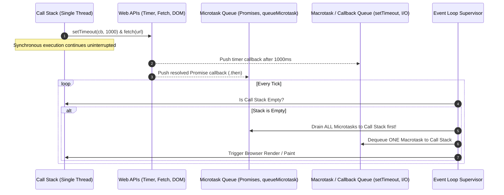
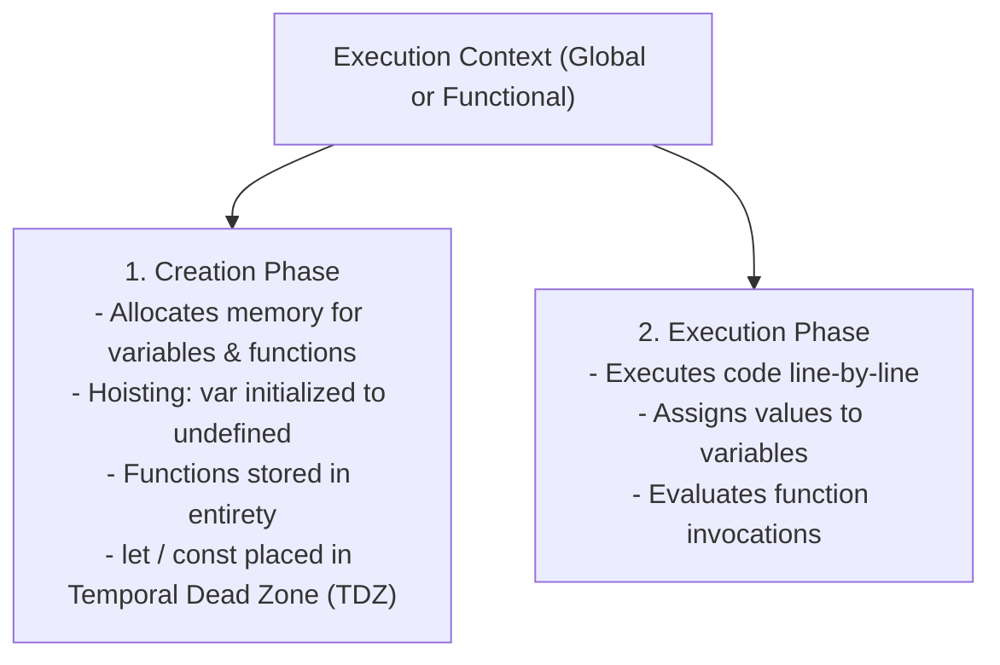
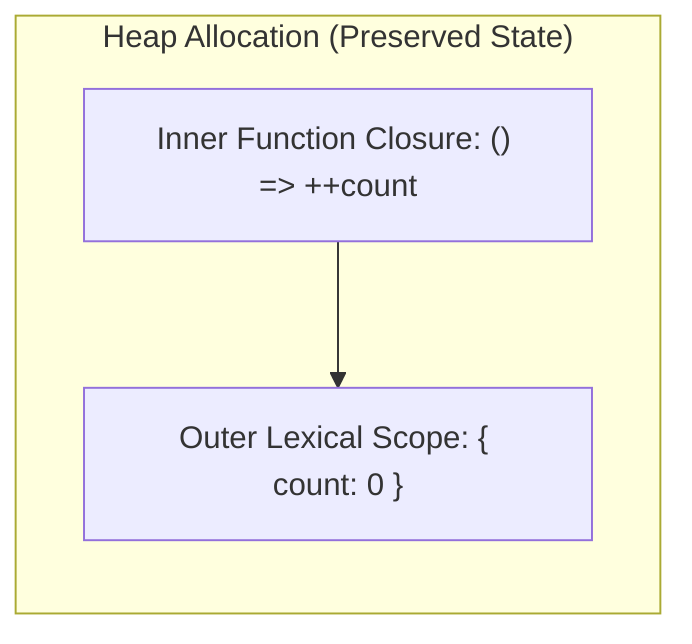
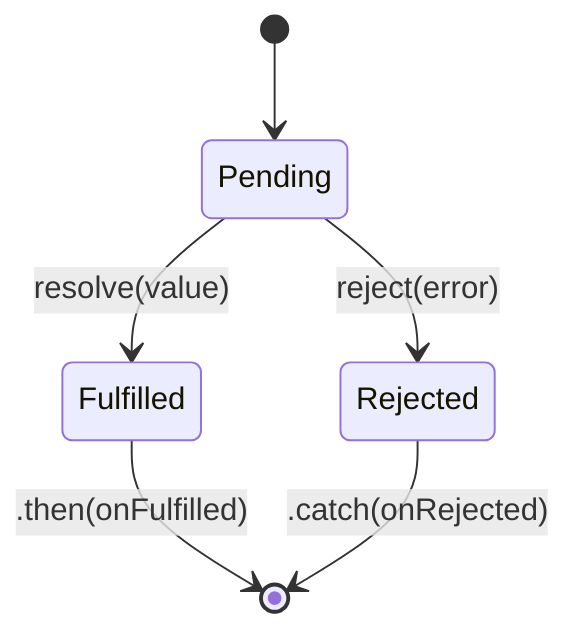
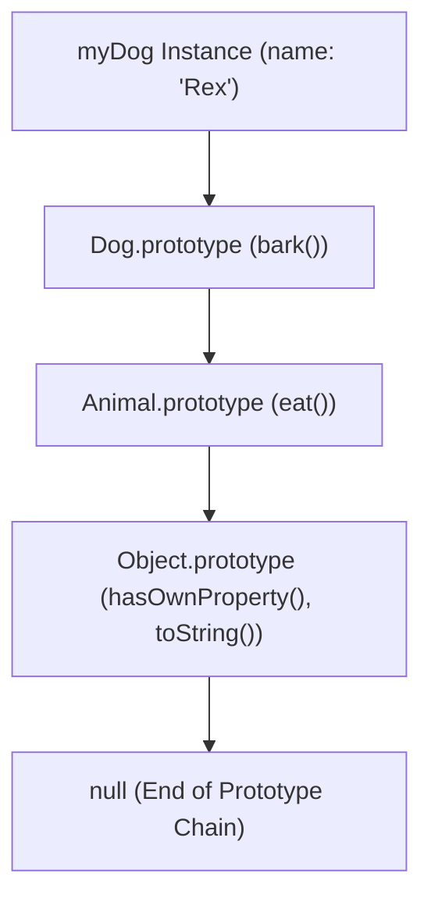
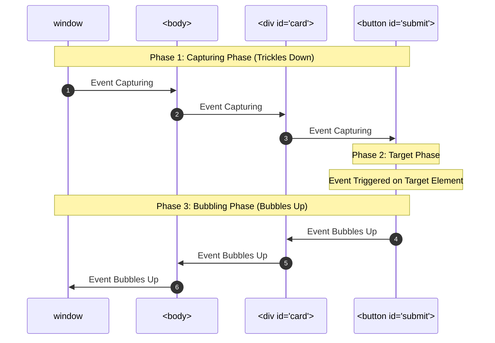

# JavaScript Master Reference & Engine Internals Guide

---

## 1. JavaScript Runtime Architecture & The Event Loop

JavaScript is a single-threaded, non-blocking, asynchronous concurrent runtime powered by an engine (like Google V8 in Chrome/Node.js).



> **Microtasks vs. Macrotasks Priority:** The Event Loop **always** completely drains the entire Microtask Queue (including newly queued microtasks) before processing the next single Macrotask.

---

## 2. Execution Context, Hoisting & Scoping



### `var` vs. `let` vs. `const`

| Feature | `var` | `let` | `const` |
|---|---|---|---|
| **Scope** | **Function-scoped** | **Block-scoped** `{ ... }` | **Block-scoped** `{ ... }` |
| **Hoisting** | Hoisted; initialized as `undefined` | Hoisted; kept in **Temporal Dead Zone (TDZ)** | Hoisted; kept in **TDZ** |
| **Re-declaration** | Allowed in same scope | Throws `SyntaxError` | Throws `SyntaxError` |
| **Re-assignment** | Allowed | Allowed | Throws `TypeError` |

### The Temporal Dead Zone (TDZ)
The region of a scope between entering the block and the actual line where a `let` or `const` is declared:
```javascript
{
    // TDZ for myVar starts here
    // console.log(myVar); // ReferenceError: Cannot access 'myVar' before initialization
    let myVar = 42; // TDZ ends here
    console.log(myVar); // 42
}
```

---

## 3. Closures & Practical Design Patterns

A **Closure** is the combination of a function bundled together with references to its surrounding lexical state (`LexicalEnvironment`), enabling the inner function to access outer variables even after the outer function has returned.



```javascript
// Data Privacy / Encapsulation via Closure
function createRateLimiter(maxRequests) {
    let requestCount = 0; // Private enclosed state

    return {
        attemptRequest: function () {
            if (requestCount >= maxRequests) {
                return false;
            }
            requestCount++;
            return true;
        },
        reset: function () {
            requestCount = 0;
        }
    };
}

const limiter = createRateLimiter(3);
console.log(limiter.attemptRequest()); // true
console.log(limiter.attemptRequest()); // true
console.log(limiter.attemptRequest()); // true
console.log(limiter.attemptRequest()); // false
```

---

## 4. The `this` Keyword & Dynamic Binding

In JavaScript, `this` is not bound to where a function is declared; it depends on **how the function is invoked**:
1. **Default Binding:** In standalone invocations (`foo()`), `this` points to the `globalThis` (`window` in browser), or `undefined` in `'use strict'`.
2. **Implicit Binding:** When invoked as an object method (`obj.foo()`), `this` refers to `obj`.
3. **Explicit Binding (`call`, `apply`, `bind`):**
   * `fn.call(context, arg1, arg2)`: Invokes immediately with comma-separated arguments.
   * `fn.apply(context, [arg1, arg2])`: Invokes immediately with an array of arguments.
   * `const bound = fn.bind(context)`: Returns a new function with fixed `this`.
4. **`new` Binding:** When instantiated via `new Foo()`, `this` references the freshly created empty object.
5. **Arrow Functions:** **Have NO `this` of their own!** They capture `this` lexically from their enclosing scope at definition time.

---

## 5. Asynchronous JavaScript: Promises & `async`/`await`



### Static Promise Combinators

| Combinator | Resolves When | Rejects When | Typical Use Case |
|---|---|---|---|
| `Promise.all([p1, p2])` | **All** promises fulfill | **First** promise rejects (Fail-Fast)| Fetching dependent parallel data |
| `Promise.allSettled([p1, p2])`| **All** promises settle (either fulfill or reject)| Never rejects | Batch jobs where partial failures are acceptable |
| `Promise.race([p1, p2])` | **First** promise settles (fulfills or rejects) | **First** promise settles | Enforcing timeout limits on network requests |
| `Promise.any([p1, p2])` | **First** promise fulfills | **All** promises reject (`AggregateError`) | Fetching identical asset from fastest mirror/CDN |

```javascript
// Clean async/await with error boundary
async function fetchStartupData(startupId) {
    try {
        const response = await fetch(`https://api.dayzero.ai/v1/startups/${startupId}`);
        if (!response.ok) {
            throw new Error(`HTTP Error: ${response.status}`);
        }
        const data = await response.json();
        return data;
    } catch (error) {
        console.error("Failed to load startup metrics:", error.message);
        throw error;
    }
}
```

---

## 6. Prototypal Inheritance & Modern ES6 Classes

Unlike class-based languages (Java, C++), JavaScript objects link directly to other objects via an internal hidden link `[[Prototype]]` (accessible via `Object.getPrototypeOf()` or `__proto__`).



```javascript
class Animal {
    constructor(name) {
        this.name = name;
    }
    eat() {
        return `${this.name} is eating.`;
    }
}

class Dog extends Animal {
    constructor(name, breed) {
        super(name); // Invokes parent constructor
        this.breed = breed;
    }
    bark() {
        return `${this.name} barks loudly!`;
    }
}

const rex = new Dog("Rex", "German Shepherd");
console.log(rex.bark()); // Rex barks loudly!
console.log(rex.eat());  // Rex is eating. (Traversed prototype chain)
```

---

## 7. DOM Events: Bubbling, Capturing & Event Delegation



### Event Delegation Pattern
Attaching a single event listener to a common parent rather than separate listeners on thousands of dynamic children:
```javascript
// High-performance event delegation on dynamic list
document.querySelector("#item-list").addEventListener("click", function (event) {
    if (event.target.matches("button.delete-btn")) {
        const itemId = event.target.dataset.id;
        console.log(`Deleting item ${itemId}`);
    }
});
```

---

## 8. Top 20 High-Yield JavaScript Interview Questions

1. **What is the difference between `==` and `===`?**
   * *Answer:* `==` performs loose equality with implicit **type coercion** before comparing values (e.g., `0 == false` is `true`, `"" == 0` is `true`). `===` performs strict equality checking both value and data type without coercion (e.g., `0 === false` is `false`).
2. **What causes a Memory Leak in JavaScript and how do you prevent it?**
   * *Answer:* Common causes: (1) Forgotten timers (`setInterval`) or unremoved event listeners holding references to detached DOM elements, (2) Unintentional global variables, (3) Closures holding references to massive data structures, and (4) Storing references in Maps/Sets instead of `WeakMap`/`WeakSet` (which allow garbage collection).
3. **What is Debouncing vs. Throttling?**
   * *Answer:*
     * **Debounce:** Delays executing a function until a specified period of inactivity has elapsed since the last event (e.g., search autocomplete input).
     * **Throttle:** Enforces a maximum execution rate, executing the function at most once per fixed time interval regardless of invocation frequency (e.g., window scrolling or resizing).
4. **What is Currying in JavaScript?**
   * *Answer:* Currying is a functional programming technique where a function with multiple arguments is transformed into a sequence of nested functions that take one argument at a time: `f(a, b, c) -> f(a)(b)(c)`.

## 9. Higher-Order Functional Array Operations

```javascript
const transactions = [
    { id: 1, type: "income", amount: 1200 },
    { id: 2, type: "expense", amount: 450 },
    { id: 3, type: "income", amount: 800 },
    { id: 4, type: "expense", amount: 200 }
];

// 1. Chained Transformation: Filter -> Map -> Reduce
const netIncome = transactions
    .filter(t => t.type === "income")
    .map(t => t.amount)
    .reduce((accumulator, current) => accumulator + current, 0);

console.log("Net Income:", netIncome); // 2000

// 2. Efficient Flattening with flatMap()
const userOrders = [
    { user: "Kowshik", items: ["Laptop", "Monitor"] },
    { user: "Alex", items: ["Keyboard"] }
];
const allItems = userOrders.flatMap(o => o.items);
console.log(allItems); // ['Laptop', 'Monitor', 'Keyboard']
```

---

## 10. Practical Debounce & Throttle Implementations

```javascript
// Debounce: Executes after inactivity threshold
function debounce(fn, delayMs) {
    let timerId = null;
    return function (...args) {
        clearTimeout(timerId);
        timerId = setTimeout(() => {
            fn.apply(this, args);
        }, delayMs);
    };
}

// Throttle: Executes at most once per interval
function throttle(fn, intervalMs) {
    let lastExecuted = 0;
    return function (...args) {
        const now = Date.now();
        if (now - lastExecuted >= intervalMs) {
            lastExecuted = now;
            fn.apply(this, args);
        }
    };
}

// Usage in DOM event listeners
const handleSearch = debounce((query) => {
    console.log("Searching API for:", query);
}, 300);

const handleScroll = throttle(() => {
    console.log("Tracking scroll position:", window.scrollY);
}, 200);
```
