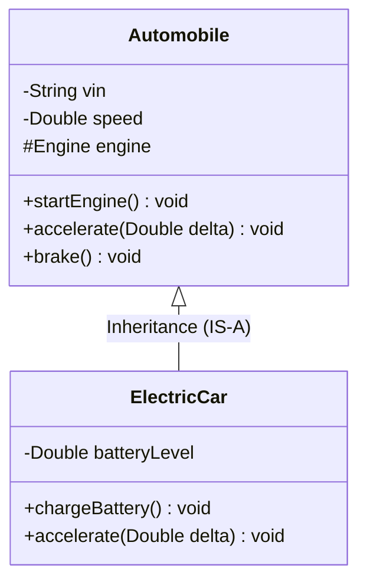
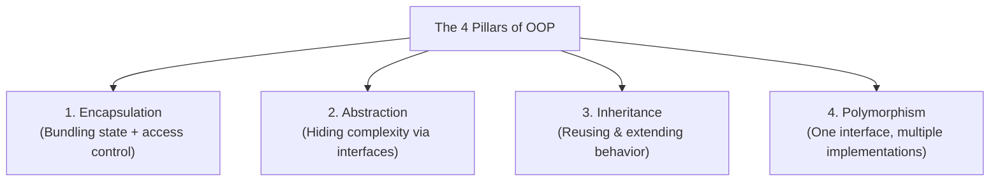
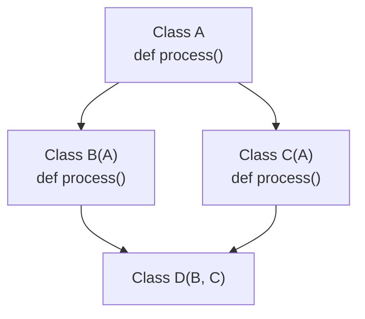
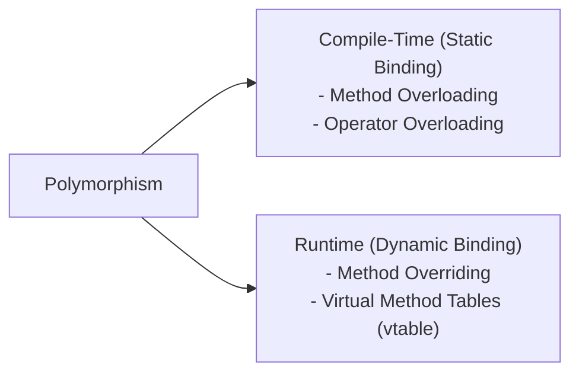
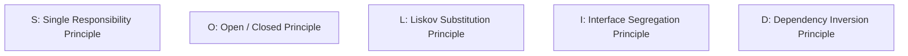

# Object-Oriented Programming (OOP) & SOLID Principles Master Reference

---

## 1. Paradigm Overview & Fundamental Philosophy

Object-Oriented Programming (OOP) models software systems as collections of interacting **objects**, each encapsulating internal state (attributes/data) and behavior (methods/functions).



### Procedural Programming vs. Object-Oriented Programming

| Dimension | Procedural Programming (C, Pascal) | Object-Oriented Programming (Python, Java, C++) |
|---|---|---|
| **Primary Unit** | Functions / Procedures and global data | Classes and Objects |
| **Data Focus** | Functions operate freely on shared data; weak data hiding | Data is encapsulated within objects; access is restricted |
| **Execution Flow** | Step-by-step top-down flow | Bottom-up modeling of collaborating entities |
| **Code Reusability** | Limited to function calls; high boilerplate | High via inheritance, polymorphism, and composition |
| **Security** | Low; vulnerable to global state mutation | High via access specifiers and data encapsulation |
| **Scalability** | Becomes brittle and hard to maintain as LOC grows | Highly modular; decoupled architecture with high maintainability |

---

## 2. The Four Pillars of OOP



### Pillar 1: Encapsulation & Data Hiding
* **Encapsulation:** Wrapping attributes and methods together into a cohesive class boundary.
* **Data Hiding:** Protecting sensitive object state from arbitrary direct mutation by external callers.

```python
class BankAccount:
    def __init__(self, owner: str, initial_balance: float = 0.0):
        self.owner = owner
        self.__balance = initial_balance  # Private attribute (name-mangled)
        self._audit_log = []              # Protected attribute (convention)

    def deposit(self, amount: float) -> None:
        if amount <= 0:
            raise ValueError("Deposit amount must be positive.")
        self.__balance += amount
        self._audit_log.append(f"Deposited {amount}")

    def withdraw(self, amount: float) -> float:
        if amount > self.__balance:
            raise ValueError("Insufficient funds.")
        self.__balance -= amount
        self._audit_log.append(f"Withdrew {amount}")
        return amount

    # Getter property
    @property
    def balance(self) -> float:
        return self.__balance
```

### Pillar 2: Abstraction
Hiding internal implementation mechanisms and exposing only a clean, minimal public contract.

```python
from abc import ABC, abstractmethod

class PaymentGateway(ABC):
    @abstractmethod
    def authorize_payment(self, amount: float) -> bool:
        """Authorize the charge with upstream processor."""
        pass

    @abstractmethod
    def capture_payment(self, transaction_id: str) -> None:
        """Capture the authorized funds."""
        pass

class StripePaymentGateway(PaymentGateway):
    def authorize_payment(self, amount: float) -> bool:
        # Complex HMAC signatures, REST payloads, TLS validation hidden from caller
        print(f"Stripe: Authorized ${amount:.2f}")
        return True

    def capture_payment(self, transaction_id: str) -> None:
        print(f"Stripe: Captured {transaction_id}")
```

### Pillar 3: Inheritance & The Diamond Problem
Enables child classes to inherit attributes and behaviors from parent classes (IS-A relationship).



#### The Diamond Problem & Method Resolution Order (MRO)
When class `D` inherits from both `B` and `C` (which both inherit from `A`), which implementation of `process()` does `D` execute?
* **Python's Solution:** C3 Linearization Algorithm. Resolves order deterministically using `ClassName.__mro__`.
* **Java's Solution:** Does not support multiple class inheritance. Solves interface diamond conflicts by requiring child classes to explicitly override conflicting `default` methods.

```python
class A:
    def process(self): return "A"

class B(A):
    def process(self): return "B"

class C(A):
    def process(self): return "C"

class D(B, C):
    pass

d = D()
print(d.process())  # Outputs 'B'
print(D.__mro__)   # D -> B -> C -> A -> object
```

### Pillar 4: Polymorphism (Static vs. Dynamic)



#### Overloading vs. Overriding

| Feature | Method Overloading (Compile-Time) | Method Overriding (Runtime) |
|---|---|---|
| **Location** | Within the **same class** | Between **Parent and Child classes** |
| **Signature** | Same method name, **different parameters** | **Identical** method name, parameters, and return type |
| **Binding Time** | Resolved at compile time (Static binding) | Resolved at runtime based on the actual object (Dynamic binding) |
| **Python Context**| Python does not natively support multiple signatures; uses default args or `functools.singledispatch` | Fully supported via standard class inheritance |

```python
class Animal:
    def speak(self) -> str:
        return "Generic vocalization"

class Dog(Animal):
    def speak(self) -> str:
        return "Woof!"

class Cat(Animal):
    def speak(self) -> str:
        return "Meow!"

# Runtime Polymorphic Dispatch
animals = [Dog(), Cat(), Animal()]
for a in animals:
    print(a.speak())  # Dynamically calls correct subclass implementation
```

---

## 3. Object Relationships: Association, Aggregation & Composition

```mermaid
classDiagram
    direction LR
    class Company {
        -String name
    }
    class Department {
        -String deptName
    }
    class Employee {
        -String name
    }
    Company *-- Department : Composition (Strong: Dept dies if Company dies)
    Department o-- Employee : Aggregation (Weak: Employee exists independently)
```

| Relationship | Coupling Level | Lifecycle Dependency | Example |
|---|---|---|---|
| **Association** | Loose | Independent; objects simply use each other | Driver uses Car |
| **Aggregation (HAS-A)** | Moderate | Weak ownership; child can exist independently of container | Department has Employees (If Dept closes, employees exist) |
| **Composition (HAS-A)**| High | Strong ownership; child cannot exist without container | House has Rooms (If House is destroyed, Rooms are destroyed) |

> **Best Practice Rule:** *Favor Composition over Inheritance.* Inheritance tightly couples subclasses to superclass implementations. Composition allows swapping behaviors at runtime.

---

## 4. SOLID Principles: In-Depth Production Refactoring



### S — Single Responsibility Principle (SRP)
> *"A class should have one, and only one, reason to change."*

```python
# ❌ VIOLATION: User class manages state, persistence, and email notification
class User:
    def __init__(self, username: str, email: str):
        self.username = username
        self.email = email

    def save_to_database(self):
        # Database logic
        pass

    def send_welcome_email(self):
        # SMTP logic
        pass

# ✅ ADHERENCE: Segregated concerns into single-purpose components
class User:
    def __init__(self, username: str, email: str):
        self.username = username
        self.email = email

class UserRepository:
    def save(self, user: User) -> None:
        print(f"Persisting {user.username} to PostgreSQL")

class EmailService:
    def send_welcome(self, user: User) -> None:
        print(f"Sending onboarding email to {user.email}")
```

### O — Open/Closed Principle (OCP)
> *"Software entities should be open for extension, but closed for modification."*

```python
# ❌ VIOLATION: Adding a new shape requires modifying the area calculator with another if/elif
class AreaCalculator:
    def calculate(self, shape):
        if shape.type == "circle":
            return 3.1415 * (shape.radius ** 2)
        elif shape.type == "rectangle":
            return shape.width * shape.height

# ✅ ADHERENCE: Polymorphic interface; new shapes are added without editing existing logic
from abc import ABC, abstractmethod

class Shape(ABC):
    @abstractmethod
    def area(self) -> float:
        pass

class Circle(Shape):
    def __init__(self, radius: float):
        self.radius = radius
    def area(self) -> float:
        return 3.14159 * (self.radius ** 2)

class Rectangle(Shape):
    def __init__(self, width: float, height: float):
        self.width = width
        self.height = height
    def area(self) -> float:
        return self.width * self.height
```

### L — Liskov Substitution Principle (LSP)
> *"Derived classes must be substitutable for their base classes without altering program correctness."*

```python
# ❌ VIOLATION: Square changes the behavior of Rectangle, breaking expectations
class Rectangle:
    def __init__(self, w: float, h: float):
        self.w = w
        self.h = h
    def set_width(self, w): self.w = w
    def set_height(self, h): self.h = h

class Square(Rectangle):
    def set_width(self, w):
        self.w = w
        self.h = w  # Unexpected side-effect on height!

# ✅ ADHERENCE: Decouple distinct geometries via shared abstract interfaces
class Shape(ABC):
    @abstractmethod
    def area(self) -> float: pass
```

### I — Interface Segregation Principle (ISP)
> *"Clients should not be forced to depend on interfaces they do not use."*

```python
# ❌ VIOLATION: Bloated 'Fat' interface
class Worker(ABC):
    @abstractmethod
    def code(self): pass
    @abstractmethod
    def eat(self): pass

# ✅ ADHERENCE: Role-specific segregated interfaces
class Workable(ABC):
    @abstractmethod
    def work(self): pass

class Eatable(ABC):
    @abstractmethod
    def eat(self): pass

class HumanWorker(Workable, Eatable):
    def work(self): print("Working...")
    def eat(self): print("Eating lunch...")

class RobotWorker(Workable):
    def work(self): print("Working 24/7...")
    # Robot is not forced to implement eat()
```

### D — Dependency Inversion Principle (DIP)
> *"High-level modules should not depend on low-level modules. Both should depend on abstractions."*

```python
# ❌ VIOLATION: High-level Notification directly creates concrete low-level TwilioClient
class NotificationService:
    def __init__(self):
        self.client = TwilioClient()  # Hard-coded tight coupling

# ✅ ADHERENCE: Depend on abstract sender interface (Dependency Injection)
class MessageSender(ABC):
    @abstractmethod
    def send(self, recipient: str, body: str) -> None: pass

class TwilioSMS(MessageSender):
    def send(self, recipient: str, body: str) -> None:
        print(f"SMS to {recipient}: {body}")

class SendGridEmail(MessageSender):
    def send(self, recipient: str, body: str) -> None:
        print(f"Email to {recipient}: {body}")

class NotificationService:
    def __init__(self, sender: MessageSender):
        self.sender = sender  # Injected dependency

    def notify(self, user: str, msg: str):
        self.sender.send(user, msg)
```

---

## 5. Core Design Patterns (GoF)

### 1. Singleton (Thread-Safe)
Ensures a class has only one instance and provides a global point of access.

```python
import threading

class DatabaseConnectionPool:
    _instance = None
    _lock = threading.Lock()

    def __new__(cls, *args, **kwargs):
        if not cls._instance:
            with cls._lock:
                if not cls._instance:  # Double-checked locking
                    cls._instance = super().__new__(cls)
                    cls._instance._init_pool()
        return cls._instance

    def _init_pool(self):
        print("Initializing 20 DB connection handles...")
```

### 2. Factory Pattern
Defines an interface for creating objects, delegating instantiation to subclasses.

```python
class Logger(ABC):
    @abstractmethod
    def log(self, message: str) -> None: pass

class FileLogger(Logger):
    def log(self, msg: str): print(f"File log: {msg}")

class CloudWatchLogger(Logger):
    def log(self, msg: str): print(f"CloudWatch log: {msg}")

class LoggerFactory:
    @staticmethod
    def get_logger(env: str) -> Logger:
        if env == "production":
            return CloudWatchLogger()
        return FileLogger()
```

### 3. Strategy Pattern
Defines a family of algorithms, encapsulating each one and making them interchangeable at runtime.

```python
class DiscountStrategy(ABC):
    @abstractmethod
    def apply_discount(self, total: float) -> float: pass

class FestiveDiscount(DiscountStrategy):
    def apply_discount(self, total: float) -> float: return total * 0.85

class VIPDiscount(DiscountStrategy):
    def apply_discount(self, total: float) -> float: return total * 0.70

class ShoppingCart:
    def __init__(self, strategy: DiscountStrategy):
        self.strategy = strategy
    def checkout(self, amount: float) -> float:
        return self.strategy.apply_discount(amount)
```
