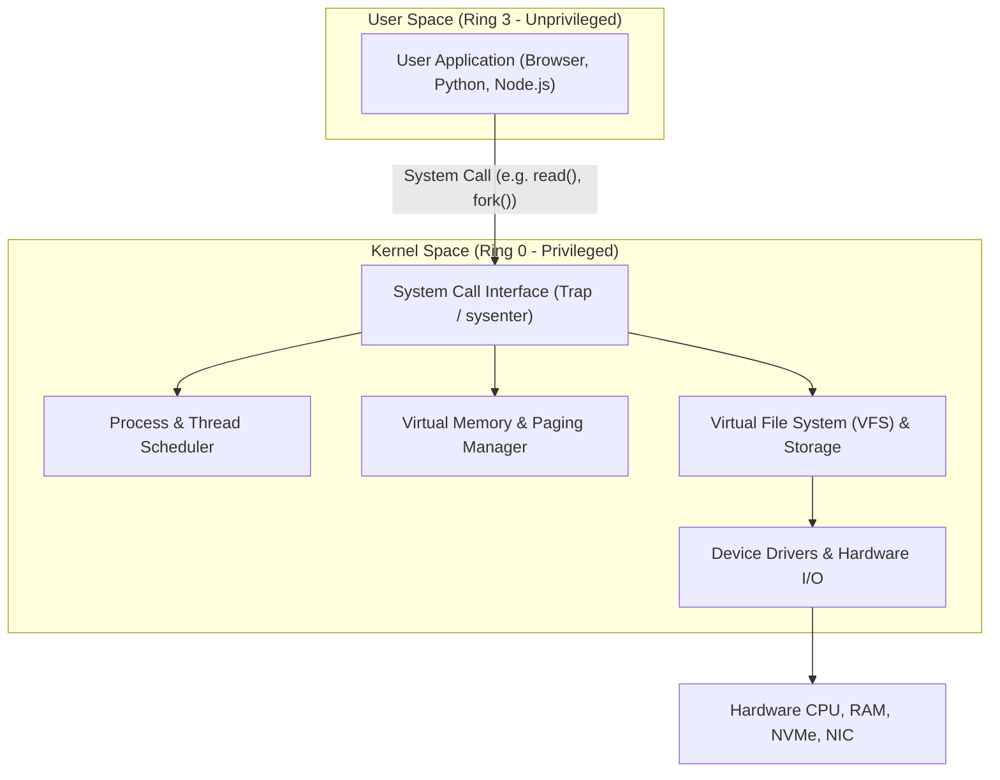
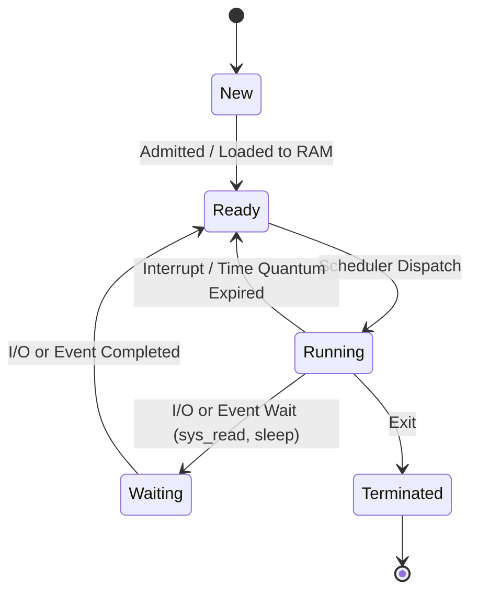
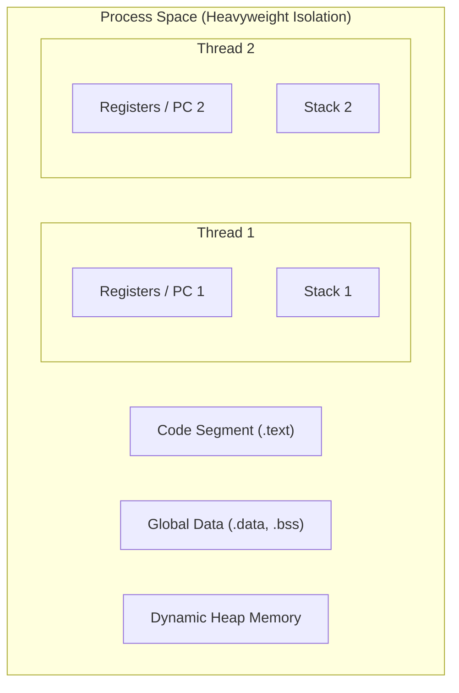
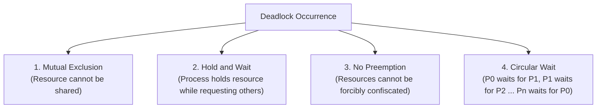
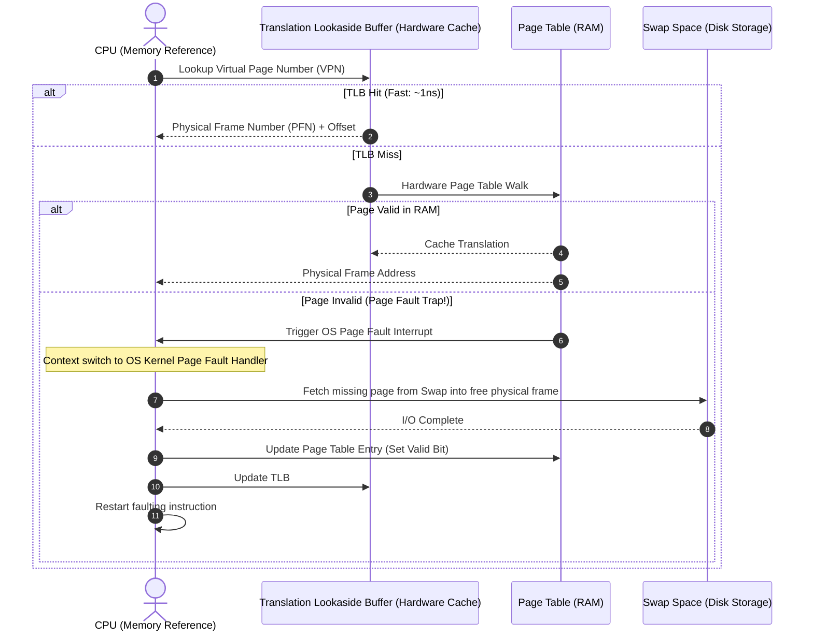
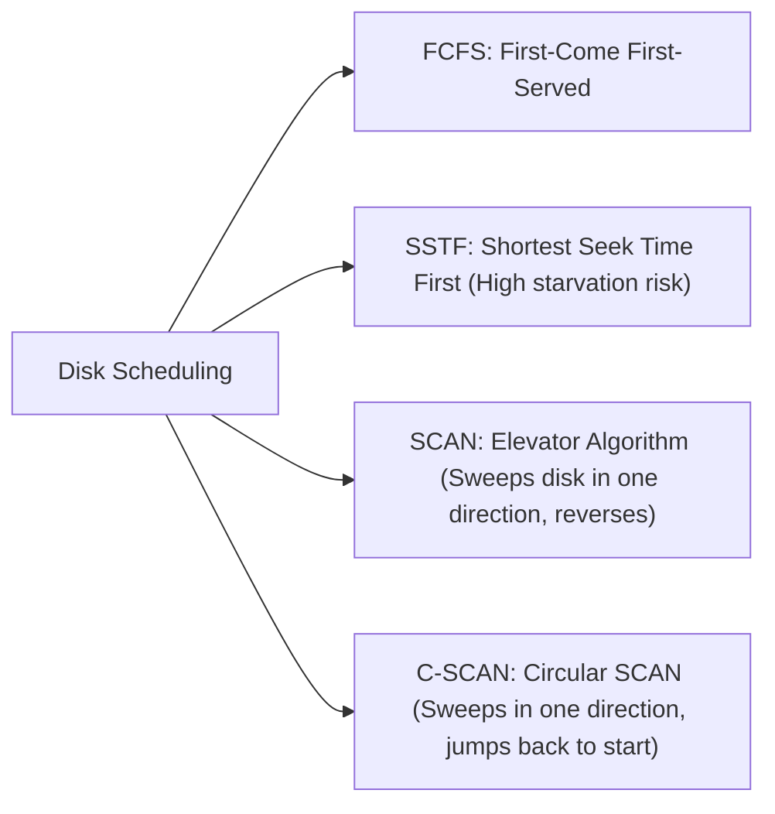
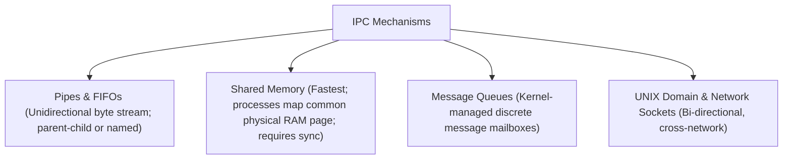

# Operating Systems Master Reference & Internals Guide

---

## 1. Operating System Architecture & Dual-Mode Execution

An Operating System manages computer hardware, provides execution environments for application programs, and acts as an intermediary between users and computer hardware.



### Monolithic Kernel vs. Microkernel

| Dimension | Monolithic Kernel (Linux, macOS) | Microkernel (QNX, seL4, Minix) |
|---|---|---|
| **Core Architecture** | All OS services (VFS, IPC, drivers, networking) run inside kernel space | Only minimal primitives (IPC, low-level scheduling, memory paging) in kernel space |
| **Execution Speed** | Extremely fast; direct in-kernel function invocations | Slower; overhead from frequent context switches and IPC messages between user servers |
| **Fault Isolation** | Low; a single buggy device driver crash can kernel-panic the OS | High; crashed user-space driver/filesystem restarts without crashing kernel |
| **Codebase Size** | Millions of lines of code (Linux ~30M+ LOC) | Tens of thousands of lines of code (Easier to formally verify) |

---

## 2. Processes, Threads & Concurrency



### Process vs. Thread



| Feature | Process | Thread (Lightweight Process) |
|---|---|---|
| **Definition** | An independent program in execution | A basic unit of CPU execution within a process |
| **Address Space** | Dedicated, isolated virtual address space | Shares code, data, and heap with peer threads |
| **Context Switch Cost**| High; flushes TLB, updates MMU page table registers | Low; preserves page tables, updates registers and stack pointer |
| **Communication** | Inter-Process Communication (IPC: Pipes, Shared Memory, Sockets)| Fast shared memory access (requires synchronization) |
| **Failure Impact** | Crash in one process does not affect other processes | Crash in one thread (e.g., segfault) terminates the entire process |

---

## 3. CPU Scheduling Algorithms

CPU scheduling selects a process from the Ready queue to execute on the CPU core when the current process blocks or finishes its time slice.

### Scheduling Algorithms Comparison

| Algorithm | Preemptive? | Selection Criteria | Major Advantages | Critical Disadvantages |
|---|---|---|---|---|
| **FCFS** (First-Come, First-Served) | No | Arrival Time | Simple, zero scheduling overhead | **Convoy Effect:** Short jobs wait behind massive CPU-bound jobs |
| **SJF** (Shortest Job First) | No | Burst Time | Provably **optimal minimum average waiting time** | Impossible to know burst duration in advance |
| **SRTF** (Shortest Remaining Time First) | Yes | Remaining Burst Time | Highly responsive for short tasks | High context-switching overhead; potential starvation of long tasks |
| **Round Robin (RR)** | Yes | Fixed Time Quantum ($q$) | Fair share; ideal for interactive time-sharing | Sensitive to quantum size: $q$ too large $\to$ FCFS; $q$ too small $\to$ context switch thrashing |
| **Priority Scheduling** | Both | Integer Priority | Critical real-time tasks run first | **Starvation:** Solved via **Aging** (gradually raising priority over time) |
| **MLFQ** (Multilevel Feedback Queue) | Yes | Dynamic priority based on observed behavior | Separates I/O-bound from CPU-bound tasks automatically | Complex tuning of decay rates and promotion thresholds |

---

## 4. Process Synchronization & Deadlocks

### The Critical Section Problem
A segment of code accessing shared mutable resources. A valid solution must satisfy three conditions:
1. **Mutual Exclusion:** If process $P_i$ is executing in its critical section, no other process can enter.
2. **Progress:** If no process is in its critical section, only processes not in their remainder section can participate in deciding who enters next.
3. **Bounded Waiting:** A bound must exist on the number of times other processes are allowed to enter after a process has requested entry.

### Mutex vs. Semaphore

| Characteristic | Mutex (Mutual Exclusion Lock) | Counting Semaphore |
|---|---|---|
| **Mechanism** | Locking object with **ownership** | Signaling mechanism using integer counter |
| **Values** | Binary (0 or 1 / Locked or Unlocked) | Non-negative integer ($N \ge 0$) |
| **Ownership** | Only the thread that acquired the lock can release it | Any thread can post/signal the semaphore |
| **Primary Purpose**| Serializing access to a single shared resource | Managing a finite resource pool of size $N$ |

### Deadlocks & The 4 Coffman Conditions
A deadlock occurs when a set of processes are blocked because each is holding a resource and waiting for another resource held by another process. **All four conditions must hold simultaneously:**



#### Deadlock Handling Strategies
* **Prevention:** Invalidate at least one of the four Coffman conditions (e.g., impose strict global linear ordering on all resources to prevent circular wait).
* **Avoidance (Banker's Algorithm):** Dynamically inspects resource requests, ensuring system remains in a **Safe State** before granting allocation.
* **Detection & Recovery:** Periodically construct a Resource Allocation Graph (RAG); break deadlocks via process termination or resource preemption.
* **Ostrich Algorithm:** Ignore the problem if deadlocks occur rarely (standard approach in modern general-purpose OSs).

---

## 5. Memory Management, Paging & Virtual Memory



### Page Replacement Algorithms

* **FIFO (First-In, First-Out):** Replaces the oldest loaded page. Suffers from **Belady’s Anomaly** (increasing allocated page frames can paradoxically increase page fault frequency).
* **LRU (Least Recently Used):** Replaces the page that has not been referenced for the longest period. Optimal practical heuristic; implemented via hardware reference bits or aging registers.
* **Optimal (OPT / Belady's Algorithm):** Replaces the page that will not be used for the longest duration in the future. Theoretical benchmark; impossible to implement in general OSs.

### Thrashing
* **Definition:** A state where the CPU spends more time swapping pages in and out of secondary storage than executing user instructions.
* **Root Cause:** Total working set size of all active processes exceeds available physical RAM ($\sum WSS_i > \text{Total Physical Memory}$).
* **Solution:** Local page replacement, suspending/swapping entire processes to reduce multiprogramming degree.

---

## 6. Storage & Disk Scheduling

### Disk Scheduling Algorithms



### Inodes & File Systems (ext4 / Linux)
In Linux filesystems, an **Inode (Index Node)** stores all file metadata *except* the filename and raw data:
* File type and POSIX permissions (`rwxr-xr-x`)
* Owner UID and GID
* File size in bytes and timestamps (atime, mtime, ctime)
* Pointers to physical disk data blocks: Direct pointers, Single Indirect, Double Indirect, and Triple Indirect blocks.
* The directory itself is merely a special file mapping `filename -> inode_number`.

---

## 7. Top 20 High-Yield Operating Systems Interview Questions

1. **What is a System Call, and how does it transition between User and Kernel mode?**
   * *Answer:* A system call is the programmatic interface by which an application requests privileged services from the OS kernel. The application loads the syscall number into a CPU register and triggers a software interrupt (`trap` / `syscall` instruction). The CPU hardware switches privilege level from Ring 3 to Ring 0, saves the program counter and registers onto the kernel stack, and jumps to the kernel's System Call Dispatch Table.
2. **What is a Zombie Process vs. an Orphan Process?**
   * *Answer:*
     * **Zombie Process:** A process that has completed execution (`exit()`), but still has an entry in the Process Table because its parent has not yet read its exit status via `wait()` / `waitpid()`. Consumes a PID slot.
     * **Orphan Process:** A running process whose parent terminated prematurely. The `init` / `systemd` process (PID 1) automatically adopts the orphan and reaps it upon exit.
3. **What is Context Switching, and what causes its overhead?**
   * *Answer:* Context switching is the process of saving the execution state of the currently running process/thread and restoring the state of the next scheduled process. Overhead stems from: (1) Saving/restoring CPU registers, PC, and stack pointer, (2) Switching virtual address space (reloading CR3 register), and (3) Flushing the Translation Lookaside Buffer (TLB) and CPU L1/L2 hardware caches.
4. **Explain Belady’s Anomaly.**
   * *Answer:* Belady’s Anomaly is the phenomenon where allocating more physical memory page frames to a process leads to an *increase* in the number of page faults. It occurs in FIFO page replacement because FIFO is not a stack-based algorithm. It does not occur in LRU or Optimal.

## 8. Inter-Process Communication (IPC) & Classic Concurrency Problems



### The Producer-Consumer Solution using Semaphores
```c
#include <semaphore.h>
#include <pthread.h>

#define BUFFER_SIZE 5
int buffer[BUFFER_SIZE];
int in = 0, out = 0;

sem_t empty;  // Counts empty slots; initialized to BUFFER_SIZE
sem_t full;   // Counts filled slots; initialized to 0
pthread_mutex_t mutex; // Mutual exclusion lock for buffer index

void* producer(void* arg) {
    int item = 1;
    while(1) {
        sem_wait(&empty);               // Decrement empty slot count
        pthread_mutex_lock(&mutex);     // Lock critical section
        
        buffer[in] = item++;
        in = (in + 1) % BUFFER_SIZE;
        
        pthread_mutex_unlock(&mutex);   // Unlock critical section
        sem_post(&full);                // Increment filled slot count
    }
}

void* consumer(void* arg) {
    while(1) {
        sem_wait(&full);                // Decrement filled slot count
        pthread_mutex_lock(&mutex);     // Lock critical section
        
        int item = buffer[out];
        out = (out + 1) % BUFFER_SIZE;
        
        pthread_mutex_unlock(&mutex);   // Unlock critical section
        sem_post(&empty);               // Increment empty slot count
    }
}
```

---

## 9. Deadlock Avoidance: The Banker's Algorithm

The Banker's Algorithm guarantees that allocating resources will never transition the system into an **Unsafe State** (a state that could lead to a deadlock).

### Matrices Defined:
* **$Allocation[i][j]$:** Number of units of resource $R_j$ currently held by process $P_i$.
* **$Max[i][j]$:** Maximum units of resource $R_j$ process $P_i$ may request.
* **$Available[j]$:** Available units of resource $R_j$ in the system.
* **$Need[i][j]$:** Remaining resources required by $P_i$:
  $$Need[i][j] = Max[i][j] - Allocation[i][j]$$

### Safety Check Logic:
Find a sequence $\langle P_1, P_2, \dots, P_n 
angle$ such that for every process $P_i$:
$$Need_i \le Available$$
If such a sequence exists, the system is in a **Safe State**, and requests can be granted safely without deadlock risk.
