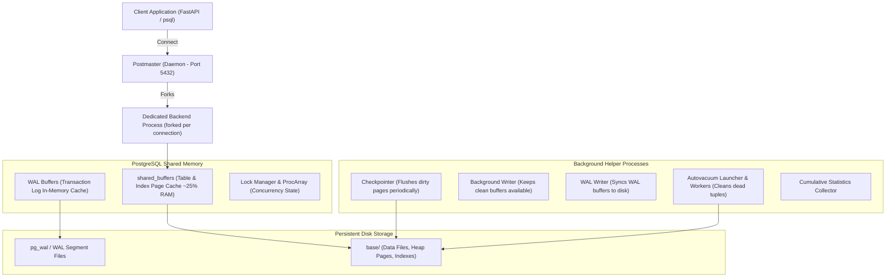
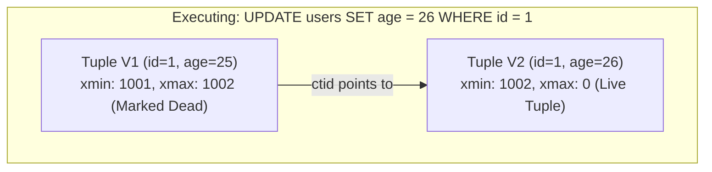
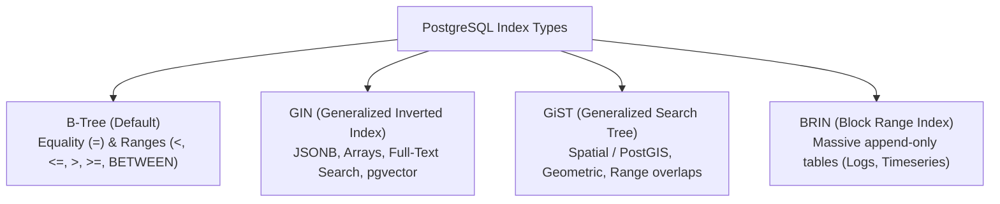
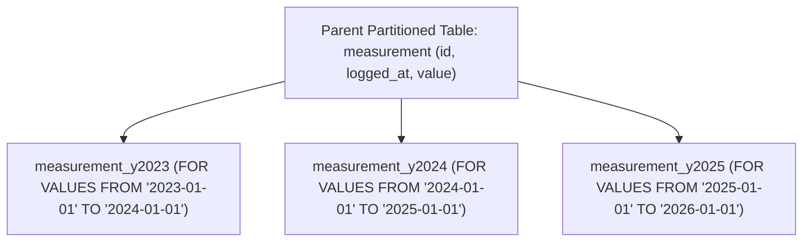

# PostgreSQL Master Reference & Production Engineering Guide

---

## 1. Process Architecture & Memory Hierarchy

PostgreSQL uses a multi-process architecture (not multi-threaded) centered around the **Postmaster** supervisor process and shared memory structures.



### Key Memory Parameters
* **`shared_buffers`:** Shared RAM caching data pages and indexes. Recommended: 25% of total system RAM on Linux.
* **`work_mem`:** Memory allocated per sorting operation, hash table, or merge join *per query*. If a query has 4 complex joins, it can consume $4 \times \text{work\_mem}$.
* **`maintenance_work_mem`:** Memory used for maintenance commands (`VACUUM`, `CREATE INDEX`, `ALTER TABLE`).

---

## 2. Multi-Version Concurrency Control (MVCC) Internals

PostgreSQL implements MVCC by retaining older versions of modified or deleted rows until no active transaction needs them. Every heap tuple contains hidden system attributes:
* **`xmin`:** The Transaction ID (XID) of the transaction that inserted this row.
* **`xmax`:** The Transaction ID that deleted or updated this row (0 if un-deleted).
* **`ctid`:** Physical location pointer `(block_number, tuple_index)` of this tuple or its updated successor.



### Table Bloat & The Role of VACUUM
When updates and deletes occur, dead tuples remain inside disk data pages:
* **Standard `VACUUM`:** Scans pages, marks space occupied by dead tuples as reusable for subsequent inserts. Does **not** release disk space to the OS (does not shrink file size), does not block reads/writes.
* **`VACUUM FULL`:** Reconstructs the entire table into a new disk file, releasing unused disk space back to the operating system. **Acquires an Exclusive Lock (`AccessExclusiveLock`)**, blocking all reads and writes.
* **`Autovacuum`:** Daemon that automatically triggers `VACUUM` and `ANALYZE` when the dead tuple ratio exceeds thresholds:
  $$\text{threshold} = \text{autovacuum\_vacuum\_threshold} + (\text{autovacuum\_vacuum\_scale\_factor} \times \text{reltuples})$$

---

## 3. Advanced Indexing Strategies

PostgreSQL supports the richest indexing ecosystem in relational databases:



### Index Implementation Examples

```sql
-- 1. Standard B-Tree with Covering Index (Index-Only Scan)
CREATE INDEX idx_users_email_covering 
ON users(email) 
INCLUDE (username, created_at);

-- 2. Partial Index (Indexes only a high-frequency subset; tiny footprint)
CREATE INDEX idx_orders_unprocessed 
ON orders(created_at) 
WHERE status IN ('PENDING', 'PROCESSING');

-- 3. Expression / Functional Index (Optimizes case-insensitive lookups)
CREATE INDEX idx_users_lower_email 
ON users (LOWER(email));

-- 4. GIN Index on JSONB document
CREATE INDEX idx_products_metadata_gin 
ON products USING GIN (attributes jsonb_path_ops);

-- 5. BRIN Index for massive append-only telemetry (100M+ rows, minimal memory)
CREATE INDEX idx_logs_timestamp_brin 
ON system_audit_logs USING BRIN (created_at) WITH (pages_per_range = 128);
```

---

## 4. Query Plan Analysis: `EXPLAIN (ANALYZE, BUFFERS)`

```sql
EXPLAIN (ANALYZE, BUFFERS, VERBOSE, COSTS)
SELECT u.username, COUNT(o.id) AS total_orders
FROM users u
JOIN orders o ON u.id = o.user_id
WHERE u.created_at >= '2024-01-01'
GROUP BY u.username;
```

### Common Plan Node Scans & Join Algorithms
* **Sequential Scan (Seq Scan):** Reads every single page of the table from start to finish. Fast for small tables or when fetching $> 20\%$ of all rows.
* **Index Scan:** Traverses B-tree to find pointers, then visits physical heap pages for each row.
* **Bitmap Index Scan + Bitmap Heap Scan:** Builds a dynamic bitmapped array of pages containing matching rows, sorting page access sequentially before reading heap blocks to minimize random I/O.
* **Index-Only Scan:** Query retrieves all required columns directly from index leaves via `INCLUDE` without visiting heap pages (verified against Visibility Map).
* **Hash Join:** Builds an in-memory hash table on the smaller relation, then streams the larger relation to find matches.
* **Merge Join:** Both inputs are pre-sorted by join key and merged in a single coordinated pass.

---

## 5. PostgreSQL Advanced SQL Toolkit

### A. JSONB Querying & Path Expressions
```sql
-- Ingesting semi-structured JSONB
INSERT INTO user_profiles (id, metadata) VALUES 
('c8a42702-8f12-421f-8182-35e69bf84e49', '{"skills": ["python", "fastapi", "docker"], "tier": "gold", "experience": 3}');

-- Query JSONB contains operator (@>)
SELECT * FROM user_profiles WHERE metadata @> '{"tier": "gold"}';

-- Extract text values from nested keys
SELECT metadata->>'tier' AS user_tier, metadata->'skills'->>0 AS primary_skill 
FROM user_profiles;
```

### B. Common Table Expressions (CTE) & Recursive Hierarchies
```sql
-- Recursive query traversing organizational management hierarchy
WITH RECURSIVE OrgTree AS (
    -- Anchor member: Top-level CEO
    SELECT emp_id, manager_id, name, 1 AS level
    FROM employees
    WHERE manager_id IS NULL
    UNION ALL
    -- Recursive member: Subordinates
    SELECT e.emp_id, e.manager_id, e.name, ot.level + 1
    FROM employees e
    INNER JOIN OrgTree ot ON e.manager_id = ot.emp_id
)
SELECT * FROM OrgTree ORDER BY level, emp_id;
```

### C. Analytical Window Functions
```sql
-- Top 3 highest earners per department
SELECT * FROM (
    SELECT 
        dept_id,
        emp_id,
        salary,
        DENSE_RANK() OVER(PARTITION BY dept_id ORDER BY salary DESC) as rank
    FROM employees
) ranked_salaries
WHERE rank <= 3;
```

### D. Upsert (`INSERT ... ON CONFLICT`)
```sql
INSERT INTO user_daily_metrics (user_id, metric_date, api_calls)
VALUES (101, CURRENT_DATE, 1)
ON CONFLICT (user_id, metric_date)
DO UPDATE SET api_calls = user_daily_metrics.api_calls + EXCLUDED.api_calls;
```

---

## 6. AI Vector Search: `pgvector` Extension

```sql
-- Enable vector extension for embeddings
CREATE EXTENSION IF NOT EXISTS vector;

-- Table storing 1536-dimensional OpenAI / Gemini embeddings
CREATE TABLE document_chunks (
    id UUID PRIMARY KEY DEFAULT gen_random_uuid(),
    content TEXT NOT NULL,
    embedding vector(1536) NOT NULL
);

-- HNSW (Hierarchical Navigable Small World) Index for fast approximate nearest neighbor search
CREATE INDEX idx_chunks_hnsw 
ON document_chunks USING hnsw (embedding vector_cosine_ops) 
WITH (m = 16, ef_construction = 64);

-- Cosine Distance Query (<=>)
SELECT id, content, 1 - (embedding <=> '[0.012, -0.045, ...]') AS cosine_similarity
FROM document_chunks
ORDER BY embedding <=> '[0.012, -0.045, ...]'
LIMIT 5;
```

---

## 7. Top 20 High-Yield PostgreSQL Interview Questions

1. **What is the difference between `JSON` and `JSONB` in PostgreSQL?**
   * *Answer:* `JSON` stores an exact textual replica of the input string, requiring re-parsing on every query execution and preserving whitespace/key duplicates. `JSONB` stores data in a decomposed binary format, stripping redundant whitespace and duplicates, with slightly slower write speed but dramatically faster read performance and support for GIN indexing.
2. **Explain how `pgvector` allows PostgreSQL to replace dedicated vector databases like Pinecone.**
   * *Answer:* `pgvector` introduces native vector data types and indexing mechanisms (HNSW and IVFFlat) directly inside PostgreSQL. It enables hybrid queries joining relational business state (users, permissions, timestamps) with high-dimensional vector embeddings in a single ACID transaction without syncing external vector stores.
3. **What is the difference between `VACUUM` and `ANALYZE`?**
   * *Answer:* `VACUUM` reclaims disk space from dead tuples and freezes old transaction IDs to prevent transaction ID wraparound. `ANALYZE` collects table statistics (histograms, most common values, correlation) and stores them in `pg_statistic`, which the Cost-Based Query Planner relies on to select optimal execution plans.
4. **What is connection pooling and why is PgBouncer mandatory for high-concurrency PostgreSQL workloads?**
   * *Answer:* Because PostgreSQL forks a separate OS process per client connection (~5–10MB RAM per process), opening thousands of direct connections leads to context-switch thrashing and memory exhaustion. PgBouncer maintains a small pool of warm connections to the database and reuses them across client transactions, multiplying throughput.

## 8. Declarative Table Partitioning (Range, List, Hash)

Partitioning divides large logical tables into smaller physical tables, accelerating queries via **Partition Pruning** and simplifying data retention (e.g. `DROP TABLE logs_2023`).



```sql
-- Declarative Range Partitioning
CREATE TABLE measurements (
    id UUID DEFAULT gen_random_uuid(),
    logged_at TIMESTAMP WITH TIME ZONE NOT NULL,
    temperature NUMERIC(5, 2) NOT NULL,
    PRIMARY KEY (id, logged_at) -- Partition key must be part of primary key
) PARTITION BY RANGE (logged_at);

-- Child Partition Tables
CREATE TABLE measurements_2024 PARTITION OF measurements
    FOR VALUES FROM ('2024-01-01') TO ('2025-01-01');

CREATE TABLE measurements_2025 PARTITION OF measurements
    FOR VALUES FROM ('2025-01-01') TO ('2026-01-01');

-- Partition Pruning in action: Scans ONLY measurements_2024!
EXPLAIN SELECT * FROM measurements WHERE logged_at = '2024-06-15 12:00:00+00';
```

---

## 9. Triggers & Stored Functions for Audit Logging

```sql
-- Create audit log table
CREATE TABLE audit_trail (
    id SERIAL PRIMARY KEY,
    table_name VARCHAR(50),
    action VARCHAR(10),
    user_id UUID,
    old_data JSONB,
    new_data JSONB,
    changed_at TIMESTAMP DEFAULT CURRENT_TIMESTAMP
);

-- PL/pgSQL Trigger Function
CREATE OR REPLACE FUNCTION log_user_changes()
RETURNS TRIGGER AS $$
BEGIN
    IF (TG_OP = 'UPDATE') THEN
        INSERT INTO audit_trail(table_name, action, old_data, new_data)
        VALUES ('users', 'UPDATE', row_to_json(OLD)::jsonb, row_to_json(NEW)::jsonb);
        RETURN NEW;
    ELSIF (TG_OP = 'DELETE') THEN
        INSERT INTO audit_trail(table_name, action, old_data)
        VALUES ('users', 'DELETE', row_to_json(OLD)::jsonb);
        RETURN OLD;
    END IF;
    RETURN NULL;
END;
$$ LANGUAGE plpgsql;

-- Bind trigger to table
CREATE TRIGGER trg_user_audit
AFTER UPDATE OR DELETE ON users
FOR EACH ROW EXECUTE FUNCTION log_user_changes();
```
