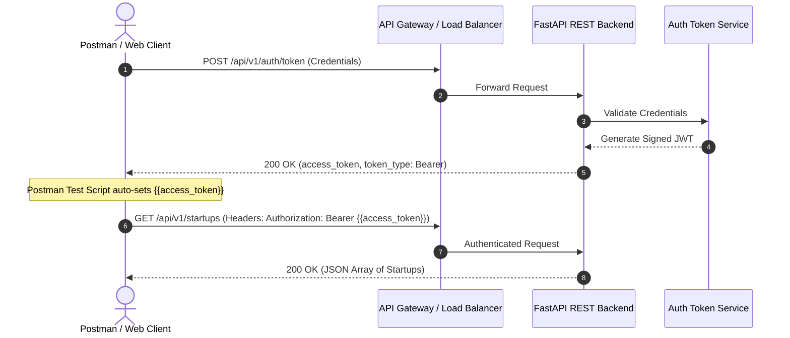
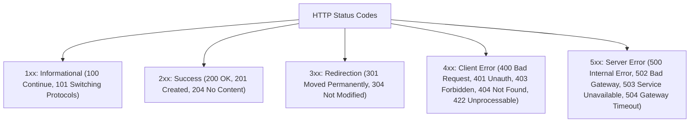
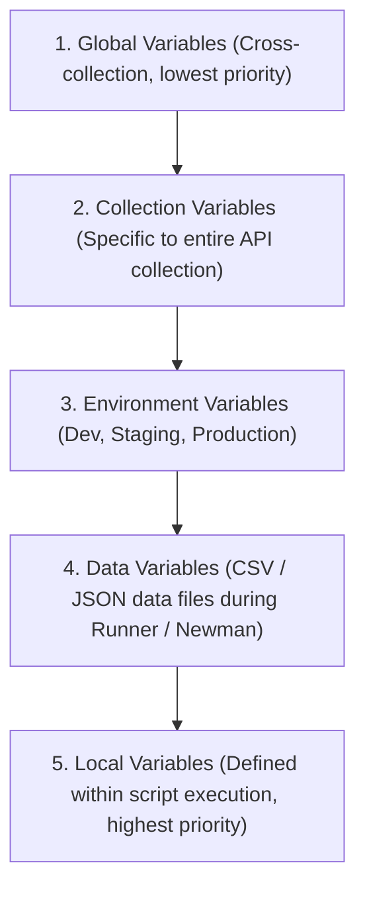
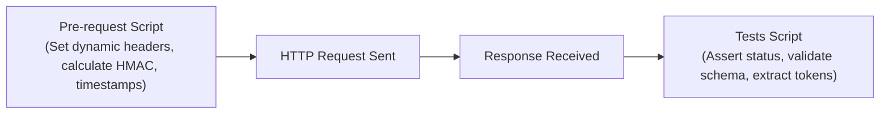

# Postman & API Testing Master Reference & Automation Guide

---

## 1. REST API Architecture & HTTP Protocol Foundations

A RESTful (Representational State Transfer) API is an architectural style for networked systems that adheres to six core constraints:
1. **Client-Server Architecture:** Decouples user interface concerns from data storage concerns.
2. **Statelessness:** Every request from client to server must contain all necessary context to understand and process the request. No client context is stored on the server between requests.
3. **Cacheability:** Responses must implicitly or explicitly define themselves as cacheable or non-cacheable to prevent stale data.
4. **Uniform Interface:** Standardized URIs representing resources, manipulation of resources through representations, and self-descriptive messages.
5. **Layered System:** The client cannot ordinarily tell whether it is connected directly to the end server or an intermediate proxy/load balancer.
6. **Code on Demand (Optional):** Servers can temporarily extend client functionality by transferring executable code (e.g., JavaScript).



### HTTP Verbs: Idempotency vs. Safety Matrix

| HTTP Verb | Primary Action | Safe? (Read-Only) | Idempotent? ($f(f(x)) = f(x)$) | Typical Response Code |
|---|---|---|---|---|
| **GET** | Retrieve resource | **Yes** | **Yes** | `200 OK` |
| **HEAD** | Retrieve headers only (no body) | **Yes** | **Yes** | `200 OK` |
| **OPTIONS** | Probe permitted communication options (CORS)| **Yes** | **Yes** | `200 OK` / `204 No Content` |
| **POST** | Create a new subordinate resource | **No** | **No** (Repeated calls create duplicates)| `201 Created` |
| **PUT** | Replace/Overwrite entire resource | **No** | **Yes** (Repeated calls yield same state) | `200 OK` / `204 No Content` |
| **PATCH** | Partial update of existing resource | **No** | **No** (unless specifically crafted) | `200 OK` |
| **DELETE** | Remove resource | **No** | **Yes** (Resource remains deleted) | `200 OK` / `204 No Content` |

---

## 2. HTTP Status Codes Classification



* **401 Unauthorized vs. 403 Forbidden:**
  * **`401 Unauthorized`:** The client lacks valid authentication credentials (e.g., missing or expired JWT Bearer token). Authentication is required.
  * **`403 Forbidden`:** The server knows who the client is (authenticated), but the client does not have the necessary permissions/roles to access the resource.
* **502 Bad Gateway vs. 504 Gateway Timeout:**
  * **`502 Bad Gateway`:** An edge proxy (Nginx, Cloudflare) received an invalid response (or connection reset) from the upstream application server (FastAPI, Node).
  * **`504 Gateway Timeout`:** The upstream server failed to respond within the gateway’s configured timeout window.

---

## 3. Postman Variable Scope Hierarchy

Variables allow dynamic values to be passed between requests and environments:



### Useful Dynamic Variables (Built-in Postman Mocking)
* `{{$guid}}`: Generates a random v4 UUID.
* `{{$timestamp}}`: Current Unix epoch timestamp in seconds.
* `{{$randomEmail}}`: Generates a random synthetic email address.
* `{{$randomFullName}}`: Generates a random name for test data generation.

---

## 4. Test Scripting & Request Chaining

Postman includes a powerful Node.js sandbox that runs code before a request is sent (**Pre-request Script**) and after a response returns (**Tests**).



### Automated Auth Chaining Script (Login $\to$ Set Token $\to$ Authenticate)
Place this snippet into the **Tests** tab of your `POST /auth/login` endpoint:

```javascript
// 1. Verify successful authentication
pm.test("Status code is 200 OK", function () {
    pm.response.to.have.status(200);
});

// 2. Parse response body and validate token presence
const responseData = pm.response.json();
pm.test("Response contains access_token and token_type", function () {
    pm.expect(responseData).to.have.property("access_token");
    pm.expect(responseData.token_type).to.eql("bearer");
});

// 3. Automatically persist token into active Environment
if (responseData.access_token) {
    pm.environment.set("jwt_token", responseData.access_token);
    console.log("Updated {{jwt_token}} environment variable successfully.");
}

// 4. Assert response latency SLA (< 500ms)
pm.test("Response time is under 500ms", function () {
    pm.expect(pm.response.responseTime).to.be.below(500);
});
```

### Comprehensive Payload & JSON Schema Assertion
```javascript
const schema = {
    type: "object",
    required: ["id", "username", "email", "roles"],
    properties: {
        id: { type: "integer" },
        username: { type: "string" },
        email: { type: "string", format: "email" },
        roles: { type: "array", items: { type: "string" } }
    }
};

pm.test("Schema validation", function () {
    pm.response.to.have.jsonSchema(schema);
});
```

---

## 5. Automated CI/CD Execution with Newman CLI

Newman is the headless command-line collection runner for Postman, allowing API collections to run inside GitHub Actions, GitLab CI, or Jenkins pipelines.

```bash
# 1. Install Newman globally
npm install -g newman newman-reporter-htmlextra

# 2. Run collection with environment and generate HTML report
newman run collections/dayzero_api.json \
  -e environments/production.json \
  --reporters cli,htmlextra \
  --reporter-htmlextra-export reports/api_test_report.html \
  --bail # Fails CI pipeline on first assertion error
```

---

## 6. Top 20 High-Yield API Testing Interview Questions

1. **What is the difference between PUT and PATCH?**
   * *Answer:* `PUT` is designed for complete resource replacement. The client sends the entire representation; any missing fields in the payload are typically set to null or default values by the server. `PATCH` is designed for partial modification; only the supplied fields are updated, leaving existing fields intact. `PUT` is strictly idempotent, whereas `PATCH` is not guaranteed to be idempotent.
2. **How do you test an API that requires OAuth 2.0 Authorization Code Flow in Postman?**
   * *Answer:* In the Collection or Request **Authorization** tab, select **OAuth 2.0**. Configure the Auth URL, Access Token URL, Client ID, Client Secret, and Scopes. Postman opens a webview for the user to log in and approve scopes, intercepts the redirect URI, captures the authorization code, exchanges it for an Access Token, and auto-injects it into the `Authorization: Bearer <token>` header.
3. **What is API Mocking, and why is it useful during development?**
   * *Answer:* API Mocking simulates the behavior of a real backend service before it is implemented by returning predefined response payloads based on matching request headers, paths, and methods. It unblocks frontend teams to develop against agreed-upon API contracts concurrently while backend engineers build the actual service.
4. **How do you handle API security testing in Postman?**
   * *Answer:* Test for (1) Broken Object Level Authorization (BOLA/IDOR) by substituting resource IDs in path parameters with unauthorized user IDs, (2) Missing authentication headers (asserting `401 Unauthorized`), (3) Expired and malformed JWT tokens, (4) SQL Injection and Cross-Site Scripting (XSS) payloads in query/body parameters, and (5) Strict CORS preflight header validation (`OPTIONS`).

## 7. Data-Driven Testing with CSV & JSON Payloads

Data-driven testing executes an identical request collection against hundreds of parameter rows using Postman Collection Runner or Newman.

```json
[
  { "username": "admin_user", "expected_role": "admin", "expected_status": 200 },
  { "username": "guest_user", "expected_role": "viewer", "expected_status": 200 },
  { "username": "banned_user", "expected_role": "none", "expected_status": 403 }
]
```

### Script Utilizing Data Variables:
```javascript
// Access row values via pm.iterationData
const expectedStatus = pm.iterationData.get("expected_status");
const expectedRole = pm.iterationData.get("expected_role");

pm.test("Status code matches dataset expected status", function () {
    pm.response.to.have.status(expectedStatus);
});

if (expectedStatus === 200) {
    const json = pm.response.json();
    pm.test("Role matches test row", function () {
        pm.expect(json.role).to.eql(expectedRole);
    });
}
```

```bash
# Execute data-driven collection via Newman
newman run collections/user_auth_tests.json -d test_data/users.json -e environments/staging.json
```
