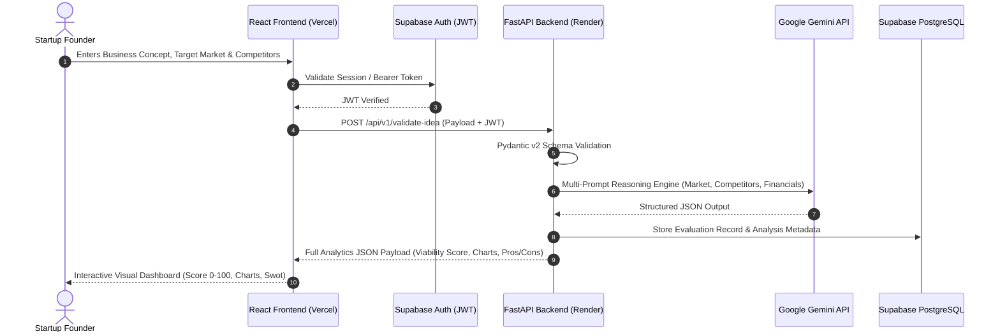
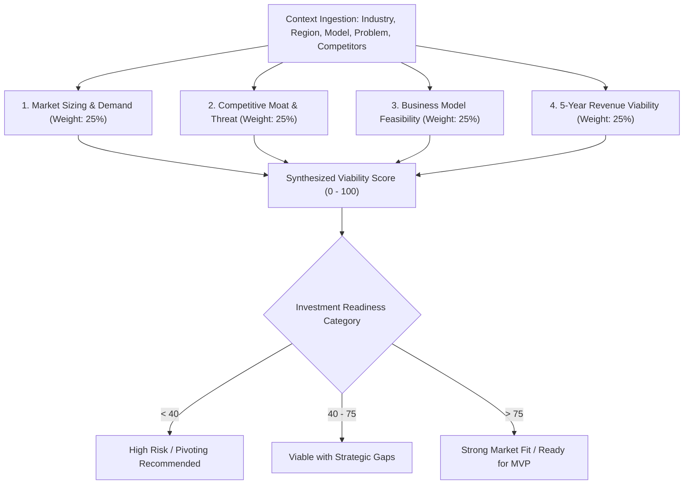
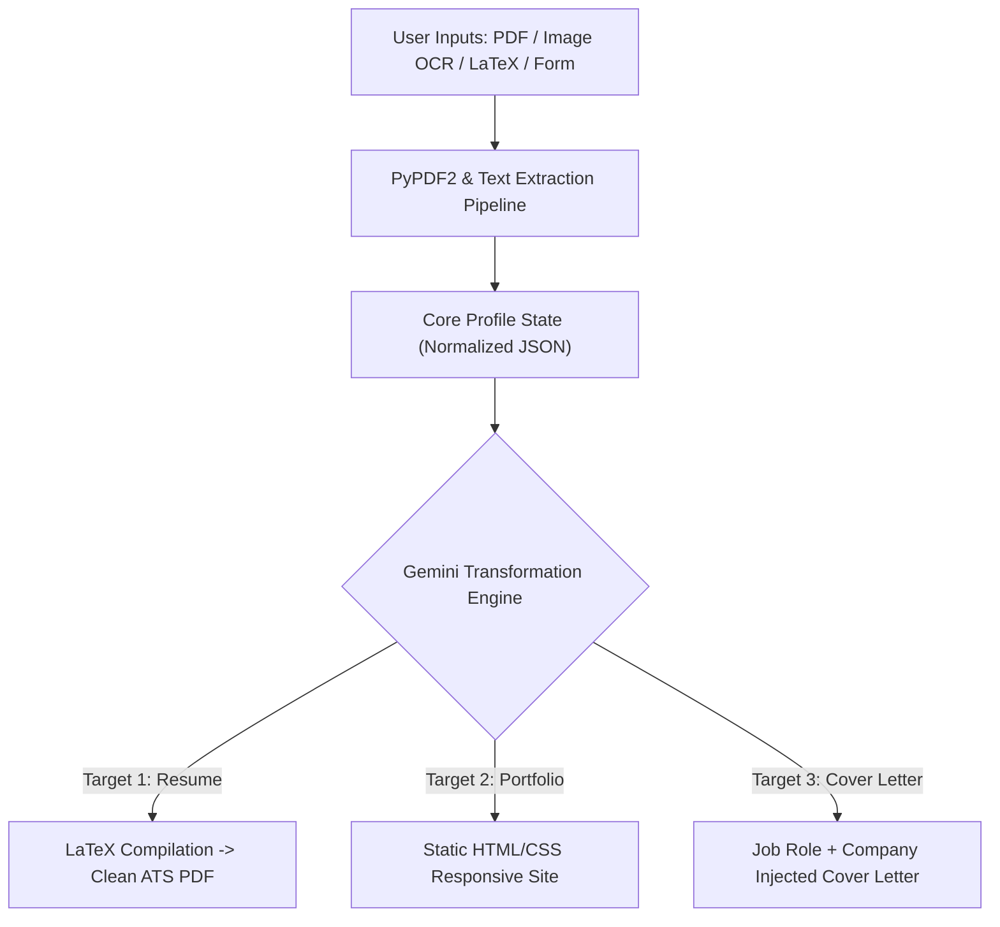

# Master Interview Guide: Project Architectures & Technical Defenses

> In-depth technical breakdown, architectures, source workflows, challenges, and 25+ interviewer Q&A for **Gandikota Sai Kowshik's** core engineering projects.

---

## 1. Projects Matrix Overview

| Project Name | Domain & Problem Solved | Core Tech Stack | Deployment | Key Architectural Highlight |
|---|---|---|---|---|
| **DayZero AI** | AI-driven startup idea validation, market sizing, competitor mapping & 5-yr revenue projections | React.js, FastAPI, Python, Google Gemini API, Supabase (PostgreSQL + Auth) | Frontend: Vercel<br>Backend: Render | Async FastAPI gateway with Pydantic schema enforcement for deterministic LLM outputs. |
| **INSTA REPO** | Automated multi-format career asset synthesis (Resumes, Portfolios, Targeted Cover Letters) | Python, Streamlit, Google Gemini API, PyPDF2, pdfplumber, LaTeX | Streamlit Cloud | Multi-source ingestion pipeline (PDF/Image/Text) to polymorphic document generation. |
| **WasteGuideAI** | Automated municipal waste classification for recycling & hazard segregation | Python, TensorFlow/Keras, OpenCV, Streamlit | Local / Cloud | Transfer learning on MobileNetV2 for real-time edge/mobile inference. |

---

## 2. Project 1 — DayZero AI (Flagship Product)

### A. Executive & Technical Summary
* **Problem Statement:** Startup founders and investors spend weeks conducting fragmented market research: sizing Total Addressable Market (TAM), scouting competitors, analyzing viability, and modeling financials.
* **Solution:** DayZero AI aggregates multi-dimensional business context into a unified ingestion pipeline, querying advanced reasoning models (Gemini) through an asynchronous FastAPI backend to produce an interactive analytics dashboard within seconds.




### DayZero AI Viability Scoring Algorithm



### B. High-Yield Interview Explanations

#### 1–2 Minute Pitch (HR / Screening Round)
*"One of my flagship projects is **DayZero AI**, an AI-powered startup validation platform. The problem I tackled is that early-stage founders and investors waste dozens of hours manually evaluating market feasibility, sizing competition, and estimating financial runway.*

*With DayZero AI, a user inputs their business context—such as the problem statement, target audience, geography, and monetization model. The application sends this context from a React frontend to an asynchronous FastAPI backend. The backend orchestrates prompt reasoning pipelines with the Gemini API to analyze market share, competitor gaps, risk factors, and a 5-year revenue trajectory, returning an overall Viability Score out of 100.*

*I integrated Supabase for PostgreSQL database persistence and secure passwordless/JWT authentication, deploying the frontend on Vercel and the backend on Render. It transforms raw business assumptions into actionable investment data."*

#### 3–5 Minute Technical Pitch (Engineering Round)
*"From an engineering perspective, DayZero AI is an asynchronous analytical pipeline designed around reliability and deterministic structured data.*

*The primary architectural challenge with Generative AI is non-determinism: LLMs often output markdown prose when web frontends require rigid JSON to render charts and metric cards. I solved this by implementing strict Pydantic v2 data models on FastAPI that enforce field types, score bounds (0 to 100), and structured array hierarchies.*

*The backend architecture decouples request ingestion from data synthesis:
1. **Frontend:** React with modular dashboard components that render dynamic Chart.js visualizations for revenue curves and competitive positioning matrices.
2. **Backend Gateway:** FastAPI using asynchronous endpoints (`async def`) and non-blocking HTTP clients (`httpx`) to prevent thread pool exhaustion while awaiting external LLM reasoning.
3. **Storage & Auth:** Supabase PostgreSQL utilizing Row Level Security (RLS) policies to ensure multi-tenant user isolation.
4. **Resilience:** Implemented exponential backoff and payload retry logic to gracefully handle external API rate limits and token spikes."*

### C. Core Backend Implementation Snippet (FastAPI + Pydantic)

```python
from fastapi import FastAPI, Depends, HTTPException, status
from pydantic import BaseModel, Field
from typing import List, Dict, Optional
import httpx
import os

app = FastAPI(title="DayZero AI Gateway", version="1.0.0")

class StartupIdeaRequest(BaseModel):
    problem_statement: str = Field(..., min_length=20, max_length=1000)
    target_customers: str = Field(..., min_length=5)
    industry: str
    target_region: str = "Global"
    business_model: str # B2B, B2C, Marketplace, SaaS
    competitors: Optional[List[str]] = []

class EvaluationResult(BaseModel):
    viability_score: int = Field(..., ge=0, le=100)
    market_potential: str
    competitor_analysis: Dict[str, str]
    five_year_revenue_projection_usd: List[int]
    pros: List[str]
    cons: List[str]
    scalability_verdict: str

@app.post("/api/v1/evaluate", response_model=EvaluationResult, status_code=status.HTTP_200_OK)
async def evaluate_startup(payload: StartupIdeaRequest):
    try:
        # Asynchronous external API call to Gemini Reasoning Engine
        prompt = f"""
        Analyze this startup idea and return strict JSON matching the schema:
        Problem: {payload.problem_statement}
        Target Market: {payload.target_customers}
        Industry: {payload.industry}
        Model: {payload.business_model}
        Competitors: {', '.join(payload.competitors)}
        """
        
        # Async HTTP dispatch preventing event loop blocking
        async with httpx.AsyncClient(timeout=30.0) as client:
            response = await client.post(
                f"https://generativelanguage.googleapis.com/v1beta/models/gemini-pro:generateContent?key={os.getenv('GEMINI_API_KEY')}",
                json={"contents": [{"parts": [{"text": prompt}]}]}
            )
            response.raise_for_status()
            
        # Parse and validate with Pydantic
        raw_data = response.json()
        # Transform and return structured validated model
        # ...
        return validated_result
    except httpx.HTTPStatusError as e:
        raise HTTPException(status_code=status.HTTP_502_BAD_GATEWAY, detail=f"LLM upstream error: {str(e)}")
    except Exception as err:
        raise HTTPException(status_code=status.HTTP_500_INTERNAL_SERVER_ERROR, detail=str(err))
```

### D. Relational Database Schema (Supabase / PostgreSQL)

```sql
-- Multi-tenant schema with Row Level Security
CREATE TABLE users (
    id UUID PRIMARY KEY DEFAULT gen_random_uuid(),
    email VARCHAR(255) UNIQUE NOT NULL,
    created_at TIMESTAMP WITH TIME ZONE DEFAULT CURRENT_TIMESTAMP
);

CREATE TABLE startup_evaluations (
    id UUID PRIMARY KEY DEFAULT gen_random_uuid(),
    user_id UUID REFERENCES users(id) ON DELETE CASCADE,
    industry VARCHAR(100) NOT NULL,
    business_model VARCHAR(50) NOT NULL,
    viability_score INT CHECK (viability_score BETWEEN 0 AND 100),
    report_data JSONB NOT NULL,
    created_at TIMESTAMP WITH TIME ZONE DEFAULT CURRENT_TIMESTAMP
);

CREATE INDEX idx_evaluations_user ON startup_evaluations(user_id);
CREATE INDEX idx_evaluations_industry ON startup_evaluations(industry);
```

---

## 3. Project 2 — INSTA REPO

### A. Technical Summary
* **Problem:** Candidates waste hours formatting custom resumes, building web portfolios from scratch, and writing individualized cover letters for each job application.
* **Solution:** INSTA REPO ingests arbitrary candidate data (existing PDF resumes, image snapshots via OCR, LaTeX markup, or manual forms) into a centralized candidate profile, using Gemini to generate customized LaTeX PDFs, dynamic HTML portfolios, and targeted cover letters in one click.



### B. Core Technical Challenges & Solutions
1. **Handling Polymorphic Ingestion:**
   * *Problem:* Users upload unstructured PDFs with two-column layouts, which standard text readers scramble.
   * *Solution:* Combined `pdfplumber` for coordinate-based bounding box extraction with fallback heuristics, passing the semi-structured stream to Gemini with an extraction prompt to normalize into a standardized JSON resume model.
2. **Preventing AI Hallucinations in Work Experience:**
   * *Problem:* Generative models tend to invent accomplishments or exaggerate dates.
   * *Solution:* Built strict ground-truth prompt constraints: *"Only use exact dates, companies, and metrics provided in the raw profile. Never invent employment history."*

---

## 4. Project 3 — WasteGuideAI

### A. Technical Summary
* **Problem:** Municipal waste sorting facilities struggle with manual sorting errors, leading to recyclable contamination and hazardous material leakage.
* **Solution:** An image classification pipeline leveraging Deep Convolutional Neural Networks (CNNs) trained on categorized municipal waste datasets (Biodegradable, Recyclable, Hazardous, E-waste).

### B. Architecture & Training Mechanics
* **Base Architecture:** Transfer learning using **MobileNetV2** pre-trained on ImageNet, fine-tuning the top classification layers.
* **Why MobileNetV2?** Depthwise separable convolutions provide high inference speed (under 45ms per frame) with minimal memory footprint, making it deployable on edge devices (Raspberry Pi / Jetson Nano).
* **Augmentation Pipeline:** Random rotations, zoom, horizontal flips, and color jitter to combat variable real-world lighting conditions in waste bins.

---

## 5. Master Interview Defense: 25+ Tough Interviewer Questions

### Architecture & System Design
1. **Why did you choose FastAPI over Django or Flask for DayZero AI?**
   * *Answer:* Django is heavyweight with an ORM and admin dashboard that were redundant since Supabase handled database and auth. Flask is synchronous by default; handling multi-second AI generation would block worker threads. FastAPI is natively asynchronous (`async/await` on ASGI), provides blazing performance on Starlette, and features built-in Pydantic validation and automatic OpenAPI documentation.

2. **How do you handle API rate limits from Gemini when traffic surges?**
   * *Answer:* At the application level, I implemented client-side debouncing and backend token-bucket rate limiting. If upstream returns an HTTP 429 (Too Many Requests), our middleware utilizes exponential backoff with jitter (`retry_after = (2 ** attempt) + random.uniform(0, 1)`). For enterprise production, I would place a Redis queue (Celery or ARQ) between the client and API.

3. **How do you ensure consistent, deterministic JSON from non-deterministic LLMs?**
   * *Answer:* Three techniques: (1) Setting temperature to low values (e.g., `0.1`–`0.2`), (2) Supplying explicit Few-Shot examples in the system prompt showing the exact expected JSON schema, and (3) Validating the returned payload immediately through Pydantic v2 schemas. If parsing fails, an automated retry repair prompt fixes the output.

4. **Why Supabase instead of a self-hosted PostgreSQL instance?**
   * *Answer:* Supabase provided managed PostgreSQL with built-in Row Level Security, instant JWT authentication, automatic connection pooling, and real-time capabilities out of the box, drastically reducing infrastructure overhead for a rapid-growth product.

5. **What was your biggest architectural bottleneck in DayZero AI?**
   * *Answer:* Time To First Byte (TTFB). Multi-section comprehensive startup analysis took 12–18 seconds to generate. Waiting 18 seconds on a blank screen degraded user retention. I restructured the response into asynchronous sectional processing, displaying skeletons and streaming real-time status updates to the client.

6. **What security measures did you implement?**
   * *Answer:* Environment isolation for API secrets, CORS middleware configured strictly for the production Vercel domain (preventing unauthorized origin requests), Supabase JWT authentication headers on protected routes, and Pydantic input sanitization to prevent prompt injection and payload tampering.

### E. DayZero AI Supabase Row Level Security (RLS) & Client Auth

```sql
-- Enable Row Level Security on evaluations
ALTER TABLE startup_evaluations ENABLE ROW LEVEL SECURITY;

-- Policy: Users can strictly read ONLY their own evaluations
CREATE POLICY "Users can view their own startup reports"
ON startup_evaluations
FOR SELECT
USING (auth.uid() = user_id);

-- Policy: Users can only insert reports for their own user_id
CREATE POLICY "Users can create their own startup reports"
ON startup_evaluations
FOR INSERT
WITH CHECK (auth.uid() = user_id);
```

### F. INSTA REPO Implementation: Streamlit Ingestion & LaTeX Engine

```python
import streamlit as st
import pypdf
import os

st.set_page_config(page_title="INSTA REPO - Career Asset Synthesis", layout="wide")
st.title("⚡ INSTA REPO: Dynamic Resume & Portfolio Synthesizer")

uploaded_file = st.file_uploader("Upload Existing Resume (PDF)", type=["pdf"])

def extract_text_from_pdf(pdf_stream):
    reader = pypdf.PdfReader(pdf_stream)
    text = ""
    for page in reader.pages:
        text += page.extract_text() or ""
    return text

if uploaded_file is not None:
    raw_resume_text = extract_text_from_pdf(uploaded_file)
    st.success("Extracted raw candidate profile successfully.")
    
    target_role = st.selectbox("Select Target Output Asset", ["ATS-Optimized Resume", "HTML Portfolio", "Targeted Cover Letter"])
    
    if st.button("Synthesize Document"):
        with st.spinner("Executing structured Gemini transformation..."):
            # Generative LLM pipeline formatting into LaTeX / HTML
            st.code(f"\\documentclass{{article}}\n\\begin{{document}}\n\\section*{{Candidate Resume}}\n...\n\\end{{document}}", language="latex")
            st.download_button("Download Compiled Asset", data="mock_pdf_binary", file_name="resume.pdf")
```

### G. WasteGuideAI: MobileNetV2 Transfer Learning Pipeline

```python
import tensorflow as tf
from tensorflow.keras import layers, models

def build_waste_classifier(num_classes=4, img_size=(224, 224)):
    # Pre-trained MobileNetV2 base without top classification head
    base_model = tf.keras.applications.MobileNetV2(
        input_shape=(*img_size, 3),
        include_top=False,
        weights='imagenet'
    )
    base_model.trainable = False # Freeze base weights for transfer learning

    model = models.Sequential([
        base_model,
        layers.GlobalAveragePooling2D(),
        layers.BatchNormalization(),
        layers.Dropout(0.3),
        layers.Dense(128, activation='relu'),
        layers.Dense(num_classes, activation='softmax') # 4 classes: Organic, Recyclable, Hazardous, E-Waste
    ])
    
    model.compile(
        optimizer=tf.keras.optimizers.Adam(learning_rate=1e-3),
        loss='categorical_crossentropy',
        metrics=['accuracy']
    )
    return model
```
