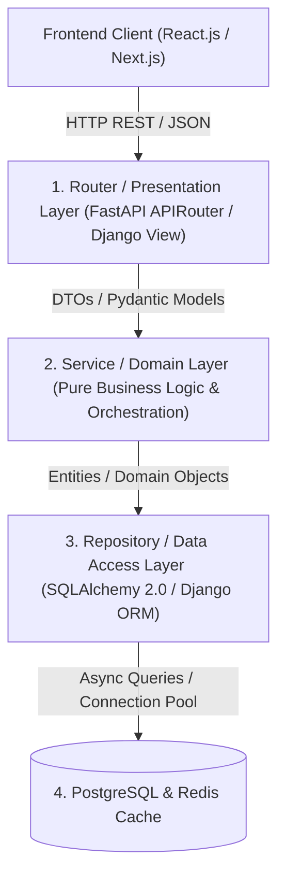
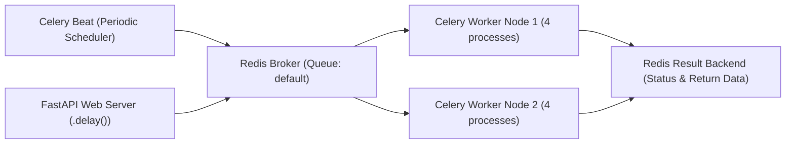
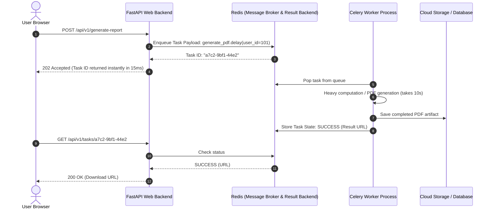

# Python Full-Stack Development Master Reference & Architecture Guide

---

## 1. Enterprise Layered Architecture in Python

In enterprise Python web applications, separation of concerns prevents business logic from coupling to database drivers or transport protocols.



### Component Responsibilities Matrix

| Layer | Primary Responsibilities | What It Must NEVER Do |
|---|---|---|
| **Router** | URL mapping, status codes, dependency injection, Pydantic request/response parsing | Execute raw SQL, execute complex domain logic, interact with third-party APIs |
| **Service Layer** | Business logic, validation, orchestrating multi-step workflows, triggering async tasks | Accept raw HTTP `Request` objects, execute SQL queries directly |
| **Repository** | Data access abstraction, building queries, transaction boundaries | Contain UI/HTTP dependencies, business calculations |
| **Database** | Relational state, referential integrity constraints, indexing | Execute business logic in heavy stored procedures |

---

## 2. Python Web Frameworks Comparison Matrix

| Dimension | FastAPI | Django / Django REST Framework | Flask |
|---|---|---|---|
| **Architecture** | Asynchronous Native (ASGI, Starlette) | Monolithic Batteries-Included (WSGI & async views)| Microframework (WSGI) |
| **Data Validation** | Native Pydantic v2 (Rust-backed) | Django Forms / DRF Serializers | Requires external libraries (Marshmallow) |
| **Documentation** | Built-in Swagger UI & ReDoc | Requires `drf-spectacular` / `drf-yasg` | Requires `flasgger` |
| **ORM** | Unopinionated (SQLAlchemy 2.0, SQLModel) | Built-in Django ORM (ActiveRecord pattern) | Unopinionated (Flask-SQLAlchemy) |
| **Admin Panel** | No built-in admin (use third-party) | Automatic, production-grade Admin Dashboard | No built-in admin |
| **Best Used For** | High-performance APIs, Microservices, AI/ML APIs | Complex relational CRUD apps, enterprise portals | Simple utility APIs, rapid single-file prototypes |

---

## 3. Asynchronous Task Queues: Celery with Redis

### Celery Worker & Distributed Broker Architecture




For long-running tasks (video encoding, sending bulk emails, generating PDF reports, training ML models), synchronous web requests will time out. A task queue delegates work to background processes.



### Production Celery Setup Snippet
```python
# celery_app.py
from celery import Celery
import os

celery_app = Celery(
    "worker",
    broker=os.getenv("REDIS_URL", "redis://localhost:6379/0"),
    backend=os.getenv("REDIS_URL", "redis://localhost:6379/1")
)

celery_app.conf.update(
    task_serializer="json",
    accept_content=["json"],
    result_serializer="json",
    timezone="UTC",
    enable_utc=True,
    task_track_started=True,
    task_time_limit=300, # 5 min hard limit
)

@celery_app.task(bind=True, max_retries=3)
def process_startup_analysis(self, evaluation_id: str):
    try:
        # Long-running ML / Gemini inference logic
        print(f"Executing background analysis for {evaluation_id}")
        return {"status": "COMPLETED", "evaluation_id": evaluation_id}
    except Exception as exc:
        raise self.retry(exc=exc, countdown=2 ** self.request.retries)
```

---

## 4. Full-Stack Real-Time Communication: WebSockets in FastAPI

```python
from fastapi import FastAPI, WebSocket, WebSocketDisconnect
from typing import List

app = FastAPI()

class ConnectionManager:
    def __init__(self):
        self.active_connections: List[WebSocket] = []

    async def connect(self, websocket: WebSocket):
        await websocket.accept()
        self.active_connections.append(websocket)

    def disconnect(self, websocket: WebSocket):
        self.active_connections.remove(websocket)

    async def broadcast(self, message: str):
        for connection in self.active_connections:
            await connection.send_text(message)

manager = ConnectionManager()

@app.websocket("/ws/notifications")
async def websocket_notifications(websocket: WebSocket):
    await manager.connect(websocket)
    try:
        while True:
            data = await websocket.receive_text()
            # Broadcast incoming updates to all connected subscribers
            await manager.broadcast(f"Broadcast: {data}")
    except WebSocketDisconnect:
        manager.disconnect(websocket)
```

---

## 5. Top 15 High-Yield Python Full-Stack Interview Questions

1. **How do you solve the N+1 query problem in SQLAlchemy with FastAPI?**
   * *Answer:* The N+1 query problem occurs when querying a parent table triggers an additional query for each individual child row. In SQLAlchemy 2.0 async, use `select(Parent).options(selectinload(Parent.children))` for one-to-many collections (which executes a single `SELECT ... WHERE id IN (...)` batch query), or `joinedload(Parent.child)` for one-to-one / many-to-one relationships (which generates an SQL `LEFT OUTER JOIN`).
2. **What is the difference between FastAPI `BackgroundTasks` and Celery?**
   * *Answer:* `BackgroundTasks` runs inside the same process/memory space as the FastAPI application after the response is sent. It is lightweight for small non-critical operations (like firing a single transactional email), but if the web server restarts or crashes, pending tasks are lost, and heavy CPU tasks will freeze the async event loop. **Celery** is an enterprise distributed task queue backed by a persistent message broker (RabbitMQ/Redis) with separate worker processes, automatic retries, task scheduling (Celery Beat), and horizontal scalability across servers.
3. **How do you handle database migrations safely in production without downtime?**
   * *Answer:* Using the **Expand-and-Contract (Parallel Run) pattern** with Alembic: (1) **Expand:** Add new columns/tables as nullable or with defaults without deleting old columns, (2) Deploy new code that writes to both old and new columns, (3) Backfill historical data from old to new, (4) Deploy code reading exclusively from new columns, and (5) **Contract:** Drop old unused columns in a final migration.
