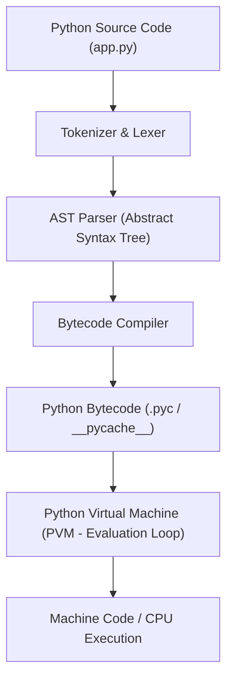
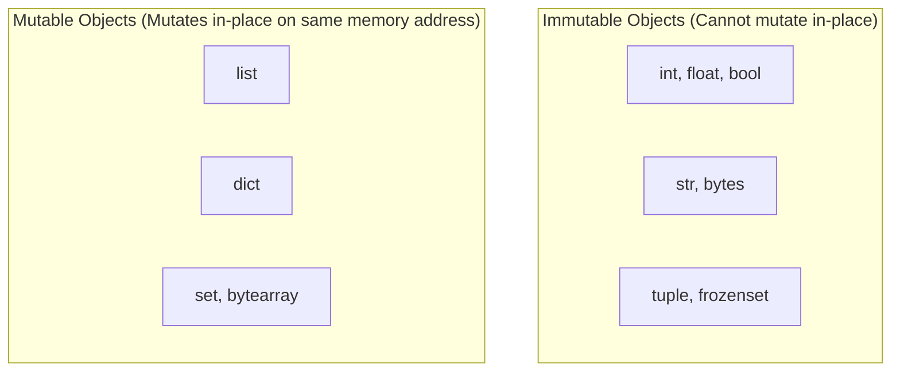
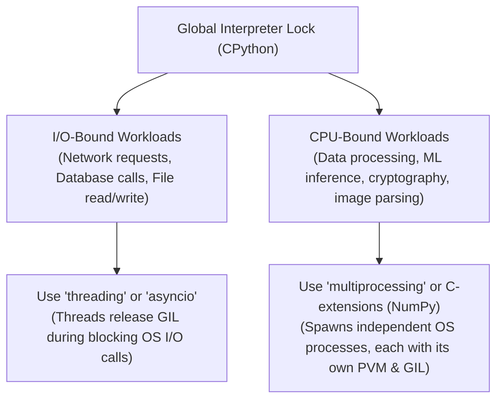

# Python Master Reference & Internals Engineering Guide

---

## 1. CPython Architecture & Memory Management

Python is an interpreted, high-level, dynamically typed and strongly typed programming language. CPython is the reference implementation written in C.



### Memory Management & Garbage Collection
CPython manages memory automatically using a dual-system mechanism:
1. **Reference Counting (Primary):** Every Python object header (`PyObject`) stores an internal counter `ob_refcnt`. When a variable references an object, the counter increments; when a reference goes out of scope or is deleted (`del`), it decrements. When `ob_refcnt == 0`, the memory is immediately deallocated.
2. **Generational Cyclic Garbage Collector (Secondary):** Reference counting cannot deallocate circular references (e.g., Object A references B, and B references A). Python’s cyclic GC tracks container objects (`lists`, `dicts`, `tuples`, user classes) across three generations:
   * **Generation 0:** Newly created objects; collected most frequently.
   * **Generation 1:** Objects surviving Gen 0 collections.
   * **Generation 2:** Long-lived objects surviving Gen 1; collected least frequently.

---

## 2. Variables, Mutability & Memory Allocation

In Python, variables are not memory containers; they are **named pointers (references)** to heap objects. Python passes arguments via **Call by Object Reference (Call by Sharing)**.



### Shallow Copy vs. Deep Copy

| Operation | Syntax | Mechanism | Impact on Nested Objects |
|---|---|---|---|
| **Assignment** | `b = a` | Creates a new pointer referencing the identical object in memory | Mutating `b` mutates `a` |
| **Shallow Copy** | `b = copy.copy(a)` or `a.copy()` | Constructs a new container, but populates it with references to children | Mutating nested objects affects both `a` and `b` |
| **Deep Copy** | `b = copy.deepcopy(a)` | Recursively constructs duplicate containers and deep copies all child objects | Completely independent object graph |

---

## 3. Advanced Iterators, Generators & Context Managers

```mermaid
graph LR
    Iterable["Iterable (Has __iter__)"] -->|iter(obj)| Iterator["Iterator (Has __next__)"]
    Iterator -->|next(it)| YieldVal["Yields values one-by-one"]
    YieldVal -->|Exhausted| StopIter["Raises StopIteration Exception"]
```

### Generators & Memory Optimization
Generators compute values on-demand (**Lazy Evaluation**) using the `yield` statement, consuming $O(1)$ memory regardless of dataset size:

```python
# Standard list loads all 10 million integers into RAM (~80MB)
def get_squares_list(n):
    return [i ** 2 for i in range(n)]

# Generator yields one item per iteration; occupies ~120 bytes of RAM!
def get_squares_gen(n):
    for i in range(n):
        yield i ** 2

squares = get_squares_gen(10_000_000)
print(next(squares)) # 0
print(next(squares)) # 1
```

### Context Managers (`with` statement)
Guarantees deterministic resource cleanup (file handles, database connections, locks) even if exceptions occur:

```python
class ManagedDatabaseConnection:
    def __init__(self, dsn: str):
        self.dsn = dsn
        self.connection = None

    def __enter__(self):
        print("Opening database connection...")
        self.connection = f"ActiveConn({self.dsn})"
        return self.connection

    def __exit__(self, exc_type, exc_val, exc_tb):
        print("Closing database connection safely...")
        self.connection = None
        # Returning True suppresses any raised exception
        return False

# Usage:
with ManagedDatabaseConnection("postgres://localhost:5432/db") as conn:
    print(f"Executing query on {conn}")
```

---

## 4. Decorators: Syntactic Sugar & Metaprogramming

A decorator is a higher-order function that takes a function as input, extends its behavior without modifying source code, and returns a new callable.

```python
import functools
import time
from typing import Callable, Any

def audit_performance(threshold_ms: float = 100.0):
    """Parameterized Decorator Factory"""
    def decorator(func: Callable) -> Callable:
        @functools.wraps(func) # Preserves original __name__, __doc__, and signature
        def wrapper(*args: Any, **kwargs: Any) -> Any:
            start_time = time.perf_counter()
            result = func(*args, **kwargs)
            duration_ms = (time.perf_counter() - start_time) * 1000
            
            if duration_ms > threshold_ms:
                print(f"[ALERT] {func.__name__} took {duration_ms:.2f}ms (Exceeded {threshold_ms}ms)")
            return result
        return wrapper
    return decorator

@audit_performance(threshold_ms=50.0)
def process_data(records: list):
    time.sleep(0.08) # Simulates computation
    return len(records)

process_data([1, 2, 3])
```

---

## 5. Concurrency: The Global Interpreter Lock (GIL)

The **GIL (Global Interpreter Lock)** is a mutex in CPython that prevents multiple native OS threads from executing Python bytecode simultaneously on multiple CPU cores.



### Python Concurrency Paradigm Matrix

| Library / Module | Mechanism | Best Used For | GIL Bound? |
|---|---|---|---|
| **`asyncio`** | Single-threaded cooperative multitasking with event loop | Thousands of concurrent HTTP/socket connections | No (single thread) |
| **`threading`** | OS threads sharing process memory space | Concurrent I/O tasks where latency is dominated by network/disk | Yes (Only 1 thread runs bytecode at a time) |
| **`multiprocessing`** | Separate OS processes with isolated memory space | Heavy mathematical calculations, image processing | **Bypasses GIL entirely** |

---

## 6. Top 20 High-Yield Python Interview Questions

1. **Why does Python not support function overloading like Java or C++?**
   * *Answer:* In Python, functions are first-class objects. If you define two functions with the same name, the second definition simply overwrites the first in the module’s namespace dictionary (`globals()`). Python achieves overloading flexibility through optional default parameters (`def func(a, b=None)`), variable arguments (`*args, **kwargs`), or `functools.singledispatch`.
2. **What is the difference between `is` and `==`?**
   * *Answer:* `==` checks for **value equality** by invoking the object's `__eq__()` method. `is` checks for **identity equality**, verifying whether two variables point to the exact same physical memory address (`id(a) == id(b)`).
3. **What are `__slots__` and why are they used?**
   * *Answer:* By default, Python objects store their instance attributes in a dynamic dictionary `__dict__`, which incurs memory overhead. Defining `__slots__ = ('name', 'age')` tells Python to allocate a fixed-size array for attributes instead of `__dict__`, reducing memory usage by up to 40–50% on millions of object instances.
4. **How does Python's dictionary maintain insertion order since Python 3.7?**
   * *Answer:* CPython separated the hash table into two arrays: a sparse indices array storing hash table bucket offsets, and a dense array storing entries `[hash, key, value]` in the exact chronological order they were inserted. This reduced memory usage by ~25% while guaranteeing insertion order.

## 7. Magic / Dunder Methods & Object Protocols

Python objects customize standard language behavior by implementing double-underscore (dunder) methods:

```python
class Vector2D:
    __slots__ = ('x', 'y') # Allocates fixed memory tuple; suppresses __dict__

    def __init__(self, x: float, y: float):
        self.x = x
        self.y = y

    # User-friendly string representation
    def __str__(self) -> str:
        return f"({self.x}, {self.y})"

    # Unambiguous debugging representation
    def __repr__(self) -> str:
        return f"Vector2D(x={self.x}, y={self.y})"

    # Operator Overloading for +
    def __add__(self, other: "Vector2D") -> "Vector2D":
        if not isinstance(other, Vector2D):
            return NotImplemented
        return Vector2D(self.x + other.x, self.y + other.y)

    # Equality Protocol
    def __eq__(self, other: object) -> bool:
        if not isinstance(other, Vector2D):
            return False
        return self.x == other.x and self.y == other.y

    # Make instances callable like functions
    def __call__(self, scalar: float) -> "Vector2D":
        return Vector2D(self.x * scalar, self.y * scalar)

v1 = Vector2D(3, 4)
v2 = Vector2D(1, 2)
v3 = v1 + v2
print(v3)       # (4, 6)
print(v3(2))    # (8, 12) (Callable protocol)
```

---

## 8. Dataclasses & Modern Type Hinting

```python
from dataclasses import dataclass, field
from typing import List, Optional
from datetime import datetime

@dataclass(frozen=True, slots=True) # Immutable + High Memory Efficiency
class CandidateProfile:
    name: str
    email: str
    skills: List[str] = field(default_factory=list)
    grad_year: int = 2025
    created_at: datetime = field(default_factory=datetime.utcnow)

p = CandidateProfile(name="Gandikota Sai Kowshik", email="kowshik@example.com", skills=["Python", "FastAPI", "Docker"])
print(p)
# p.name = "New Name" # Raises FrozenInstanceError!
```
